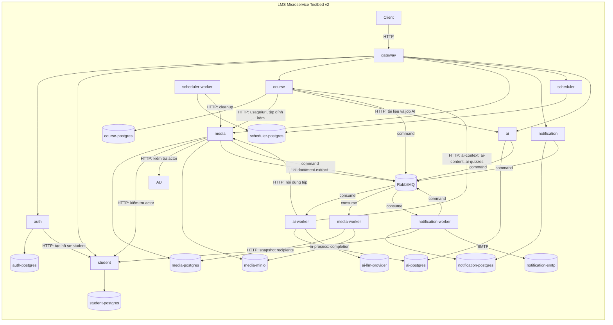

# Service catalogue and topology v2

> **Task:** R-01 — [bảng task refactor](../plan/refactor/refactor-board-v1.md)
>
> **Trạng thái:** Đề xuất — chờ Đức tự xác nhận `service.name`, edge và dependency identity (xem mục 13).
>
> **Thay thế:** [service-catalogue-and-topology-v1](service-catalogue-and-topology-v1.md) (giữ làm lịch sử, không dùng cho dataset mới).
>
> **Quyết định nền:** [ADR-001](../adr/adr-001-restructure-lms-testbed-v1.md), [ADR-002](../adr/adr-002-ai-primary-root-cause-analysis-v1.md).
>
> **Mục đích:** chốt bộ service, dependency graph và identity telemetry của LMS testbed sau tái cấu trúc, để export/query layer, workload và dataset về sau dùng cùng một topology.

## 1. Source of truth và ranh giới tài liệu

Artifact này không định nghĩa lại scope nghiên cứu. Khi mâu thuẫn, ưu tiên: ADR-001/002 → tài liệu này → [http-and-event-contracts-v2](http-and-event-contracts-v2.md) và [data-ownership-and-fault-matrix-v2](data-ownership-and-fault-matrix-v2.md) → các tài liệu v1 còn lại (đang chờ viết lại ở R-12).

Nghiệp vụ lấy từ repo mẫu .NET `intern_be/ducnm3` làm đặc tả; không port mã.

### Không thuộc tài liệu này

- Schema request/response chi tiết từng endpoint (nằm trong `lms/contracts/` bằng zod, tạo cùng từng service).
- Fault injector chi tiết, danh mục case phức tạp đầy đủ (R-12).
- Kubernetes, service mesh, Chaos Mesh, frontend.

---

# 2. Quyết định topology v2

**8 service + 4 worker.** Worker là process riêng, cùng image với service tương ứng, entrypoint `worker.ts`, có `service.name` riêng.

```text
gateway  auth  student  course  media  notification  scheduler  ai
                                  media-worker  notification-worker  scheduler-worker  ai-worker
```

Hạ tầng bắt buộc:

```text
PostgreSQL 17 (mỗi service một logical DB)
RabbitMQ
MinIO (S3 tương thích)
SMTP (Mailpit khi dev/CI, SMTP thật khi production)
Nhà cung cấp LLM bên ngoài (OpenAI-compatible; giả lập bằng HTTP stub khi test)
```

Không còn: Redis, Storage Mock, event `grade.completed`, service `enrollment`/`submission`/`grading`.

## 2.1. `service.name` canonical

```text
gateway
auth
student
course
media
media-worker
notification
notification-worker
scheduler
scheduler-worker
ai
ai-worker
```

Container/pod/process name không được dùng thay `service.name`.

## 2.2. Dependency identity canonical

```text
auth-postgres
student-postgres
course-postgres
media-postgres
notification-postgres
scheduler-postgres
ai-postgres
media-minio
notification-smtp
ai-llm-provider
course-rabbitmq
media-rabbitmq
media-worker-rabbitmq
notification-rabbitmq
notification-worker-rabbitmq
ai-rabbitmq
ai-worker-rabbitmq
```

Quy ước đặt tên: `<service.name của bên sử dụng>-<hạ tầng>`; `gateway` không sở hữu hạ tầng. `scheduler-worker` truy cập `scheduler-postgres` qua identity `scheduler-postgres` (cùng owner).

---

# 3. Architecture diagram v2



### Diễn giải quan trọng

- Gateway validate JWT cục bộ sau login; `auth` không phải dependency của mọi request.
- HTTP đồng bộ giữa service đi trực tiếp tới service owner, qua route `/internal/v1/…` không mở qua Gateway.
- Quan hệ `course → media-worker`, `media → media-worker`, `notification → notification-worker`, `notification → media-worker`, `notification-worker → media-worker` là **async logical edge**, transport thật đi qua RabbitMQ bằng command.
- Hạ tầng (PostgreSQL, RabbitMQ, MinIO, SMTP, LLM provider) là component/dependency evidence, không nằm trong candidate set service-level của RCA.
- Export telemetry tới OTel Collector (`aiops-platform`) không phải business dependency và không vẽ vào graph này.

---

# 4. Service catalogue

| Component               | `service.name`        | Trách nhiệm                                                                                                                                               | Data/resource ownership        | Inbound                                   | Outbound                                                                                     |
| ----------------------- | --------------------- | --------------------------------------------------------------------------------------------------------------------------------------------------------- | ------------------------------ | ----------------------------------------- | -------------------------------------------------------------------------------------------- |
| **API Gateway**         | `gateway`             | Entry point; route theo prefix; validate JWT; ánh xạ role; propagate trace và `x-principal-*`; chuẩn hóa lỗi proxy                                        | Không có DB                    | Client                                    | auth, student, course, media, notification, scheduler, ai                                    |
| **Auth**                | `auth`                | Đăng ký student, đăng nhập, refresh, phát JWT; quản lý tài khoản 3 role                                                                                   | `auth_db`                      | Gateway                                   | `auth-postgres`; student (HTTP tạo hồ sơ khi đăng ký)                                        |
| **Student**             | `student`             | Hồ sơ và danh sách student, thống kê                                                                                                                      | `student_db`                   | Gateway; auth; media; notification-worker | `student-postgres`                                                                           |
| **Course**              | `course`              | Course, lesson, quiz, enrollment, tiến độ, quiz attempt, export CSV, facade mỏng cho luồng AI soạn bài (kiểm quyền, ghép tệp đính kèm với trạng thái của `ai`; không có bảng hay worker AI) và ba route nội bộ cho `ai-worker`, đồng bộ usage media bằng command | `course_db`                    | Gateway; ai-worker                        | `course-postgres`; media (HTTP); ai (HTTP); `course-rabbitmq` (command)                      |
| **Media**               | `media`               | Upload multipart/trực tiếp, library, content stream, usage, thumbnail status/retry, thống kê, jobs                                                        | `media_db`; object trong MinIO | Gateway; course; scheduler-worker; ai-worker                  | `media-postgres`; `media-minio`; student; `media-rabbitmq` (command, gồm `ai.document.extract`)                         |
| **Media worker**        | `media-worker`        | Consumer: tạo thumbnail, đồng bộ/xóa usage markdown, đăng ký usage cho notification                                                                       | `media_db` (cùng owner media)  | RabbitMQ                                  | `media-postgres`; `media-minio`; `media-worker-rabbitmq`                                     |
| **Notification**        | `notification`        | Tạo thông báo đơn, tạo/tra cứu batch, inbox student                                                                                                       | `notification_db`              | Gateway                                   | `notification-postgres`; `notification-rabbitmq` (command)                                   |
| **Notification worker** | `notification-worker` | Consumer: snapshot recipient, dispatch batch, gửi email thật, ghi thông báo đã gửi                                                                        | `notification_db`              | RabbitMQ                                  | `notification-postgres`; student (HTTP); `notification-smtp`; `notification-worker-rabbitmq` |
| **Scheduler**           | `scheduler`           | Quản lý job và lịch sử run                                                                                                                                | `scheduler_db`                 | Gateway                                   | `scheduler-postgres`                                                                         |
| **Scheduler worker**    | `scheduler-worker`    | Chạy job theo cron/tay; job `MEDIA_UNUSED_CLEANUP`                                                                                                        | `scheduler_db` (cùng owner)    | Tick nội bộ                               | `scheduler-postgres`; media (HTTP)                                                           |
| **AI**                  | `ai`                  | Provider/model/binding, API key mã hóa, completion, health-check, usage log; tài liệu và job AI của bài học (`ai_documents`, `ai_jobs`)                                                                               | `ai_db`                        | Gateway; course                           | `ai-postgres`; `ai-rabbitmq` (command); `ai-llm-provider`|
| **AI worker**           | `ai-worker`           | Consumer: trích văn bản tài liệu (TXT/MD, DOCX, PDF/ảnh qua provider), chạy job AI (vòng agent gọi provider trong process, ghi kết quả vào `course` qua HTTP nội bộ) | `ai_db` (cùng owner `ai`)       | RabbitMQ (`ai.document.extract`, `ai.job.run`); chỉ `/health` `/ready` | `ai_db`; `course` (ai-context/ai-content/ai-quizzes); `media` (content); `ai-llm-provider` |

### Ownership rules

1. Mỗi service (và worker của nó) chỉ truy cập database của chính owner.
2. Một PostgreSQL instance chứa nhiều logical DB, **không cho phép truy cập DB chéo service**.
3. Tham chiếu chéo service dùng ID logic, không có foreign key.
4. Object trong MinIO thuộc `media`; service khác chỉ nhận `media_id` và gọi `media`.
5. `notification-worker` không đọc `student_db`; lấy recipient qua HTTP của `student`.
6. Shared package (`@aiops-lms/common`, `@aiops-lms/contracts`, `@aiops-lms/observability`) chỉ chứa primitive kỹ thuật; không chia sẻ entity, repository, controller.
7. Worker và API cùng owner dùng chung schema DB nhưng khác `service.name` để Analysis phân biệt được nguồn triệu chứng.

---

# 5. Dependency graph v2

## 5.1. Service-to-service (HTTP đồng bộ)

```text
gateway -> auth | student | course | media | notification | scheduler | ai
auth -> student                      # tạo hồ sơ khi đăng ký
course -> media                      # usage ids/urls, tệp đính kèm bài học
course -> ai                         # tài liệu và job AI (facade; documents/sync|query, jobs)
ai-worker -> course                  # ai-context, ai-content, ai-quizzes (tạo vòng course -> ai -> course)
ai-worker -> media                   # nội dung tệp cho trích văn bản
media -> student                     # kiểm tra actor (avatar)
notification-worker -> student       # snapshot recipient theo trang
scheduler-worker -> media            # cleanup media không dùng
```

`gateway -> student` chỉ phục vụ route public của student; route `/internal/v1/*` không đi qua Gateway.

Mọi cạnh trên đều xác thực bằng service access token ([ADR-004](../adr/adr-004-service-access-token-and-api-surfaces-v1.md)): bên gọi lấy token từ `auth` (§5.4), bên nhận verify cục bộ bằng JWKS. Cạnh `gateway -> *` dùng bề mặt public `/api/v1`, các cạnh còn lại dùng `/internal/v1`.

## 5.2. Service-to-service (command qua RabbitMQ)

```text
course -> media-worker               # đồng bộ/xóa markdown usage
ai -> ai-worker                      # ai.document.extract (sync), ai.job.run (tạo job)
media -> ai-worker                   # ai.document.extract (tệp READY có extract_text)
media -> media-worker                # tạo thumbnail
notification -> media-worker         # đăng ký/bắt đầu usage thông báo
notification-worker -> media-worker  # hoàn tất usage thông báo khi batch kết thúc
notification -> notification-worker  # snapshot, dispatch batch
notification-worker -> notification-worker  # dispatch tự enqueue lại cho tới khi hết item
```

## 5.3. Component/dependency graph

```text
auth, student, course, media, notification, scheduler, ai -> <service>-postgres
media, media-worker -> media-minio
notification-worker -> notification-smtp
ai, ai-worker -> ai-llm-provider
ai-worker -> ai-postgres
course, media, notification, ai -> <service>-rabbitmq (publish)
media-worker, notification-worker, ai-worker -> <service>-rabbitmq (consume)
```

---

## 5.4. Cạnh xác thực (token và JWKS)

```text
gateway, auth -> auth                 # lấy service token (POST /internal/v1/auth/service-token)
gateway, student, course, ... -> auth # tải JWKS (GET /.well-known/jwks.json)
```

- Lấy token: định danh dependency `<caller>-auth-token` (`gateway-auth-token`; `auth` tự lấy cho mình bằng gọi thẳng use case nên không có cạnh mạng). Tần suất thấp và theo chu kỳ (làm mới nền ở 50% TTL = ~5 phút mỗi cặp caller/audience), request thường không chờ cạnh này.
- Tải JWKS: định danh `<caller>-auth-jwks`. Chỉ khi khởi động/cache hết hạn (mặc định 5 phút)/gặp `kid` lạ.
- Khi `auth` lỗi: token đã có vẫn dùng đến khi hết hạn (stale-while-error), JWKS đã cache vẫn dùng. Sau đó lỗi lan sang mọi service (triệu chứng ở service khác, gốc ở `auth`): xem FG/FH/C6 ở [data-ownership-and-fault-matrix-v2](data-ownership-and-fault-matrix-v2.md).

---

# 6. Edge catalogue phục vụ telemetry/graph/RCA

| Edge ID | Caller                            | Callee/dependency    | Kiểu          | Workflow   | Evidence tối thiểu                                    |
| ------- | --------------------------------- | -------------------- | ------------- | ---------- | ----------------------------------------------------- |
| `e01`   | Client                            | gateway              | HTTP          | W1–W7      | route, method, status, duration                       |
| `e02`   | gateway                           | auth                 | HTTP          | W1         | caller=`gateway`, callee=`auth`                       |
| `e03`   | gateway                           | student              | HTTP          | W1, W3     | caller=`gateway`, callee=`student`                    |
| `e04`   | gateway                           | course               | HTTP          | W2, W3, W6 | caller=`gateway`, callee=`course`                     |
| `e05`   | gateway                           | media                | HTTP          | W2, W4     | caller=`gateway`, callee=`media`                      |
| `e06`   | gateway                           | notification         | HTTP          | W5         | caller=`gateway`, callee=`notification`               |
| `e07`   | gateway                           | scheduler            | HTTP          | W7         | caller=`gateway`, callee=`scheduler`                  |
| `e08`   | gateway                           | ai                   | HTTP          | W6         | caller=`gateway`, callee=`ai`                         |
| `e09`   | auth                              | student              | HTTP          | W1         | caller=`auth`, callee=`student`                       |
| `e10`   | course                            | media                | HTTP          | W2, W6     | caller=`course`, callee=`media`                       |
| `e11`   | course                            | ai                   | HTTP          | W6         | caller=`course`, callee=`ai`                          |
| `e12`   | media                             | student              | HTTP          | W4         | caller=`media`, callee=`student`                      |
| `e13`   | notification-worker               | student              | HTTP          | W5         | caller=`notification-worker`, callee=`student`        |
| `e14`   | scheduler-worker                  | media                | HTTP          | W7         | caller=`scheduler-worker`, callee=`media`             |
| `e15`   | course                            | media-worker         | async command | W2         | `command_name`, `message_id`, producer/consumer       |
| `e16`   | media                             | media-worker         | async command | W4         | như trên                                              |
| `e17`   | notification, notification-worker | media-worker         | async command | W5         | như trên                                              |
| `e18`   | notification                      | notification-worker  | async command | W5         | như trên                                              |
| `e19`   | notification-worker               | notification-worker  | async command | W5         | như trên                                              |
| `e20`   | notification-worker               | notification-smtp    | dependency    | W5         | `dependency_identity=notification-smtp`               |
| `e21`   | media, media-worker               | media-minio          | dependency    | W4         | `dependency_identity=media-minio`                     |
| `e22`   | ai, ai-worker                     | ai-llm-provider      | dependency    | W6         | `dependency_identity=ai-llm-provider`                 |
| `e23`   | `<service>`                       | `<service>-postgres` | DB            | tất cả     | `dependency_identity=<service>-postgres` (7 identity) |
| `e24`   | publisher / consumer              | `<service>-rabbitmq` | messaging     | W2, W4, W5, W6 | publish/consume span + broker metrics                 |
| `e25`   | gateway, mọi service              | auth (JWKS)          | HTTP          | nền        | `dependency_identity=<caller>-auth-jwks`, tần suất thấp |
| `e26`   | gateway                           | auth (token)         | HTTP          | nền        | `dependency_identity=<caller>-auth-token`, chu kỳ ~5 phút |
| `e27`   | ai-worker                         | course               | HTTP          | W6         | caller=`ai-worker`, callee=`course`, `dependency_identity=ai-worker-course`; **đóng vòng `course → ai → course`** (xem dưới) |
| `e28`   | ai-worker                         | media                | HTTP          | W6         | caller=`ai-worker`, callee=`media`, `dependency_identity=ai-worker-media` |
| `e29`   | ai, media                         | ai-worker            | async command | W6         | `command_name` (`ai.document.extract`, `ai.job.run`), `message_id`, producer/consumer |

### Vòng phụ thuộc `course → ai → course` (R-08)

`course` gọi `ai` (`e11`, tạo job và tra cứu tài liệu) và `ai-worker` gọi lại `course` (`e27`, đọc bối cảnh bài học, ghi nội dung/quiz). Vòng được chấp nhận vì hai chiều **bất đồng bộ qua job**: `course` chỉ ghi nhận `202` từ `ai` rồi kết thúc, không bao giờ chờ `ai-worker`; `ai-worker` có `service.name` riêng nên trace/metric phân biệt được. Hệ quả cho RCA: lỗi hoặc chậm ở `course` có thể hiện thành job `FAILED` của `ai`; telemetry dùng `dependency_identity=ai-worker-course` (và `ai-worker-media` cho `e28`) để cạnh ngược này không bị nhập với `e11`. `e11` hiện còn đồng bộ với người dùng (tra cứu tài liệu/job, tạo job), nên `ai` chết làm năm route AI của `course` lỗi `DEPENDENCY_*` nhưng các route khác không ảnh hưởng.

### Edge observability rule

Giữ nguyên quy tắc v1: mỗi boundary phải thu được identity caller/callee, operation, duration, status/error, timeout semantics và trace/span/parent relation. Không dùng `trace_id`, `span_id`, user ID hoặc request ID làm Prometheus label. Log phải có `trace_id`/`span_id` khi có active span để MCP truy vấn được (ADR-002).

---

# 7. Workflow view

| ID     | Tên                     | Đường đi chính                                                                                                               |
| ------ | ----------------------- | ---------------------------------------------------------------------------------------------------------------------------- |
| **W1** | Đăng ký và đăng nhập    | Client → gateway → auth → `auth-postgres`; đăng ký: auth → student                                                           |
| **W2** | Soạn nội dung khóa học  | Instructor → gateway → course → `course-postgres`; markdown có media → course ⇒ `media-worker` (command) → `media-postgres`  |
| **W3** | Ghi danh và học         | Student → gateway → course (enroll, tiến độ, quiz attempt, chấm điểm) → `course-postgres`                                    |
| **W4** | Upload media            | Client → gateway → media (upload-intent) → MinIO trực tiếp → media (upload-complete, promote) ⇒ `media-worker` tạo thumbnail |
| **W5** | Thông báo batch + email | Admin → gateway → notification ⇒ `notification-worker` (snapshot từ student, dispatch, SMTP) ⇒ `media-worker` (usage)        |
| **W6** | AI soạn bài / sinh quiz | Instructor → gateway → course → ai ⇒ `ai-worker` (command) → `ai-llm-provider`; tài liệu: `ai-worker` → media (content); kết quả: `ai-worker` → course (ai-content/ai-quizzes); tệp có `extract_text`: media ⇒ `ai-worker` |
| **W7** | Dọn media không dùng    | `scheduler-worker` → media (cleanup) → `media-minio` + `media-postgres`                                                      |

Chuỗi phụ thuộc dài nhất (phục vụ case RCA phức tạp): W5 chạm 5 service/worker (notification → notification-worker → student; notification → media-worker → MinIO) và dùng chung RabbitMQ với W2/W4.

---

# 8. Quan hệ với dynamic dependency graph của Analysis

Giữ nguyên nguyên tắc v1: graph thiết kế dùng để **validate** graph quan sát từ trace, không thay thế. Edge thiếu trong trace ghi nhận là vấn đề coverage. Async edge nối bằng trace context trong header RabbitMQ; fallback `message_id`/thời gian chỉ khi cần và phải giảm confidence. Hạ tầng xuất hiện trong evidence graph nhưng không trộn vào candidate set service-level.

**Candidate set RCA mặc định:** `auth`, `student`, `course`, `media`, `media-worker`, `notification`, `notification-worker`, `scheduler`, `scheduler-worker`, `ai`, `ai-worker`. `gateway` là symptom mặc định, chỉ là candidate khi evaluation protocol có gateway fault.

---

# 9. Mapping topology tới fault v0

Chi tiết ở [data-ownership-and-fault-matrix-v2](data-ownership-and-fault-matrix-v2.md); danh mục case phức tạp hoàn chỉnh được chốt ở R-12.

| Fault v0               | Root-cause               | Evidence/component      | Symptom dự kiến                                       |
| ---------------------- | ------------------------ | ----------------------- | ----------------------------------------------------- |
| FA Chậm MinIO          | `media` / `media-worker` | `media-minio`           | upload-complete timeout tại gateway, thumbnail kẹt    |
| FB Backlog hàng đợi    | `notification-worker`    | `notification-rabbitmq` | thumbnail của `media-worker` chậm, usage sync trễ     |
| FC Chậm DB giữ kết nối | `course`                 | `course-postgres`       | enroll/quiz submit chậm không có span lỗi             |
| FD Provider AI chậm    | `ai`                     | `ai-llm-provider`       | lease job hết hạn, retry chồng, outbox backlog        |
| FE Student chậm        | `student`                | `student-postgres`      | batch notification partial-failed, log không có error |
| FF Quá tải CPU         | một service bất kỳ       | instance                | latency/error lan theo dependency                     |

---

# 10. Scope consistency

**MVP trong topology v2:** 8 service + 4 worker, PostgreSQL/RabbitMQ/MinIO/SMTP/LLM provider, các workflow W1–W7.

**Không đưa vào topology v2:** Redis, frontend, performance runner, kênh real-time, notification tự động theo sự kiện, Kubernetes/service mesh, multi-fault, RCA mức instance/component làm primary.

---

# 11. Quy tắc thay đổi topology

Giữ nguyên quy tắc v1: thêm/xóa service, đổi ownership dữ liệu, thêm/đổi command hoặc producer/consumer, đổi đồng bộ ↔ bất đồng bộ, thêm dependency chéo service, đổi `service.name`, đưa hạ tầng vào candidate set đều là thay đổi kiến trúc phá vỡ và cần ADR + cập nhật catalogue, contract, telemetry/ground-truth, evaluation protocol, fault matrix.

---

# 12. Khác biệt v1 → v2

| Mục                 | v1                      | v2                                  |
| ------------------- | ----------------------- | ----------------------------------- |
| Business service    | 6 + gateway             | 8 service + 4 worker                |
| Storage             | Storage Mock in-memory  | MinIO thật (`media-minio`)          |
| Cache               | Redis (`course-redis`)  | Bỏ                                  |
| Async               | event `grade.completed` | Command qua RabbitMQ (outbox/inbox) |
| Notification        | Log fixture             | SMTP thật + inbox REST              |
| Workflow            | W1–W5                   | W1–W7                               |
| Dependency identity | 9                       | 17                                  |
| Edge                | e01–e20                 | e01–e26 (e25–e26: JWKS và token, ADR-004) |

---

# 13. Xác nhận cần có

Đức tự xác nhận trước khi chuyển R-01 sang hoàn thành (refactor do một mình Đức làm, không cần Bách review):

- [ ] `service.name` và dependency identity ở mục 2 đủ ổn định cho telemetry/feature.
- [ ] Edge `e02–e26` đủ để dựng dynamic graph cho W1–W7.
- [ ] Async command có thể nối bằng RabbitMQ trace context.
- [ ] Candidate set mục 8 hợp lý; worker tách `service.name` riêng được chấp nhận.
- [ ] Fault v0 ở mục 9 đủ làm nền cho danh mục case phức tạp.

| Trường         | Giá trị   |
| -------------- | --------- |
| Người xác nhận | Đức       |
| Trạng thái     | `PENDING` |
