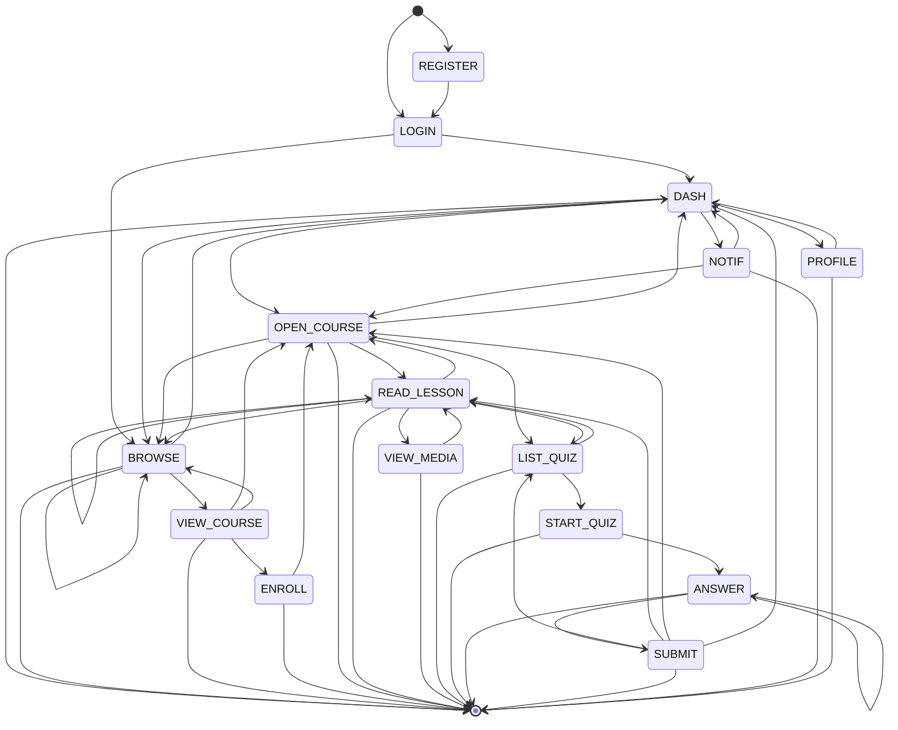

# Workload design v1 — workload theo hành vi người dùng

> **Cập nhật 17/11/2026 ([ADR-007](../adr/adr-007-semi-real-workload-and-ai-evidence-v1.md)).** Traffic của học viên **không còn** sinh bằng mức 2 thuần giả định. Nguồn traffic nay là dải bốn mức: **mức 1** (đã cài ở [PR #76](https://github.com/Minhduc7904/DO_AN_TOT_NGHIEP/pull/76), giữ làm smoke test và mốc "giả lập đơn giản"); **mức 2** chỉ còn cho giảng viên, admin và job lịch; **mức 2+** phát lại phiên thật của học viên từ log Moodle Unistudium 2022 (mục 13, mới); **mức 3 offline** — LLM sinh persona giảng viên và nội dung **một lần**, đóng băng thành JSON có hash — là Stretch (mục 14, mới). Máy trạng thái học viên ở mục 3–5 được giữ lại làm khung ánh xạ cho mức 2+ và làm nguồn "mức 2 thuần" khi kiểm chứng độ thực (mục 10.4). Đường cong theo giờ và đỉnh ngày làm quiz của học viên lấy từ log Moodle (mục 7.7); OULAD giữ vai trò kiểm tra vĩ mô. Mục cũ "Giới hạn", "Đối chiếu DoD", "Nguồn tham khảo" đổi số thành 15, 16, 17. Đoạn chi tiết nào bên dưới còn mâu thuẫn với ADR-007 thì ADR-007 được ưu tiên.

> **Task:** `task-01_design-user-behavior-workload` (tuần 13) — [card task](../plan/weekly/week-13_2026-10-25_to_2026-10-31/task-01_design-user-behavior-workload.md)
>
> **Trạng thái:** Đề xuất — v1, 17/11/2026; bổ sung cùng ngày theo ADR-007 (mức 2+, mức 3 offline, kiểm chứng hold-out). Thiết kế cho mức 2 và 2+; k6 mức 1 đã cài song song ở task-02 tuần 13 ([PR #76](https://github.com/Minhduc7904/DO_AN_TOT_NGHIEP/pull/76), `aiops-platform/load/`). Mọi con số tải (số người dùng, tốc độ đến, thời lượng, hệ số chồng phiên) là giá trị khởi đầu, **chốt sau pilot** ở tuần 14–15.
>
> **Phạm vi:** workload mức 1, 2, 2+ theo gợi ý của giảng viên hướng dẫn: người dùng ảo có profile, mục tiêu, máy trạng thái, thời gian nghỉ, phản ứng với lỗi của hệ thống, nhịp tải theo giờ trong ngày; phát lại phiên học viên thật từ log Moodle; hai profile healthy bắt buộc; cách kiểm chứng phân phối, kiểm chứng độ thực và cách tái lập; mức 3 offline ở dạng thiết kế Stretch. Không thuộc phạm vi: LLM agent chạy online làm nguồn tải (ADR-007 đã loại), fault injector, export telemetry, thêm thao tác LMS mới (LMS đóng băng theo ADR-006).
>
> **Tài liệu liên quan:** [ADR-007](../adr/adr-007-semi-real-workload-and-ai-evidence-v1.md), [plan v0.4](../plan/plan-v0.4-24-weeks.md) (thay plan v0.3 từ 17/11/2026), [plan v0.3, tuần 13–14 và mục 8–9](../plan/plan-v0.3-24-weeks.md), [ADR-006](../adr/adr-006-trim-project-scope-v1.md), [evaluation-protocol-v1 mục 5.4–5.5](evaluation-protocol-v1.md), [analysis-anomaly-rca-blueprint-v1 mục 18](analysis-anomaly-rca-blueprint-v1.md), [service-catalogue-and-topology-v2 mục 7](service-catalogue-and-topology-v2.md), [telemetry-and-ground-truth-schema-v1 mục 4.1 và 8](telemetry-and-ground-truth-schema-v1.md), [dependency-resilience-policy-v2](dependency-resilience-policy-v2.md), [seed-data-guide](../guides/seed-data-guide.md).
>
> **Nguồn sự thật về endpoint:** các file `lms/test/regression/*.regression.mjs` trên `main` ([thư mục regression](../../../lms/test/regression/)). Mọi request trong tài liệu này đi qua Gateway với tiền tố `/api/v1`, trừ bước POST thẳng lên MinIO bằng URL ký sẵn của luồng upload.

## 0. Đọc nhanh

- **Sau ADR-007:** học viên dùng **mức 2+** — mỗi phiên là một phiên thật trong log Moodle Unistudium 2022 ([L-Unistudium]), giữ nguyên thứ tự thao tác và thời gian nghỉ, chỉ nén lịch bắt đầu phiên (một ngày → 48 phút). Tự tính trên log: 95,2% số dòng ánh xạ được sang trạng thái của mục 5.2; 34.248 phiên khi cắt ở 30 phút nghỉ; trung vị 3 thao tác và 46 s mỗi phiên (mục 2.3, 13). Giảng viên, admin, job lịch vẫn dùng mức 2 như các mục 3–8.
- **Vì sao cần:** detector bất thường và RCA engine học "thế nào là bình thường" từ telemetry của run khỏe. Nếu tải là một vòng lặp gọi API đều đặn thì "bình thường" quá phẳng, detector dễ báo nhầm khi gặp tải thật có lên xuống. Workload theo hành vi tạo ra nhiễu nền giống người dùng: lúc đông lúc vắng, phiên dài phiên ngắn, có người bỏ dở, có người thử lại khi lỗi.
- **Cách làm:** mỗi phiên làm việc (session) là một người dùng ảo (VU) có **profile** (kiểu người), **goal** (mục tiêu của phiên này), đi qua một **máy trạng thái** (mỗi trạng thái là một thao tác gọi endpoint thật), nghỉ giữa các thao tác theo phân phối **log-normal**, và phản ứng với lỗi (thử lại, đăng nhập lại, bỏ ngang). Số phiên bắt đầu mỗi phút đi theo **đường cong trong ngày** đã nén 24 giờ còn 48 phút.
- **Căn cứ số liệu:** tỉ lệ profile học viên, mức tăng hoạt động trước hạn nộp bài, số thao tác mỗi phiên và xác suất hoạt động mỗi ngày được **tính lại trực tiếp từ bộ dữ liệu công khai OULAD** (32.593 lượt đăng ký học, 10.655.280 dòng log); thời gian nghỉ lấy tham số log-normal đã công bố của Wilson; mô hình máy trạng thái và mô hình "đến theo dòng" dựa trên van Hoorn và cs. (2008) và Schroeder và cs. (2006). Các xác suất chuyển trạng thái, mức kiên nhẫn, đường cong theo giờ là **giả định của đề tài**, ghi rõ lý do ở mục 9. Với học viên, các giả định này được **thay bằng số đo từ log Moodle** ở mức 2+ (đánh dấu trong bảng mục 9); mức kiên nhẫn và phản ứng với lỗi vẫn là giả định vì log không ghi lỗi của hệ thống.
- **Hai profile healthy bắt buộc:** `normal mixed traffic` (một ngày thường, khoảng 720 phiên học viên + 90 phiên giảng viên + sự kiện admin trong 48 phút) và `healthy high-load spike` (ngày sát hạn quiz, tải đỉnh gấp 2,4 lần ngày thường trong 8 phút buổi tối). Ở mức 2+, phần học viên của hai profile là phát lại một ngày thường và ngày cao điểm thật của log (ngày làm quiz nhiều nhất: 1.376 phiên, gấp 3,66 lần ngày trung bình) — mục 13.5.
- **Tuần 14** hiện thực bằng k6 (executor `ramping-arrival-rate`, mỗi phiên một iteration giữ trạng thái riêng), ghi nhật ký thao tác mỗi run, kiểm chứng phân phối theo mục 10 và kiểm chứng độ thực bằng hold-out của log Moodle, so ba nguồn tải (mục 10.4).

---

## 1. Mục tiêu, phạm vi và thuật ngữ

### 1.1. Mục tiêu

1. Sinh traffic healthy đủ đa dạng và có nguồn gốc giải thích được để fit detector và đo báo động nhầm ([evaluation-protocol-v1 mục 5.4](evaluation-protocol-v1.md)).
2. Làm tải nền cho mọi fault run của bốn case MVP C2, C3, C4, C6 ([ADR-006](../adr/adr-006-trim-project-scope-v1.md) mục 4): mỗi case cần có traffic đi qua đúng thành phần bị lỗi trong cửa sổ fault (bảng ở mục 8.5).
3. Tái lập được: cùng `workload_seed` và cùng cấu hình thì cùng chuỗi phiên dự kiến (mục 11).

### 1.2. Mức 1, mức 2, mức 2+, mức 3

Bảng theo [ADR-007](../adr/adr-007-semi-real-workload-and-ai-evidence-v1.md) mục 1. Trước ADR-007, "mức 3" trong tài liệu này nghĩa là phát lại log người dùng thật và nằm ngoài phạm vi; nay phần phát lại được làm dưới tên **mức 2+**, còn "mức 3" chỉ dạng LLM sinh nội dung offline.

| Mức | Nội dung | Phạm vi người dùng | Thuộc tài liệu này |
| --- | --- | --- | --- |
| Mức 1 | Mỗi workflow W1–W7 một kịch bản thao tác cố định trên dữ liệu seed (giống regression, chạy lặp) | Mọi vai trò; smoke test và **mốc giả lập đơn giản** khi kiểm chứng độ thực | Mục 12.1; **đã cài** ở tuần 13 (PR #76) |
| Mức 2 | Người dùng ảo có profile, goal, máy trạng thái xác suất, think time, phản ứng với lỗi, nhịp tải theo giờ | **Chỉ** giảng viên (W2, W4 phía giảng viên, W6), admin (W5), job lịch (W7). Máy trạng thái học viên (mục 5.2–5.6) giữ làm nguồn "mức 2 thuần" khi so ba nguồn tải | Mục 3–8; MVP, tuần 14 |
| **Mức 2+** | Phát lại phiên thật của học viên từ log Moodle: ánh xạ sự kiện → trạng thái mục 5.2, giữ thứ tự thao tác và think time, nén lịch bắt đầu phiên, phản ứng với lỗi theo mục 6 | Học viên (W1, W3, W4 phía đọc, W5 phía hộp thư) | Mục 13 (mới); MVP, tuần 14 |
| Mức 3 (offline) | LLM sinh **một lần** persona giảng viên và nội dung (đề cương, bài, câu hỏi, tài liệu cho W6), lưu JSON có hash; k6 chỉ đọc. Không chạy agent online | Độ thực của **nội dung**, không phải nhịp tải | Mục 14 (mới); **Stretch** |

### 1.3. Thuật ngữ dùng trong tài liệu

| Từ | Nghĩa trong tài liệu này |
| --- | --- |
| **workload** | Toàn bộ traffic mà bộ sinh tải gửi vào hệ thống trong một run. |
| **phiên (session)** | Một lần một người dùng mở LMS, làm một chuỗi thao tác rồi rời đi. Trong k6, một phiên là một *iteration*. |
| **VU (virtual user)** | "Người dùng ảo" của k6: một luồng chạy kịch bản. Một VU chạy lần lượt nhiều phiên; trạng thái người dùng được khởi tạo lại ở đầu mỗi phiên. |
| **profile** | Kiểu người dùng cố định của một tài khoản, ví dụ học viên "chăm chỉ". Profile quyết định mục tiêu hay gặp, mức kiên nhẫn, thời gian rảnh. |
| **goal** | Mục tiêu của *một phiên*, ví dụ "làm quiz trước hạn". Cùng một người, mỗi phiên có thể có goal khác. |
| **trạng thái / thao tác** | Một bước người dùng làm trên giao diện, ánh xạ tới 1–3 request HTTP cụ thể. |
| **xác suất chuyển** | Xác suất từ thao tác hiện tại đi sang thao tác tiếp theo. Mỗi dòng của bảng chuyển cộng lại bằng 1. Mô hình chỉ nhìn thao tác hiện tại (cộng vài điều kiện chặn) để chọn bước sau, gọi là chuỗi Markov. |
| **think time** | Thời gian người dùng đọc, suy nghĩ, gõ phím giữa hai thao tác (k6 gọi `sleep`). |
| **log-normal** | Phân phối mà **logarit** của giá trị có phân phối chuẩn với trung bình μ và độ lệch σ. Đặc điểm: đa số giá trị nhỏ, thỉnh thoảng có giá trị rất lớn (đuôi dài). Trung vị (median) = e^μ; trung bình (mean) = e^(μ + σ²/2), luôn lớn hơn trung vị. |
| **arrival rate** | Tốc độ đến: số phiên mới bắt đầu mỗi phút. |
| **mô hình mở / đóng** | Mô hình đóng: một số VU cố định, VU chỉ bắt đầu phiên mới khi phiên cũ xong, nên hệ thống chậm thì tải tự giảm. Mô hình mở: phiên mới đến theo lịch, không chờ phiên cũ xong. Mục 7.1 giải thích vì sao chọn mô hình mở. |
| **seed** | (1) `workload_seed`: số khởi tạo bộ sinh số ngẫu nhiên của workload. (2) *dữ liệu seed*: dữ liệu nền do seeder R-10 nạp bằng SQL. Hai khái niệm khác nhau; tài liệu luôn ghi rõ. |
| **endpoint** | Một đường dẫn API cụ thể, ví dụ `POST /api/v1/student/courses/:id/enrollments`. |

---

## 2. Căn cứ số liệu đã kiểm chứng

Phần này gom các con số **đã kiểm chứng** mà các mục sau dùng. Danh sách đầy đủ tham số kèm nguồn ở mục 9; phần nào là giả định đều ghi rõ ở đó.

### 2.1. OULAD — tính lại từ dữ liệu gốc

**Nguồn:** Open University Learning Analytics Dataset (Kuzilek, Hlosta, Zdrahal), tải bản zip từ UCI Machine Learning Repository ngày 17/11/2026. File mô tả `OULAD.names` trong zip ghi: 22 lượt mở môn học (course-presentation), 10.655.280 dòng log tương tác với hệ thống học trực tuyến (VLE), 206 bài đánh giá, 173.912 lượt nộp bài. Bảng `studentInfo.csv` có 32.593 dòng (file `.names` ghi 32953, có vẻ gõ nhầm thứ tự chữ số; tài liệu này dùng số đếm thực tế 32.593). Mỗi dòng log là tổng số click của một học viên vào một tài nguyên trong một ngày (`date` tính bằng số ngày từ khi môn mở, `sum_click`); bảng `assessments.csv` có hạn nộp `date` của từng bài.

**Vì sao chọn OULAD:** đây là dữ liệu công khai lớn nhất về học viên *có đăng ký học thật* (không phải MOOC miễn phí), có cả hạn nộp bài lẫn log hoạt động hằng ngày, gần với LMS của đề tài (học viên ghi danh, học bài, làm quiz có hạn). Cách tính lặp lại được ghi ở Phụ lục A.

| Kết quả tính lại | Giá trị | Dùng cho |
| --- | --- | --- |
| Kết quả cuối khóa (32.593 lượt) | Đạt 37,9% · Rút lui (Withdrawn) 31,2% · Trượt 21,6% · Xuất sắc 9,3% | Profile "xem lướt rồi bỏ dở" (mục 3) |
| Lượt hủy đăng ký | 30,9% lượt đăng ký có ngày hủy; trung vị ngày hủy là ngày 27; 50,9% số lượt hủy xảy ra trước ngày 30 | Bỏ dở xảy ra sớm |
| Thời điểm nộp bài (167.044 lượt nộp TMA/CMA, so với hạn) | Đúng ngày hạn 17,6% · trước 1 ngày 15,5% · trước 2–3 ngày 9,6% · trước 4–7 ngày 5,6% · sớm hơn 7 ngày 22,2% · sau hạn 29,5% | Hành vi "nước rút" (mục 3, 4) |
| Hoạt động của cả lớp theo số ngày còn tới hạn (trung vị trên 22 lượt mở môn, so với mức trung bình của các ngày cách hạn 7–14 ngày) | còn 0 ngày ×1,61 · còn 1 ngày ×2,11 · còn 2 ngày ×1,83 · còn 3 ngày ×1,57 · còn 4 ngày ×1,21 · còn 5 ngày ×1,01; lớn nhất ×3,25 | Cao điểm trước hạn quiz (mục 7.4) |
| Số click của một học viên trong một ngày có hoạt động (1.808.119 cặp học viên–ngày) | trung vị 11, tứ phân vị 4–26, phân vị 90 là 52, trung bình 21,9; logarit có μ = 2,32, σ = 1,29 | Ngân sách số thao tác mỗi phiên (mục 5.9) |
| Số ngày có hoạt động của một học viên trong một lượt mở môn (≈ 256 ngày) | trung vị 47, trung bình 61,9 | Xác suất hoạt động mỗi ngày ≈ 61,9 / 256 ≈ 0,24 (mục 7.3) |
| Phân loại 28.500 học viên có hoạt động trong thời gian môn mở (cách phân loại ở Phụ lục A) | Đều đặn 41,7% · Nước rút 28,8% · Rút lui 22,9% · Ít hoạt động (dưới 10 ngày, không rút lui) 6,6% | Tỉ lệ profile (mục 3.2) |
| Số ngày hoạt động trung bình theo nhóm | Đều đặn 98,2 · Nước rút 46,6 · Rút lui 21,8 · Ít hoạt động 4,7 | Tỉ lệ *phiên* theo profile (mục 3.3) |
| Mức hoạt động trong 3 ngày sát hạn so với các ngày cách hạn 7–14 ngày, theo nhóm | Đều đặn ×1,24 · Nước rút ×2,72 · Rút lui ×1,51 · Ít hoạt động ×2,68 | Đổi tỉ lệ phiên vào ngày sát hạn (mục 3.3) |

**Giới hạn của phép quy đổi:** OULAD là đại học từ xa ở Anh (2013–2014), học viên phần lớn đi làm; "click" là một lần mở tài nguyên, mịn hơn một "thao tác" của đề tài; dữ liệu chỉ có theo **ngày**, không có theo giờ. Vì vậy OULAD được dùng cho *tỉ lệ* và *hệ số tương đối*, không dùng cho số tuyệt đối theo giờ.

### 2.2. Các nguồn khác đã mở và đọc

| Nguồn | Khẳng định/con số lấy ra |
| --- | --- |
| Wilson, "What Were They Thinking: Modeling Think Times for Performance Testing", CMG MeasureIT (khoảng 2011) | 8 tháng log giao dịch thật, hơn 13 triệu think time; fit phân phối log-normal được `meanlog = 2.659`, `sdlog = 1.325`; mẫu dùng để fit có tứ phân vị 5,17 s / 11,84 s / 29,92 s; loại think time ≤ 0 và > 1 giờ; tác giả khuyên chia think time theo loại tình huống (chọn tab 1–5 s, tạo dữ liệu 15–60 s, giữa hai nhiệm vụ 30–930 s). |
| Kizilcec, Piech, Schneider (2013), LAK '13 | Bốn kiểu học viên MOOC: Completing (làm gần hết bài đánh giá), Auditing (xem bài giảng, gần như không làm bài), Disengaging (đầu khóa làm bài rồi giảm dần, thường trong 1/3 đầu khóa), Sampling (chỉ xem video trong 1–2 kỳ, thường chỉ một video). Tỉ lệ Sampling trong ba khóa: 39%, 74%, 80%. |
| Schroeder, Wierman, Harchol-Balter (2006), NSDI '06 | Website "giống hệ đóng trong một lúc rồi rời đi", nên mô hình phù hợp là **partly-open**: người dùng đến theo dòng bên ngoài, mỗi người làm vài request có think time ở giữa. Số request trung bình mỗi phiên của 10 website trong bài dao động 1,2–12,9. Think time không đổi lựa chọn mô hình, chỉ đổi mức tải. |
| van Hoorn, Rohr, Hasselbring (2008), SIPEW '08, LNCS 5119 | Mô tả workload gồm: mô hình ứng dụng (máy trạng thái các thao tác hợp lệ, có điều kiện chặn — guard), mô hình hành vi người dùng (chuỗi Markov), tỉ lệ trộn các mô hình hành vi, và cường độ tải thay đổi theo thời gian. Chuỗi Markov là cách phổ biến để mô tả hành vi trong phiên; bài dẫn lại CBMG của Menascé và cs. |
| Smarr, Schirmer (2018), Scientific Reports 8:4793 | Log đăng nhập LMS của 14.894 sinh viên: có "cửa sổ ngủ" ổn định từ khoảng 23:00–24:00 tới 06:00–10:00; ngày có lớp thì phần lớn hoạt động ở nửa đầu ngày, ngày không có lớp thì phần lớn ở nửa sau. |
| Nielsen (1993), "Response Times: The 3 Important Limits" | 0,1 s: cảm giác tức thì; 1 s: mạch suy nghĩ không bị ngắt; 10 s: giới hạn giữ sự chú ý, quá mức này người dùng chuyển sang việc khác. |
| Brooker (2015), AWS Architecture Blog, "Exponential Backoff And Jitter" | Backoff lũy thừa có giới hạn; thêm ngẫu nhiên (jitter); "Full Jitter" chọn thời gian chờ ngẫu nhiên trên toàn khoảng backoff; Equal Jitter kém nhất. |
| Google SRE Book, chương 22 "Addressing Cascading Failures" | "Luôn dùng randomized exponential backoff khi lên lịch retry"; giới hạn số retry cho mỗi request; cân nhắc ngân sách retry theo process. |
| Tài liệu k6 (Grafana) | `ramping-arrival-rate` là executor mô hình mở; mô hình đóng gây "coordinated omission"; iteration bị bỏ (`dropped_iterations`) khi không còn VU rảnh; `exec.scenario.iterationInTest` là số thứ tự iteration duy nhất trong scenario; timeout mặc định của request là 60 s. |
| NIST/SEMATECH e-Handbook, mục 1.3.5.15 và 1.3.5.16 | Kiểm định chi-bình phương dùng cho dữ liệu chia nhóm/rời rạc; kiểm định Kolmogorov–Smirnov (KS) chỉ hợp lệ với phân phối liên tục có tham số **cố định trước**, không ước lượng từ chính dữ liệu đang kiểm. |
| Paxson, Floyd (1995), IEEE/ACM ToN [L-PaxsonFloyd] (thêm 17/11/2026, đã mở PDF) | Trên 24 trace TCP diện rộng: "user-initiated TCP session arrivals ... are well-modeled as Poisson processes with fixed hourly rates"; các tiến trình đến khác (gói tin trong phiên, kết nối dữ liệu FTP) burst hơn Poisson nhiều; kết nối do máy khởi tạo theo timer (SMTP, NNTP) không theo Poisson. Dùng cho mục 7.7. |
| Vögele và cs. (2018), WESSBAS, SoSyM [L-WESSBAS] (thêm 17/11/2026) | Trích **mô hình hành vi** (chuỗi Markov) và **tỉ lệ trộn hành vi** từ log phiên thật (gom nhóm bằng X-means), sinh kịch bản tải tự động; kiểm chứng bằng thống kê mô tả (độ dài phiên, số request theo loại); ghi nhận chuỗi Markov bậc 1 có thể sinh phiên dài hơn thật. Dùng cho mục 13.8. |
| Fang và cs. (2025), arXiv 2510.04711 [L-Fang2025] (thêm 17/11/2026) | Workload của các benchmark RCA cũ chỉ 0,14–4,35 (ví dụ trên Train-Ticket) QPS, phủ ít service; với workload theo máy trạng thái (16,47 QPS, phủ 84% service), Top-1 trung bình của 11 phương pháp RCA còn 0,21, Nezha từ 0,87 xuống 0,04 khi đánh giá trên bộ khó và thực tế hơn (bộ mới đổi nhiều yếu tố cùng lúc, không chỉ workload). Lý do phải làm traffic giống thật (mục 13.1). |

### 2.3. Log Moodle Unistudium 2022 — tính lại từ dữ liệu gốc (thêm theo ADR-007)

**Nguồn:** Milani, Biondi, Franzoni, *Unistudium 2022: students groups logs on moodle*, Zenodo v1.2 (18/12/2022), DOI 10.5281/zenodo.13763175, giấy phép **CC BY 4.0** [L-Unistudium]. Tệp `Unistudium_students_groups_logs_2022.zip` tải ngày 17/11/2026, md5 khớp với trang Zenodo. README đi kèm: log của sinh viên 4 khóa học trên Unistudium (nền tảng e-learning dựa trên Moodle của Đại học Perugia, Ý), học kết hợp (blended learning), một học kỳ; id người dùng và tên khóa đã ẩn danh. Bốn cột: `userId`, `moodleAction` (tên sự kiện chuẩn của Moodle), `course` (A–D), `dateTime` (số nguyên, đơn vị giây).

**Vì sao chọn:** trong các bộ đã tìm (mục 13.1), đây là log LMS công khai duy nhất vừa **tải tự do**, vừa có **timestamp tới giây**, vừa dùng **tên sự kiện chuẩn** của một LMS phổ biến, vừa có giấy phép cho phép dùng lại; nhờ vậy tái dựng được **phiên** (OULAD không làm được vì chỉ có ngày). So sánh các bộ khác ở mục 13.1.

Mọi con số dưới đây **do người viết tự tính** từ tệp CSV (cách tính ở Phụ lục B). Phiên được cắt khi một người dùng nghỉ quá 30 phút (mục 13.3).

| Kết quả tính lại | Giá trị | Dùng cho |
| --- | --- | --- |
| Quy mô | 208.109 dòng; 1.234 người dùng, **mỗi người chỉ thuộc một khóa** (A 503, B 142, C 384, D 205 người); 45 loại sự kiện; 91 ngày liên tiếp | Mục 13 |
| Tỉ lệ dòng ánh xạ được sang trạng thái mục 5.2 | **95,2%** (198.095 dòng); bỏ 4,8% (10.014 dòng, riêng `access_prevented` 8.961) | Mục 13.2 |
| Số phiên (cắt ở 30 phút nghỉ) | 34.248 (34.247 phiên có ít nhất một thao tác ánh xạ được); ngưỡng 15 phút: 38.419; ngưỡng 60 phút: 30.387 | Mục 13.3 |
| Số sự kiện thô mỗi phiên | trung vị 3, phân vị 90 là 14, phân vị 99 là 41, trung bình 6,08; 17,9% phiên chỉ có 1 sự kiện | Mục 13.3 |
| Số **thao tác** mỗi phiên (sau ánh xạ, gộp) | trung vị 3, tứ phân vị 2–6, phân vị 90 là 11, phân vị 99 là 30, trung bình 5,02, lớn nhất 148 | Thay `max_actions` (P09) |
| Thời lượng phiên | trung vị 46 s, tứ phân vị 8–452 s, phân vị 90 là 1.433 s, phân vị 99 là 4.193 s, trung bình 431 s; 16,2% phiên dài hơn 15 phút; 2,6% dài hơn 48 phút | Thay `time_available` (P18) |
| Think time trong phiên (137.645 khoảng nghỉ giữa hai thao tác) | tứ phân vị 7 s / **15 s** / 55 s; phân vị 90 là 308 s; trung bình 107 s; 10,2% dài hơn 300 s; fit log-normal trên các giá trị ≥ 1 s: μ = 3,093, σ = 1,636 (median 22,0 s) | Thay P11, P12 cho học viên |
| Thời gian ở lại một trang (think time theo trạng thái **trước**, trung vị) | `OPEN_COURSE` 12 s · `READ_LESSON` 21 s (tứ phân vị trên 94 s) · `LIST_QUIZ` 15 s · `START_QUIZ` → lần lưu đáp án 406 s (thời gian làm bài) · `SUBMIT` 19 s · `NOTIF` 21 s | Mục 13.3, 13.8 |
| Tỉ lệ thao tác | `READ_LESSON` 46,5% · `OPEN_COURSE` 42,2% · `START_QUIZ` 2,4% · `SUBMIT` 2,4% · `LIST_QUIZ` 2,3% · `ANSWER` 2,2% · `NOTIF` 1,5% · `ENROLL` 0,37% · `PROFILE` 0,08% · `VIEW_MEDIA` 0,03% · `BROWSE` 0,01% (chưa tính `LOGIN`, `DASH` chèn đầu phiên) | Mục 10.4, 13.3 |
| Phiên bắt đầu theo giờ trong ngày | đáy 03:00 (14 phiên cả kỳ), đỉnh 10:00 (3.602) và 15:00 (3.248); chỉ 1,96% phiên bắt đầu trong 23:00–06:00; buổi tối 19:00–21:00 chỉ bằng 0,21–0,28 lần giờ đỉnh (bảng đầy đủ ở mục 7.7) | Thay `w(h)` (P24) |
| Theo ngày | trung bình 376,4 phiên/ngày (trung vị 291; phân vị 10 là 132, phân vị 90 là 753); trung bình 2.286,9 sự kiện/ngày (độ lệch chuẩn 2.313,2); ngày trong tuần trung vị 362 phiên, cuối tuần 148,5 | Mục 13.5 |
| Ngày cao điểm | ngày thứ 40 (đếm từ 0): 1.376 phiên = **3,66 lần** trung bình, 4,73 lần trung vị; 15.967 sự kiện = 6,98 lần trung bình; 698 lượt nộp quiz | Thay P27, P28 |
| Quiz | chỉ khóa A có lượt nộp quiz (B, C, D bằng 0); 19 ngày khóa A có ≥ 50 lượt nộp | Mục 7.7, 10.4 |
| Hoạt động quanh ngày làm quiz (số phiên của khóa A, so với trung bình các ngày cách đó 7–14 ngày, trung vị trên 19 ngày quiz) | đúng ngày ×1,31 (thấp nhất ×0,59, cao nhất ×6,23) · trước 1 ngày ×1,11 · trước 2 ngày ×0,94 · trước 3 ngày ×0,85 | Mục 7.7 |

**Giới hạn:** README không nói múi giờ, và mốc thời gian đã bị dịch (giá trị nhỏ nhất 244.518.301 s ứng với năm 1977, trong khi dữ liệu là năm 2022). Giờ trong ngày được tính bằng `dateTime mod 86400`. Bằng chứng gián tiếp rằng phép dịch giữ nguyên giờ và thứ trong tuần: đáy hoạt động rơi vào 03:00, và hai ngày liên tiếp ít phiên nhất (trung bình 209,8 và 180,7 phiên) đúng là thứ Bảy, Chủ nhật nếu coi `dateTime` là giờ Unix. Nếu giá trị gốc là giờ UTC thì giờ địa phương ở Ý muộn hơn 1–2 giờ; tài liệu này chỉ dùng **hình dạng** đường cong nên chấp nhận độ lệch đó. Moodle ở đây là học kết hợp (sinh viên vẫn lên lớp), 4 khóa, một trường ở Ý; khác LMS của đề tài về quy mô và cách dùng (mục 15).

---

## 3. User Profile

### 3.1. Vai trò và nguồn tài khoản

| Vai trò | Tài khoản dùng | Ghi chú |
| --- | --- | --- |
| Student | `seed-student-N@seed.test`, mật khẩu `seed-password` (profile dữ liệu seed `small`: N = 1..1000) | Tài khoản được chia cố định cho profile (mục 3.2) để cùng một tài khoản luôn cư xử cùng một kiểu. |
| Student mới | Đăng ký trong run bằng `POST /auth/register`, email dạng `wl-<số phiên>-<chuỗi ngẫu nhiên>@load.test` | Không đưa `run_id` vào dữ liệu nghiệp vụ ([telemetry schema v1 mục 4.1](telemetry-and-ground-truth-schema-v1.md)). |
| Instructor | `seed-instructor-N@seed.test`, N = 1..10 | Mỗi giảng viên ảo dùng lại 10 tài khoản này. |
| Admin | Tài khoản bootstrap `admin@example.test`, mật khẩu đọc từ biến môi trường giống regression | Chỉ một admin. |

Dữ liệu seed dùng profile `small` (1.000 học viên, 10 giảng viên, 20 khóa học và 60 quiz, đều ở trạng thái `PUBLISHED`) và **cố định** cho mọi run trong cùng campaign ([evaluation-protocol-v1 mục 5.5](evaluation-protocol-v1.md)). Lý do chọn `small` thay vì `medium`: đợt thông báo hàng loạt gửi tới **tất cả** học viên (`target_scope = ALL_STUDENTS`), nên với `medium` mỗi đợt là 20.000 email, quá nặng cho một run healthy trên máy ~15 GB RAM. Chốt sau pilot.

### 3.2. Profile học viên

> **Phạm vi sau ADR-007:** profile, goal và bảng chuyển của học viên (mục 3.2–3.3, 4.1, 5.4) **không** còn dùng để sinh traffic học viên trong run thí nghiệm; mỗi phiên học viên là một phiên thật phát lại ở mức 2+ (mục 13). Các bảng này được giữ để (1) chạy nguồn "mức 2 thuần" khi so ba nguồn tải (mục 10.4), (2) cung cấp danh sách trạng thái, endpoint, điều kiện chặn mà mức 2+ ánh xạ vào (mục 5.2, 5.5), (3) làm kiểm tra vĩ mô bằng OULAD.

| Mã | Profile | Mô tả hành vi | Tỉ lệ tài khoản | Tài khoản seed |
| --- | --- | --- | --- | --- |
| `P1` | **Chăm chỉ** (đều đặn) | Học đều trong suốt khóa, làm quiz rải rác, ít bị hạn nộp chi phối. | 0,42 | `seed-student-1` … `417` |
| `P2` | **Nước rút trước hạn** | Bình thường vào ít, chủ yếu kiểm tra nhanh; sát hạn thì vào nhiều và tập trung làm quiz. | 0,29 | `418` … `705` |
| `P3` | **Xem lướt rồi bỏ dở** | Duyệt danh mục, xem vài khóa, có khi ghi danh, đọc dở một bài rồi rời đi; tương ứng nhóm rút lui và ít hoạt động. | 0,29 | `706` … `1000` |

**Nguồn tỉ lệ:** OULAD, mục 2.1: Đều đặn 41,7% → P1; Nước rút 28,8% → P2; Rút lui 22,9% + Ít hoạt động 6,6% = 29,5% → P3. Ranh giới "nước rút" là **giả định**: học viên có tỉ lệ ngày hoạt động rơi vào 3 ngày trước hạn cao gấp ít nhất 2 lần mức kỳ vọng nếu hoạt động đều (Phụ lục A). Độ nhạy: hạ ngưỡng xuống 1,5 lần thì nhóm nước rút tăng mạnh (63,8% trong số học viên có ít nhất 10 ngày hoạt động, so với 41,9% ở ngưỡng 2 lần); vì vậy ngưỡng được ghi vào `workload_parameters` để báo cáo.

### 3.3. Tỉ lệ phiên khác tỉ lệ người

Workload đếm theo **phiên**, không theo người: người chăm chỉ vào nhiều ngày hơn nên chiếm nhiều phiên hơn. Tỉ lệ phiên = tỉ lệ người × số ngày hoạt động trung bình (OULAD mục 2.1), và vào ngày sát hạn nhân thêm hệ số hoạt động theo nhóm.

| Profile | Tỉ lệ người | Ngày hoạt động TB | Tỉ lệ phiên **ngày thường** | Hệ số sát hạn | Tỉ lệ phiên **ngày sát hạn** |
| --- | --- | --- | --- | --- | --- |
| P1 Chăm chỉ | 0,417 | 98,2 | **0,69** | ×1,24 | **0,53** |
| P2 Nước rút | 0,288 | 46,6 | **0,22** | ×2,72 | **0,38** |
| P3 Xem lướt rồi bỏ dở | 0,295 | 21,8 (rút lui), 4,7 (ít hoạt động) | **0,09** | ×1,51 và ×2,68 | **0,09** |

Tổng hoạt động ngày sát hạn so với ngày thường: ×1,60 (tổng có trọng số các dòng trên). Con số này nằm giữa mức tăng của cả lớp vào 3 ngày cuối (×1,57 tới ×2,11, mục 2.1), nên hai cách tính nhất quán.

### 3.4. Profile giảng viên và admin

| Mã | Profile | Mô tả | Tỉ lệ |
| --- | --- | --- | --- |
| `PI` | Giảng viên | Một profile, khác nhau ở goal của phiên: soạn bài, upload tài liệu, dùng AI soạn bài, xem tổng quan/xuất CSV (mục 4.2). | 1 giảng viên ảo trên 100 học viên ảo (theo tỉ lệ 10/1.000 của dữ liệu seed `small`) — **giả định** |
| `PA` | Admin | Gửi thông báo đơn, xem/tạo tài khoản; gửi đợt thông báo hàng loạt và chạy job dọn media theo lịch (mục 7.5). | 1 admin |

### 3.5. Mức kiên nhẫn và thời gian có sẵn

**Mức kiên nhẫn** (`patience`) là thời gian chờ lâu nhất người dùng chấp nhận cho **một** phản hồi. Mỗi phiên rút một giá trị: `patience = median × e^(0,4·Z)` với Z chuẩn tắc, kẹp trong [2 s; 15 s]. **Thời gian có sẵn** (`time_available`) là tổng thời gian tối đa của phiên, rút log-normal quanh trung vị với σ = 0,5, kẹp trong [1; 15] phút.

| Profile | Trung vị kiên nhẫn | Số lần "chờ quá lâu" trước khi bỏ (`slow_limit`) | Trung vị thời gian có sẵn | Lý do |
| --- | --- | --- | --- | --- |
| P1 Chăm chỉ | 8 s | 3 | 8 phút | Có động lực học, chịu chờ gần mức 10 s của Nielsen. |
| P2 Nước rút, ngày thường | 6 s | 3 | 5 phút | Chỉ vào xem nhanh. |
| P2 Nước rút, ngày sát hạn | 12 s | 4 | 10 phút | Áp lực phải nộp, chịu chờ lâu hơn mức chú ý 10 s. |
| P3 Xem lướt | 4 s | 2 | 3 phút | Không cam kết; chậm là bỏ. |
| PI Giảng viên | 10 s | 3 | 12 phút | Đang làm việc, cần hoàn thành. Riêng chờ việc nền (AI, thumbnail) có giới hạn riêng ở mục 6.4. |
| PA Admin | 15 s | 4 | 15 phút | Thao tác quản trị, chịu chờ nhất. |

Tất cả là **giả định của đề tài**, neo vào mốc 1 s và 10 s của Nielsen (mục 2.2). Lưu ý: Gateway trong Compose cắt request upstream sau 5 s và trả `504` ([dependency-resilience-policy-v2 mục 2](dependency-resilience-policy-v2.md)), nên mọi phản hồi qua Gateway đều về trước 5 s; "chờ quá lâu" trong thực tế xảy ra khi phản hồi chậm 3–5 s lặp lại, hoặc ở bước upload thẳng lên MinIO (không qua Gateway).

---

## 4. Goal

### 4.1. Goal của học viên

| Mã | Goal | Mô tả | Kết thúc "đạt mục tiêu" khi |
| --- | --- | --- | --- |
| `G1` | Học tiếp bài | Mở khóa đang học, đọc bài kế tiếp, thỉnh thoảng làm quiz của bài. | Đã cập nhật tiến độ ≥ 1 bài lên 100% |
| `G2` | Làm/ôn quiz trước hạn | Vào thẳng quiz, làm và nộp; có thể làm lại để ôn (LMS cho mở lượt mới sau khi nộp). | Đã nộp ≥ 1 lượt |
| `G3` | Xem lướt khóa học | Tìm kiếm, xem chi tiết khóa, đôi khi ghi danh, đọc dở một bài. | Không có; phiên kết thúc khi người dùng rời đi |
| `G4` | Kiểm tra nhanh | Xem thông báo, tiến độ, hồ sơ rồi rời đi. | Đã xem thông báo |

**Tỉ lệ goal theo profile** (xác suất một phiên mang goal đó; **giả định của đề tài**, lý do bên dưới):

| Profile | Pha | G1 | G2 | G3 | G4 |
| --- | --- | --- | --- | --- | --- |
| P1 | ngày thường | 0,60 | 0,20 | 0,05 | 0,15 |
| P1 | ngày sát hạn | 0,45 | 0,40 | 0,05 | 0,10 |
| P2 | ngày thường | 0,15 | 0,15 | 0,20 | 0,50 |
| P2 | ngày sát hạn | 0,20 | 0,70 | 0,00 | 0,10 |
| P3 | ngày thường | 0,10 | 0,05 | 0,70 | 0,15 |
| P3 | ngày sát hạn | 0,10 | 0,10 | 0,65 | 0,15 |

Lý do: P2 ngày sát hạn dồn vào làm quiz vì OULAD cho thấy 33,1% lượt nộp xảy ra trong ngày hạn hoặc ngay trước đó 1 ngày, và nhóm nước rút hoạt động gấp 2,72 lần vào 3 ngày cuối; P3 chủ yếu xem lướt vì nhóm Sampling/Disengaging của Kizilcec và cs. chỉ xem ít tài liệu và hầu như không làm bài đánh giá. Con số cụ thể của từng ô là giả định.

"Ngày sát hạn" là khái niệm **của workload**, không phải dữ liệu LMS: quiz trong LMS không có trường hạn nộp, và LMS đóng băng nên không thêm. Pha (`normal` hoặc `deadline`) do profile tải quyết định (mục 8).

### 4.2. Goal của giảng viên

| Mã | Goal | Tỉ lệ | Workflow chạm tới |
| --- | --- | --- | --- |
| `I1` | Soạn bài | 0,45 | W2 (khóa, bài, quiz, xuất bản); W4 khi chèn ảnh |
| `I2` | Upload tài liệu | 0,30 | W4 (upload trực tiếp MinIO, thumbnail, usage) |
| `I3` | Dùng AI soạn bài | 0,20 | W2 + W4 + W6 (tài liệu `extract_text`, sync, job AI) |
| `I4` | Xem tổng quan, xuất CSV | 0,05 | W2 (`summary`, `export`) |

Tỉ lệ là **giả định của đề tài**. `I3` được đặt 0,20 (cao hơn mức "thật" ước đoán) để case C3 (LLM stub chậm/lỗi) có đủ job AI trong cửa sổ fault; xem mục 8.5.

### 4.3. Goal của admin

| Mã | Goal | Cách xuất hiện |
| --- | --- | --- |
| `A1` | Gửi thông báo cho một học viên | Phiên admin rải rác ban ngày (mục 7.5), xác suất 0,6 |
| `A2` | Xem/tạo tài khoản | Phiên admin rải rác, xác suất 0,4 |
| `A3` | Gửi đợt thông báo hàng loạt | Sự kiện theo lịch: 08:00 (thông báo đầu ngày) và 19:00 (nhắc hạn) |
| `A4` | Dọn media không dùng | Sự kiện theo lịch: 02:00 (giống cron ban đêm) |

---

## 5. Behavior Model

### 5.1. Ý tưởng

Theo cách mô tả của van Hoorn và cs. (2008), workload có bốn phần: (1) **mô hình ứng dụng** — các thao tác hợp lệ và điều kiện chặn (không thể nộp bài khi chưa bắt đầu lượt làm); (2) **mô hình hành vi** — chuỗi Markov chọn thao tác tiếp theo theo xác suất; (3) **tỉ lệ trộn** — profile và goal (mục 3, 4); (4) **cường độ tải** — số phiên theo thời gian (mục 7). Đề tài thêm phần (5): **phản ứng với phản hồi của hệ thống** (mục 6).

Mỗi phiên chạy vòng lặp:

```text
khởi tạo trạng thái người dùng (profile, goal, kiên nhẫn, ngân sách thao tác, thời gian có sẵn)
thao tác = LOGIN (hoặc REGISTER với người dùng mới)
lặp:
    thực hiện thao tác (1–3 request), xử lý phản hồi theo mục 6
    nếu phải bỏ ngang (mục 6) -> kết thúc, ghi lý do
    nếu hết ngân sách thao tác hoặc hết thời gian có sẵn -> kết thúc
    chọn thao tác kế tiếp theo bảng chuyển của goal hiện tại, bỏ qua bước bị điều kiện chặn
    nếu kế tiếp là EXIT -> kết thúc
    nghỉ think time theo loại của thao tác kế tiếp (mục 5.6)
```

### 5.2. Trạng thái → endpoint (học viên)

Cột "Loại nghỉ" là loại think time **trước** khi làm thao tác đó (mục 5.6).

| Trạng thái | Người dùng làm gì | WF | Request (tiền tố `/api/v1`) | Loại nghỉ |
| --- | --- | --- | --- | --- |
| `REGISTER` | Tạo tài khoản mới (chỉ phiên người mới) | W1 | `POST /auth/register` | điều hướng |
| `LOGIN` | Đăng nhập, tải thông tin tài khoản | W1 | `POST /auth/student/login`; `GET /auth/me` | — (bước đầu) |
| `DASH` | Trang chủ: khóa đã ghi danh, thông báo chưa đọc | W3, W5 | `GET /student/enrollments`; `GET /notifications/me?status=UNREAD` | điều hướng |
| `BROWSE` | Tìm khóa học | W3 | `GET /courses?search=<từ khóa>` (từ khóa rỗng nghĩa là xem danh sách) | điều hướng |
| `VIEW_COURSE` | Xem chi tiết một khóa (có trạng thái ghi danh) | W3 | `GET /courses/:id` | đọc |
| `ENROLL` | Ghi danh | W3 | `POST /student/courses/:id/enrollments` | điều hướng |
| `OPEN_COURSE` | Mở khóa: danh sách bài (kèm nội dung) và tiến độ | W3 | `GET /courses/:id/lessons`; `GET /student/courses/:id/progress` | điều hướng |
| `READ_LESSON` | Đọc một bài, cập nhật tiến độ | W3 | `PUT /student/lessons/:id/progress` | đọc |
| `VIEW_MEDIA` | Xem ảnh/tệp trong bài | W4 (đọc) | `GET /media/:id/thumbnail` hoặc `GET /media/:id/content` (công khai, không cần token) | đọc |
| `LIST_QUIZ` | Xem quiz của bài | W3 | `GET /student/lessons/:id/quizzes` | điều hướng |
| `START_QUIZ` | Mở quiz, bắt đầu hoặc tiếp tục lượt làm | W3 | `GET /student/quizzes/:id`; `POST /student/quizzes/:id/attempts` (201 lượt mới, 200 tiếp tục lượt dở) | trả lời |
| `ANSWER` | Lưu đáp án | W3 | `PUT /student/attempts/:id/answers` | trả lời |
| `SUBMIT` | Nộp bài, xem điểm | W3 | `POST /student/attempts/:id/submit` | điều hướng |
| `NOTIF` | Xem thông báo, đánh dấu đã đọc | W5 | `GET /notifications/me`; rồi `PATCH /notifications/:id/read` (xác suất 0,7) hoặc `POST /notifications/read-all` (0,2) hoặc không làm gì (0,1) | điều hướng |
| `PROFILE` | Xem hồ sơ | W1 | `GET /students/me` | điều hướng |
| `REFRESH` | Làm mới token (không phải lựa chọn của người dùng; do mục 6.3 kích hoạt) | W1 | `POST /auth/refresh` | — |
| `EXIT` | Rời đi | — | — | — |

**Thao tác không dùng (có lý do):** `GET /media/avatars/:userId` không dùng vì tài khoản seed chưa có avatar nên trả `404` hàng loạt, tạo nhiễu lỗi giả trong run healthy. `GET /student/quizzes/:id/attempts` và `GET /student/attempts/:id` có trên `main` nhưng không cần cho các goal v1.

### 5.3. Sơ đồ máy trạng thái của học viên

Sơ đồ gộp mọi cạnh có xác suất khác 0 ở ít nhất một goal; xác suất cụ thể theo goal ở mục 5.4.



`[*]` cuối là `EXIT`. `REFRESH` không vẽ vì nó chen vào bất kỳ thao tác nào khi gặp `401` (mục 6.3).

### 5.4. Bảng xác suất chuyển của học viên (theo goal)

Đọc: dòng "từ trạng thái", cột "sang trạng thái (xác suất)". Mỗi dòng cộng bằng 1. Trạng thái không có dòng trong một goal nghĩa là goal đó không đi vào trạng thái này. Mọi giá trị là **giả định của đề tài**; cấu trúc (chuỗi Markov theo nhóm hành vi) theo van Hoorn và cs. (2008). Mục 5.9 nêu các phép kiểm tra hợp lý đã làm.

Sau ADR-007, các bảng dưới chỉ dùng cho nguồn "mức 2 thuần" (mục 10.4). Khi cần **sinh thêm** phiên học viên, dùng ma trận chuyển **học từ log Moodle** (mục 13.8), không dùng các bảng giả định này. Đối chiếu nhanh với log: người thật quay về trang khóa sau khi đọc một bài với xác suất 0,40 (`READ_LESSON` → `OPEN_COURSE`), bảng G1 dưới đây chỉ đặt 0,05; người thật đọc tiếp bài khác 0,30, bảng G1 đặt 0,45 (Phụ lục B.4).

**G1 — Học tiếp bài**

| Từ | Sang (xác suất) |
| --- | --- |
| `LOGIN` | `DASH` 1,00 |
| `DASH` | `OPEN_COURSE` 0,75 · `NOTIF` 0,10 · `BROWSE` 0,05 · `PROFILE` 0,02 · `EXIT` 0,08 |
| `OPEN_COURSE` | `READ_LESSON` 0,80 · `LIST_QUIZ` 0,10 · `DASH` 0,05 · `EXIT` 0,05 |
| `READ_LESSON` | `READ_LESSON` 0,45 · `LIST_QUIZ` 0,20 · `VIEW_MEDIA` 0,15 · `OPEN_COURSE` 0,05 · `EXIT` 0,15 |
| `VIEW_MEDIA` | `READ_LESSON` 0,85 · `EXIT` 0,15 |
| `LIST_QUIZ` | `START_QUIZ` 0,60 · `READ_LESSON` 0,25 · `EXIT` 0,15 |
| `START_QUIZ` | `ANSWER` 0,95 · `EXIT` 0,05 |
| `ANSWER` | `SUBMIT` 0,65 · `ANSWER` 0,30 · `EXIT` 0,05 |
| `SUBMIT` | `READ_LESSON` 0,40 · `OPEN_COURSE` 0,15 · `DASH` 0,10 · `EXIT` 0,35 |
| `NOTIF` | `DASH` 0,50 · `OPEN_COURSE` 0,30 · `EXIT` 0,20 |
| `PROFILE` | `DASH` 0,70 · `EXIT` 0,30 |
| `BROWSE` | `VIEW_COURSE` 0,70 · `DASH` 0,10 · `EXIT` 0,20 |
| `VIEW_COURSE` | `ENROLL` 0,40 · `OPEN_COURSE` 0,30 · `BROWSE` 0,15 · `EXIT` 0,15 |
| `ENROLL` | `OPEN_COURSE` 0,85 · `EXIT` 0,15 |

**G2 — Làm/ôn quiz trước hạn**

| Từ | Sang (xác suất) |
| --- | --- |
| `LOGIN` | `DASH` 1,00 |
| `DASH` | `OPEN_COURSE` 0,85 · `NOTIF` 0,10 · `EXIT` 0,05 |
| `OPEN_COURSE` | `LIST_QUIZ` 0,70 · `READ_LESSON` 0,25 · `EXIT` 0,05 |
| `READ_LESSON` | `LIST_QUIZ` 0,55 · `READ_LESSON` 0,25 · `EXIT` 0,20 |
| `LIST_QUIZ` | `START_QUIZ` 0,80 · `READ_LESSON` 0,10 · `EXIT` 0,10 |
| `START_QUIZ` | `ANSWER` 0,97 · `EXIT` 0,03 |
| `ANSWER` | `SUBMIT` 0,72 · `ANSWER` 0,25 · `EXIT` 0,03 |
| `SUBMIT` | `LIST_QUIZ` 0,45 (ôn: làm lại hoặc quiz khác) · `OPEN_COURSE` 0,10 · `EXIT` 0,45 |
| `NOTIF` | `OPEN_COURSE` 0,70 · `EXIT` 0,30 |

**G3 — Xem lướt khóa học**

| Từ | Sang (xác suất) |
| --- | --- |
| `LOGIN` | `BROWSE` 0,60 · `DASH` 0,40 |
| `DASH` | `BROWSE` 0,60 · `OPEN_COURSE` 0,20 · `EXIT` 0,20 |
| `BROWSE` | `VIEW_COURSE` 0,50 · `BROWSE` 0,25 · `EXIT` 0,25 |
| `VIEW_COURSE` | `BROWSE` 0,45 · `ENROLL` 0,20 · `OPEN_COURSE` 0,10 · `EXIT` 0,25 |
| `ENROLL` | `OPEN_COURSE` 0,70 · `EXIT` 0,30 |
| `OPEN_COURSE` | `READ_LESSON` 0,50 · `BROWSE` 0,20 · `EXIT` 0,30 |
| `READ_LESSON` | `EXIT` 0,60 · `READ_LESSON` 0,20 · `VIEW_MEDIA` 0,10 · `BROWSE` 0,10 |
| `VIEW_MEDIA` | `EXIT` 0,60 · `READ_LESSON` 0,40 |

**G4 — Kiểm tra nhanh**

| Từ | Sang (xác suất) |
| --- | --- |
| `LOGIN` | `DASH` 1,00 |
| `DASH` | `NOTIF` 0,55 · `EXIT` 0,20 · `OPEN_COURSE` 0,15 · `PROFILE` 0,10 |
| `NOTIF` | `EXIT` 0,60 · `OPEN_COURSE` 0,30 · `DASH` 0,10 |
| `OPEN_COURSE` | `EXIT` 0,60 · `READ_LESSON` 0,40 |
| `READ_LESSON` | `EXIT` 0,70 · `READ_LESSON` 0,30 |
| `PROFILE` | `EXIT` 0,80 · `DASH` 0,20 |

**Phiên người dùng mới:** 1% số phiên học viên (giả định) là người mới: profile P3, goal G3, đi `REGISTER → LOGIN` rồi theo bảng G3. Sau `REGISTER`, nếu nhận `409` (email trùng, gần như không xảy ra vì email có chuỗi ngẫu nhiên) thì đi thẳng `LOGIN`.

### 5.5. Điều kiện chặn và cách chọn dữ liệu (học viên)

Bảng chuyển chọn *loại* thao tác; điều kiện chặn (guard) và quy tắc chọn dữ liệu quyết định thao tác đó *có làm được không* và *làm trên đối tượng nào*. Nếu bước được chọn bị chặn, thay bằng bước dự phòng ở cột cuối, không rút lại xác suất.

| Thao tác | Điều kiện | Chọn đối tượng | Nếu bị chặn |
| --- | --- | --- | --- |
| `OPEN_COURSE` | Đã có ít nhất một khóa ghi danh | G1: khóa có tiến độ thấp nhất chưa xong; G2: khóa còn quiz chưa nộp; G3, G4: ngẫu nhiên đều | `BROWSE` |
| `ENROLL` | `GET /courses/:id` báo `NOT_ENROLLED` | Khóa đang xem | `OPEN_COURSE` (đã ghi danh) |
| `READ_LESSON` | Đang mở một khóa | G1: bài đầu tiên chưa 100%; G3: bài ngẫu nhiên. Tiến độ ghi: G1, G2 ghi 100; G3 ghi số ngẫu nhiên 10–60 (đọc dở); G4 ghi 50 hoặc 100 | `OPEN_COURSE` |
| `VIEW_MEDIA` | Có media trong "kho media của run" (mục 12.2) | Ngẫu nhiên đều trong kho; 70% thumbnail, 30% content | Bỏ qua, quay lại `READ_LESSON` |
| `START_QUIZ` | `LIST_QUIZ` trả danh sách khác rỗng | Quiz đầu tiên chưa nộp; nếu đã nộp hết thì quiz ngẫu nhiên (ôn) | `READ_LESSON` |
| `ANSWER` | Có lượt làm `IN_PROGRESS` | Trả lời 1–3 câu mỗi lần lưu; chọn đáp án ngẫu nhiên hợp lệ theo `question_type` | `START_QUIZ` |
| `SUBMIT` | Có lượt làm và đã lưu ít nhất một lần | Lượt đang làm | `ANSWER` |
| `NOTIF` (đánh dấu đọc) | Có thông báo `UNREAD` | Thông báo mới nhất | Chỉ xem danh sách |

Chỉ đọc media có trong **kho media của run** (tạo ở `setup`, mục 12.2), không đọc media của dữ liệu seed: media seed chỉ có dòng trong database, không có tệp trong MinIO, nên đọc nội dung/thumbnail sẽ lỗi ([evaluation-protocol-v1 mục 5.5](evaluation-protocol-v1.md), [seed-data-guide](../guides/seed-data-guide.md)). k6 không tự tải ảnh trong markdown của bài học, nên đọc bài seed không chạm vào media seed.

### 5.6. Think time (thời gian nghỉ)

**Phân phối cơ sở:** log-normal với μ = 2,659 và σ = 1,325 (đơn vị giây), đúng tham số Wilson đã fit trên hơn 13 triệu think time của một hệ thống giao dịch thật. Ý nghĩa dễ hiểu: **một nửa số lần nghỉ ngắn hơn 14,3 s** (median = e^2,659); trung bình lý thuyết 34,4 s vì có những lần nghỉ rất dài.

**Theo loại tình huống:** Wilson khuyên không dùng một phân phối chung cho mọi bước, vì chọn tab và soạn dữ liệu mới có thời gian rất khác nhau (mục 2.2). Đề tài giữ σ và dịch μ theo hệ số loại: μ_loại = 2,659 + ln(hệ số).

| Loại nghỉ | Áp dụng trước | Hệ số | μ | Median | Mean (không cắt) | Mean sau khi cắt [1 s; 300 s] |
| --- | --- | --- | --- | --- | --- | --- |
| điều hướng | `DASH`, `BROWSE`, `ENROLL`, `OPEN_COURSE`, `LIST_QUIZ`, `SUBMIT`, `NOTIF`, `PROFILE`, các màn danh sách của giảng viên/admin | 0,5 | 1,966 | 7,1 s | 17,2 s | 17,1 s |
| trả lời | `START_QUIZ`, `ANSWER`, `I_UPLOAD` (chọn tệp) | 1,5 | 3,064 | 21,4 s | 51,5 s | 39,5 s |
| đọc | `VIEW_COURSE`, `READ_LESSON`, `VIEW_MEDIA` | 2,0 | 3,352 | 28,6 s | 68,7 s | 48,5 s |
| soạn thảo | `I_CREATE_COURSE`, `I_ADD_LESSON`, `I_EDIT_LESSON`, `I_CREATE_QUIZ`, `A_NOTIFY`, `A_BATCH` | 3,0 | 3,758 | 42,8 s | 103,1 s | 61,8 s |

- **Cắt [1 s; 300 s]:** rút lại nếu ra ngoài khoảng. Cận dưới 1 s theo Wilson (think time dưới 1 s chủ yếu là các request tự động nối nhau, không phải người nghĩ). Cận trên 300 s là giả định: Wilson cắt ở 1 giờ vì đó là độ dài bài test của ông; run của đề tài chỉ 48 phút và mỗi giờ trong ngày được nén còn 2 phút (mục 7.2), nên một lần nghỉ quá 5 phút sẽ làm phiên kéo qua nhiều "giờ" của đường cong.
- **Think time không bị nén** theo hệ số nén thời gian của ngày (mục 7.6 giải thích hệ quả).
- Các request **trong cùng một thao tác** (ví dụ `GET /courses/:id/lessons` rồi `GET /student/courses/:id/progress`) gửi liền nhau, không nghỉ, giống trình duyệt tải một trang.
- Chờ việc nền (AI, thumbnail, đợt thông báo) là **thăm dò định kỳ** chứ không phải think time: mục 6.4.

### 5.7. Máy trạng thái của giảng viên

| Trạng thái | Việc làm | WF | Request | Loại nghỉ |
| --- | --- | --- | --- | --- |
| `I_LOGIN` | Đăng nhập | W1 | `POST /auth/instructor/login`; `GET /auth/me` | — |
| `I_COURSES` | Danh sách khóa và số liệu tổng hợp | W2 | `GET /courses?search=<từ khóa>`; `GET /courses/summary` | điều hướng |
| `I_CREATE_COURSE` | Tạo khóa nháp | W2 | `POST /courses` | soạn thảo |
| `I_ADD_LESSON` | Thêm bài | W2 | `POST /courses/:id/lessons` | soạn thảo |
| `I_EDIT_LESSON` | Sửa nội dung bài (markdown, có thể chèn link ảnh vừa upload) | W2 | `PATCH /courses/:id/lessons/:lessonId` | soạn thảo |
| `I_REORDER` | Sắp xếp lại bài | W2 | `GET /courses/:id/lessons`; `PUT /courses/:id/lessons/reorder` | điều hướng |
| `I_CREATE_QUIZ` | Tạo quiz nháp (2–5 câu) | W2 | `POST /courses/:id/lessons/:lessonId/quizzes` | soạn thảo |
| `I_PUBLISH_QUIZ` | Xuất bản quiz | W2 | `PATCH /courses/:id/lessons/:lessonId/quizzes/:quizId` (`status: PUBLISHED`) | điều hướng |
| `I_PUBLISH_COURSE` | Xuất bản khóa | W2 | `PATCH /courses/:id` (`status: PUBLISHED`) | điều hướng |
| `I_UPLOAD` | Upload ảnh PNG hoặc tệp TXT | W4 | `POST /media/upload-intents` → `POST` thẳng URL ký sẵn của MinIO → `POST /media/:id/upload-complete` | trả lời |
| `I_ATTACH` | Gắn media vào khóa/bài | W4 | `POST /media/usages` | điều hướng |
| `I_LIBRARY` | Xem thư viện media (trạng thái thumbnail) | W4 | `GET /media/library` | điều hướng |
| `I_AI_SYNC` | Đồng bộ tài liệu cho AI, chờ trích xuất | W6 | `POST /courses/:id/lessons/:lessonId/ai-documents/sync`; thăm dò `GET .../ai-documents` | điều hướng |
| `I_AI_JOB` | Tạo job AI (`SYNTHESIZE_LESSON` 0,6 hoặc `GENERATE_QUIZ` 0,4), chờ kết quả | W6 | `POST .../ai-jobs`; thăm dò `GET .../ai-jobs/:jobId` | điều hướng |
| `I_EXPORT` | Xuất CSV khóa học | W2 | `GET /courses/export` | điều hướng |
| `I_DELETE_DRAFT` | Xóa khóa nháp vừa tạo trong phiên | W2 | `DELETE /courses/:id` | điều hướng |

**Điều kiện chặn quan trọng:**

- `I_AI_SYNC` và `I_AI_JOB` chỉ chạy trên **bài học tạo trong chính phiên** (sau `I_CREATE_COURSE` hoặc `I_ADD_LESSON`) với tệp TXT vừa upload có `extract_text: true` và đã gắn `LESSON_ATTACHMENT`. Lý do: bài seed có tệp đính kèm là media seed không có object trong MinIO, `ai-worker` đọc sẽ lỗi và tạo lỗi giả trong run healthy.
- `I_EDIT_LESSON`, `I_ADD_LESSON`, `I_CREATE_QUIZ` làm trên khóa của chính tài khoản giảng viên (khóa seed có `instructor_id` của tài khoản đó, hoặc khóa vừa tạo).
- `I_DELETE_DRAFT` chỉ xóa khóa `DRAFT` tạo trong chính phiên.
- `I_EXPORT` giữ hiếm (goal I4 chiếm 5%): đây là đường của case C2 cũ đã viết lại theo ADR-006, không cần dồn tải.

**Bảng chuyển của giảng viên** (giả định của đề tài):

| Goal | Từ | Sang (xác suất) |
| --- | --- | --- |
| I1 | `I_LOGIN` | `I_COURSES` 1,00 |
| I1 | `I_COURSES` | `I_EDIT_LESSON` 0,40 · `I_CREATE_COURSE` 0,20 · `I_ADD_LESSON` 0,20 · `I_CREATE_QUIZ` 0,10 · `EXIT` 0,10 |
| I1 | `I_CREATE_COURSE` | `I_ADD_LESSON` 0,90 · `EXIT` 0,10 |
| I1 | `I_ADD_LESSON` | `I_ADD_LESSON` 0,35 · `I_EDIT_LESSON` 0,25 · `I_CREATE_QUIZ` 0,15 · `I_REORDER` 0,10 · `EXIT` 0,15 |
| I1 | `I_EDIT_LESSON` | `EXIT` 0,30 · `I_EDIT_LESSON` 0,25 · `I_UPLOAD` 0,15 · `I_CREATE_QUIZ` 0,15 · `I_COURSES` 0,15 |
| I1 | `I_UPLOAD` | `I_EDIT_LESSON` 0,80 (chèn link ảnh vào markdown) · `EXIT` 0,20 |
| I1 | `I_REORDER` | `I_EDIT_LESSON` 0,50 · `EXIT` 0,50 |
| I1 | `I_CREATE_QUIZ` | `I_PUBLISH_QUIZ` 0,60 · `EXIT` 0,30 · `I_EDIT_LESSON` 0,10 |
| I1 | `I_PUBLISH_QUIZ` | `EXIT` 0,50 · `I_PUBLISH_COURSE` 0,30 (khóa còn `DRAFT`) · `I_COURSES` 0,20 |
| I1 | `I_PUBLISH_COURSE` | `EXIT` 0,70 · `I_COURSES` 0,30 |
| I2 | `I_LOGIN` | `I_LIBRARY` 0,50 · `I_COURSES` 0,50 |
| I2 | `I_LIBRARY` | `I_UPLOAD` 0,80 · `EXIT` 0,20 |
| I2 | `I_COURSES` | `I_UPLOAD` 0,90 · `EXIT` 0,10 |
| I2 | `I_UPLOAD` | `I_ATTACH` 0,60 · `I_UPLOAD` 0,25 · `I_LIBRARY` 0,10 · `EXIT` 0,05 |
| I2 | `I_ATTACH` | `EXIT` 0,40 · `I_UPLOAD` 0,30 · `I_LIBRARY` 0,30 |
| I3 | `I_LOGIN` → `I_COURSES` → `I_CREATE_COURSE` → `I_ADD_LESSON` → `I_UPLOAD` (TXT) → `I_ATTACH` → `I_AI_SYNC` → `I_AI_JOB` | Chuỗi tuần tự; ở mỗi bước có xác suất 0,05 bỏ ngang (`EXIT`) |
| I3 | `I_AI_JOB` (xong) | `EXIT` 0,40 · `I_AI_JOB` loại còn lại 0,40 · `I_PUBLISH_QUIZ` 0,20 (nếu job đã sinh quiz) |
| I4 | `I_LOGIN` → `I_COURSES` | sau `I_COURSES`: `I_EXPORT` 0,50 · `EXIT` 0,50; sau `I_EXPORT`: `EXIT` 1,00 |

Tỉ lệ ảnh/văn bản khi upload: I1 và I2 upload PNG 0,8 và TXT 0,2; I3 luôn TXT với `extract_text: true`. Kích thước tệp lấy từ một bộ tệp mẫu cố định (mục 12.3).

### 5.8. Máy trạng thái của admin

| Trạng thái | Việc làm | WF | Request | Loại nghỉ |
| --- | --- | --- | --- | --- |
| `A_LOGIN` | Đăng nhập | W1 | `POST /auth/admin/login` | — |
| `A_ACCOUNTS` | Xem danh sách tài khoản; hiếm khi tạo giảng viên | W1 | `GET /auth/accounts?role=student&page_size=100` hoặc `role=instructor`; xác suất 0,1: `POST /auth/accounts` | điều hướng |
| `A_NOTIFY` | Gửi thông báo cho một học viên (lấy `student_id` từ `A_ACCOUNTS`) | W5 | `POST /notifications` | soạn thảo |
| `A_BATCH` | Tạo đợt thông báo hàng loạt, theo dõi tiến độ gửi | W5 | `POST /notification-batches` (`batch_size` 100); thăm dò `GET /notification-batches/:id` và `GET /notification-batches/:id/delivery-status` | soạn thảo |
| `A_CLEANUP` | Kích hoạt job dọn media, xem lịch sử chạy | W7 | `POST /scheduler/jobs/:id/runs` (kèm `idempotency_key` mới); thăm dò `GET /scheduler/jobs/:id/runs` | điều hướng |

| Goal | Chuỗi |
| --- | --- |
| A1 | `A_LOGIN` → `A_ACCOUNTS` → `A_NOTIFY` (1–3 lần, lần sau nghỉ loại soạn thảo) → `EXIT` |
| A2 | `A_LOGIN` → `A_ACCOUNTS` (1–2 lần) → `EXIT` |
| A3 | `A_LOGIN` → `A_BATCH` → thăm dò tới khi đợt gửi xong hoặc hết 3 phút → `EXIT` |
| A4 | `A_LOGIN` → `A_CLEANUP` → thăm dò tới khi run xong hoặc hết 2 phút → `EXIT` |

### 5.9. Độ dài phiên: ngân sách thao tác và thời gian có sẵn

Một phiên kết thúc khi gặp `EXIT`, hoặc khi chạm một trong hai giới hạn:

- **Ngân sách thao tác** `max_actions`: rút log-normal với μ = 2,32, σ = 1,29 (bằng phân phối số click của một học viên trong một ngày có hoạt động ở OULAD, trung vị 11), làm tròn, kẹp trong [3; 40]. Quy đổi: coi **một ngày có hoạt động ≈ một phiên** và **một click ≈ một thao tác** (giả định). Vì một ngày có thể có nhiều phiên và click mịn hơn thao tác, đây là **cận trên**; độ dài thật do bảng chuyển quyết định.
- **Thời gian có sẵn** `time_available` (mục 3.5).

**Kiểm tra hợp lý (mô phỏng offline, 20.000 phiên học viên mỗi pha, không gửi HTTP, giả định thời gian phản hồi 0,15 s mỗi request):**

| Đại lượng | Ngày thường | Ngày sát hạn | Đối chiếu |
| --- | --- | --- | --- |
| Số thao tác mỗi phiên | trung vị 4, trung bình 5,5, phân vị 90 là 10 | trung vị 5, trung bình 6,1, phân vị 90 là 11 | Thấp hơn OULAD (trung vị 11 click/ngày) như dự kiến của phép quy đổi cận trên |
| Số request mỗi phiên | trung bình 8,6 | trung bình 9,5 | Nằm trong khoảng 1,2–12,9 request/phiên của 10 website trong Schroeder và cs. (2006) |
| Thời lượng phiên | trung vị 66 s, trung bình 127 s, phân vị 90 là 327 s | trung vị 85 s, trung bình 141 s, phân vị 90 là 351 s | Ngắn hơn nhiều so với 48 phút của run (mục 7.6) |
| Tỉ lệ thao tác lớn nhất | `LOGIN` 18,2% · `DASH` 18,1% · `READ_LESSON` 17,4% · `OPEN_COURSE` 13,3% · `LIST_QUIZ` 6,9% · `ANSWER` 4,9% | `LOGIN` 16,5% · `DASH` 16,4% · `OPEN_COURSE` 13,8% · `READ_LESSON` 13,0% · `LIST_QUIZ` 10,7% · `ANSWER` 8,6% | Ngày sát hạn dịch sang quiz như mong muốn |

Mô phỏng này dùng script tạm của người viết, không nằm trong repo; tuần 14 viết lại thành công cụ `tools/simulate` (mục 12.4) và chính kết quả của công cụ đó là **phân phối mục tiêu** để kiểm chứng ở mục 10.

**Đối chiếu với log Moodle (thêm 17/11/2026, mục 2.3):** trung vị số thao tác gần nhau (log 3, mô hình 4), nhưng thời lượng phiên lệch rõ: log có trung vị **46 s** (mô hình 66 s) và đuôi dài hơn nhiều — phân vị 90 là 1.433 s so với 327 s, 16,2% phiên thật dài hơn 15 phút trong khi mô hình kẹp `time_available` ≤ 15 phút. Đây là ví dụ cụ thể cho nhận xét của WESSBAS [L-WESSBAS] rằng tham số tự đặt khó khớp phân phối độ dài phiên thật, và là lý do học viên chuyển sang mức 2+.

---

## 6. System Response → Update User State

Người dùng ảo không chỉ gửi request; nó **phản ứng** với phản hồi, và phản ứng đó làm đổi trạng thái của nó. Điều này quan trọng cho RCA: khi có fault, người dùng thử lại hoặc bỏ đi làm traffic đổi hình dạng giống ngoài đời, thay vì cứ đều đặn như máy.

### 6.1. Trạng thái người dùng được cập nhật

| Biến | Ý nghĩa | Thay đổi khi |
| --- | --- | --- |
| `slow_count` | Số phản hồi chậm hơn `patience` | +1 mỗi phản hồi chậm |
| `error_count` | Số thao tác thất bại sau khi đã thử lại | +1 mỗi thao tác thất bại |
| `retries_used` | Số lần thử lại trong phiên | +1 mỗi lần thử lại |
| `token`, `refresh_token` | Token hiện tại | Sau đăng nhập, refresh |
| `enrolled`, `current_course`, `current_lesson`, `current_attempt`, `progress` | Tiến độ học trong phiên | Sau `ENROLL`, `OPEN_COURSE`, `START_QUIZ`, `SUBMIT`, `READ_LESSON` |
| `end_reason` | Lý do kết thúc phiên | Khi phiên dừng: `exit`, `goal_done`, `max_actions`, `time_available`, `impatient`, `too_many_errors`, `auth_failed`, `run_end` |

### 6.2. Bảng phản ứng theo mã phản hồi

| Phản hồi | Ví dụ thật trên `main` | Người dùng ảo làm gì | Cập nhật trạng thái |
| --- | --- | --- | --- |
| `2xx` nhanh hơn `patience` | — | Đi tiếp theo bảng chuyển | Cập nhật tiến độ |
| `2xx` chậm hơn `patience` | Fault C2/C4 làm phản hồi chậm 3–5 s | Vẫn nhận kết quả; nếu chậm hơn **2 × patience** thì bỏ ngang ngay | `slow_count += 1`; nếu `slow_count ≥ slow_limit` thì bỏ ngang, `end_reason = impatient` |
| `502`, `503`, `504`, lỗi mạng, hết timeout của k6 | `DEPENDENCY_TIMEOUT` (504), Gateway không tới được upstream | Với thao tác **an toàn để lặp** (bảng 6.5): thử lại có backoff (6.3). Với thao tác không an toàn: không tự thử lại; người dùng tự bấm lại sau một think time loại điều hướng với xác suất 0,5 (tối đa 1 lần) | `retries_used += 1`; hết lượt thử mà vẫn lỗi thì `error_count += 1` |
| `500` | Lỗi nội bộ không phân loại | Không thử lại (lặp lại không giúp gì); bỏ qua thao tác, đi tiếp với xác suất 0,5, nếu không thì rời đi | `error_count += 1` |
| `401` | Token hết hạn, token bị thu hồi, `identity` lỗi khi xác thực (C6) | Làm mới token rồi lặp lại request đúng một lần (6.4) | Có thể dẫn tới `auth_failed` |
| `403` | Học viên mở khóa chưa ghi danh (`STUDENT_NOT_ENROLLED`) | Lẽ ra điều kiện chặn đã tránh: ghi `unexpected_status`, bỏ thao tác, quay về `DASH` | Không tính vào `error_count` của hệ thống; là lỗi của workload |
| `404` | Quiz chưa xuất bản, khóa vừa bị xóa | "Nội dung không còn": chọn đối tượng khác cùng loại; nếu không còn thì về `DASH` | Không tính lỗi hệ thống |
| `409 ENROLLMENT_ALREADY_EXISTS` | Ghi danh lại (thường do lần trước đã thành công nhưng phản hồi chậm/mất, rồi người dùng bấm lại) | Coi như **thành công**, đi `OPEN_COURSE` | `enrolled = true` |
| `409 QUIZ_ATTEMPT_ALREADY_SUBMITTED` | Nộp lại bài đã nộp (thử lại sau timeout) | Coi như **đã nộp**, đi tiếp như sau `SUBMIT` | `current_attempt = null` |
| `409 LESSON_ORDER_CONFLICT` | Thêm bài trùng thứ tự | Lấy lại danh sách bài, dùng thứ tự lớn nhất + 1, thử lại một lần | — |
| `409 LESSON_CONTENT_EXISTS` | Job `SYNTHESIZE_LESSON` trên bài đã có nội dung | Xác suất 0,6: gửi lại với `overwrite_content: true`; còn lại: đổi sang `GENERATE_QUIZ` | — |
| `409 QUIZ_HAS_ATTEMPTS` | Sửa quiz đã có lượt làm | Bỏ sửa, về `I_COURSES` | — |
| `409 SCHEDULER_JOB_NOT_ACTIVE` | Job dọn media bị tạm dừng | Bỏ sự kiện, ghi `unexpected_status` | — |
| `409` khi đăng ký | Email trùng | Đi `LOGIN` | — |
| `400 VALIDATION_ERROR` | Body sai | Lỗi của workload: ghi `unexpected_status`, bỏ thao tác | Run healthy phải có 0 dòng này (mục 10) |
| `429` | — | Gateway hiện **không** giới hạn tốc độ (không có mã 429 trong code Gateway); nếu xuất hiện thì xử lý như `503` | — |

Sau mỗi thao tác: nếu `error_count ≥ 3` thì bỏ ngang với `end_reason = too_many_errors` (giả định).

### 6.3. Thử lại có backoff

Với thao tác an toàn để lặp gặp `502`, `503`, `504`, lỗi mạng hoặc timeout:

```text
tối đa 2 lần thử lại (tổng 3 lần gọi)
lần thử lại thứ k (k = 1, 2): chờ ngẫu nhiên đều trong [0; min(8 s, 1 s × 2^k)]
  -> lần 1 chờ 0–2 s, lần 2 chờ 0–4 s
```

Đây là "Full Jitter" của Brooker (2015) và đúng khuyến nghị "randomized exponential backoff, giới hạn số retry mỗi request" của Google SRE Book. Các con số (2 lần, 1 s, hệ số 2, trần 8 s) là **giả định**: hai lần là đủ để mô phỏng "người dùng bấm lại vài lần" mà không khuếch đại tải quá mạnh khi có fault.

**Điểm cần nhớ khi phân tích RCA:** theo [dependency-resilience-policy-v2](dependency-resilience-policy-v2.md), LMS **không retry HTTP ở bất kỳ đâu**. Vậy mọi request lặp lại trong telemetry khi có fault đều đến từ workload. Mỗi lần thử lại được ghi `retry_index` trong nhật ký thao tác (mục 11.2) để phân biệt.

### 6.4. Đăng nhập lại khi gặp 401 và chờ việc nền

**Khi gặp `401` ở request đã có token:**

1. Gọi `POST /auth/refresh` với `refresh_token` (một lần). Thành công thì lưu token mới và gửi lại request gốc **một lần**.
2. Refresh thất bại (`401` vì refresh token đã bị xoay, hoặc lỗi `5xx` sau khi thử lại theo 6.3) thì đăng nhập lại bằng `POST /auth/{student|instructor|admin}/login` (một lần), rồi gửi lại request gốc một lần.
3. Đăng nhập lại cũng thất bại thì bỏ ngang, `end_reason = auth_failed`.
4. `401` ngay ở bước đăng nhập đầu phiên (sai mật khẩu) không được phép xảy ra với tài khoản seed: ghi `unexpected_status`, kết thúc phiên.

Token người dùng sống 3.600 s và refresh token 86.400 s trong Compose (`IDENTITY_JWT_TTL_SECONDS`, `IDENTITY_REFRESH_TTL_SECONDS`), dài hơn mọi phiên, nên trong run healthy `401` gần như không có. Để luồng refresh vẫn có traffic nền, 3% số phiên (giả định) gọi `POST /auth/refresh` một lần ở giữa phiên như frontend tự làm mới token. Khi chạy case C6 (dừng `identity`), chuỗi trên tạo đúng hình ảnh người dùng thật: thử refresh, thử đăng nhập lại, rồi bỏ đi.

**Chờ việc nền** (không phải think time):

| Việc | Thăm dò | Chu kỳ | Bỏ chờ sau | Khi bỏ chờ |
| --- | --- | --- | --- | --- |
| Thumbnail sau upload ảnh | `GET /media/library` | 5 s, cộng ngẫu nhiên 0–1 s | 60 s | Đi tiếp, ghi `background_wait_timeout` |
| Trích xuất tài liệu AI | `GET .../ai-documents` | 5 s + 0–1 s | 90 s | `EXIT` (job tiếp tục chạy nền) |
| Job AI | `GET .../ai-jobs/:jobId` | 5 s + 0–1 s | 90 s | `EXIT` |
| Đợt thông báo | `GET /notification-batches/:id`, `.../delivery-status` | 10 s + 0–2 s | 180 s | `EXIT` |
| Job dọn media | `GET /scheduler/jobs/:id/runs` | 10 s + 0–2 s | 120 s | `EXIT` |

Các chu kỳ là giả định, mô phỏng giao diện tự làm mới. Regression dùng chu kỳ 500 ms, quá dày cho người dùng.

### 6.5. Thao tác nào được tự thử lại

| Nhóm | Thao tác | Tự thử lại theo 6.3 | Lý do |
| --- | --- | --- | --- |
| Đọc | mọi `GET` | Có | Lặp không đổi dữ liệu |
| Ghi lặp được | `PUT /student/lessons/:id/progress` (tiến độ chỉ tăng), `PUT /student/attempts/:id/answers`, `PUT .../lessons/reorder`, `PATCH .../read`, `POST /notifications/read-all` | Có | Gửi lại cùng nội dung cho cùng kết quả |
| Ghi có bảo vệ trùng | `POST .../enrollments` (409 nếu đã có), `POST .../attempts` (200 nếu đã có lượt dở), `POST .../submit` (409 nếu đã nộp), `POST /scheduler/jobs/:id/runs` (có `idempotency_key`), đăng nhập, refresh | Có | Máy chủ tự xử lý trùng |
| Ghi tạo mới | `POST /courses`, `.../lessons`, `.../quizzes`, `/media/upload-intents`, `/media/usages`, `.../ai-jobs`, `/notifications`, `/notification-batches`, `/auth/register`, `/auth/accounts`, `DELETE /courses/:id` | Không (chỉ "người dùng tự bấm lại" xác suất 0,5) | Lặp có thể tạo bản ghi trùng; đúng như frontend thật thường không tự gửi lại POST |

---

## 7. Nhịp tải

### 7.1. Vì sao dùng mô hình "đến theo lịch" (mô hình mở)

Schroeder và cs. (2006) chỉ ra website giống mô hình **partly-open**: người dùng đến từ bên ngoài theo một dòng, ở lại làm vài request có think time, rồi đi. Nếu dùng mô hình đóng (số VU cố định), khi hệ thống chậm thì VU tự gửi ít đi, tải giảm đúng lúc có sự cố; tài liệu k6 gọi hiện tượng này là *coordinated omission*. Với nghiên cứu phát hiện bất thường, điều này che mất triệu chứng. Vì vậy:

- **Số phiên bắt đầu** theo lịch (executor `ramping-arrival-rate` của k6, mô hình mở);
- **Bên trong phiên** là hành vi tuần tự có think time (phần "đóng" của partly-open).

Khi fault làm phiên dài ra, số VU đang chạy tăng lên (vì phiên mới vẫn đến), đúng như người thật. Nếu hết VU dự trữ, k6 bỏ phiên và tăng `dropped_iterations`; con số này được ghi lại như một triệu chứng phía người dùng.

### 7.2. Nén một ngày

| Tham số | Giá trị | Ghi chú |
| --- | --- | --- |
| Độ dài run phần chính | **48 phút** | Nằm trong khoảng 30–60 phút của plan; analysis blueprint mục 18.1 yêu cầu không hard-code, nên là giá trị khởi đầu, chốt sau pilot |
| 1 giờ trong ngày | 2 phút chạy thật | Hệ số nén thời gian **30** |
| Đơn vị lịch | Mỗi giờ là một stage của k6 | Executor tăng/giảm tuyến tính giữa hai stage, nên đường cong là đường gấp khúc trơn |
| Khởi động | Bước `setup` trước giờ 00:00 (mục 12.2), không tính vào cửa sổ phân tích | Giờ 00:00–06:00 tải thấp, tự đóng vai trò hâm nóng |

### 7.3. Đường cong theo giờ và cách tính tốc độ đến

**Công thức:**

```text
Số phiên học viên trong ngày:      S_day = N_pop × p_active × k_phase
Số phiên trong giờ h:              S(h)  = S_day × w(h) / Σ w
Tốc độ đến (phiên/phút chạy thật): λ(h)  = S(h) / 2          (vì 1 giờ = 2 phút)
Số VU đang bận ước tính (Little):   N(h)  ≈ λ(h) × E[thời lượng phiên]
```

| Ký hiệu | Giá trị khởi đầu | Nguồn |
| --- | --- | --- |
| `N_pop` (quần thể học viên ảo) | 3.000 (dùng lại 1.000 tài khoản seed, mỗi tài khoản trung bình 3 người ảo) | Giả định; chốt sau pilot theo mục 8.4 |
| `p_active` (xác suất một học viên có hoạt động trong ngày) | 0,24 | OULAD: 61,9 ngày hoạt động / ≈ 256 ngày của lượt mở môn |
| `k_phase` | ngày thường 1,0; ngày sát hạn 1,60 | OULAD (mục 3.3) |
| `w(h)` | bảng dưới | Giả định, dựa trên hình dạng của Smarr và Schirmer (2018) |
| `E[thời lượng phiên]` | ≈ 127 s (ngày thường), 141 s (sát hạn) | Mô phỏng mục 5.9 |

Hình dạng `w(h)`: thấp trong "cửa sổ ngủ" 23:00–06:00, tăng nhanh từ 07:00, cao suốt ban ngày (gộp ngày có lớp — hoạt động dồn nửa đầu ngày — và ngày không có lớp — dồn nửa sau), đỉnh buổi tối 20:00–21:00. Bài của Smarr và Schirmer chỉ cho **hình dạng định tính** (cửa sổ ngủ, nửa đầu/nửa sau ngày), không cho bảng số theo giờ, nên từng giá trị `w(h)` là giả định. Đường cong giảng viên `w_I(h)`: bằng `w(h)` từ 07:00 tới 18:00, bằng một nửa `w(h)` từ 19:00 tới 23:00, bằng 0,02 từ 00:00 tới 06:00 (giả định: giảng viên làm giờ hành chính).

**Bảng tốc độ đến** (học viên `N_pop` = 3.000 → `S_day` = 720 phiên ngày thường; giảng viên 90 phiên/ngày, mục 7.5; cột spike giải thích ở mục 8.2):

| Giờ | Phút chạy | `w(h)` | Học viên: phiên/giờ | Học viên λ (phiên/phút) | `w_I(h)` | Giảng viên: phiên/giờ | Hệ số buổi tối (spike) | Spike học viên: phiên/giờ | Spike học viên λ (phiên/phút) |
| --- | --- | --- | --- | --- | --- | --- | --- | --- | --- |
| 00:00 | 0–2 | 0,15 | 7,5 | 3,8 | 0,02 | 0,2 | 1,0 | 12,0 | 6,0 |
| 01:00 | 2–4 | 0,08 | 4,0 | 2,0 | 0,02 | 0,2 | 1,0 | 6,4 | 3,2 |
| 02:00 | 4–6 | 0,05 | 2,5 | 1,3 | 0,02 | 0,2 | 1,0 | 4,0 | 2,0 |
| 03:00 | 6–8 | 0,04 | 2,0 | 1,0 | 0,02 | 0,2 | 1,0 | 3,2 | 1,6 |
| 04:00 | 8–10 | 0,04 | 2,0 | 1,0 | 0,02 | 0,2 | 1,0 | 3,2 | 1,6 |
| 05:00 | 10–12 | 0,06 | 3,0 | 1,5 | 0,02 | 0,2 | 1,0 | 4,8 | 2,4 |
| 06:00 | 12–14 | 0,15 | 7,5 | 3,8 | 0,02 | 0,2 | 1,0 | 12,0 | 6,0 |
| 07:00 | 14–16 | 0,35 | 17,5 | 8,8 | 0,35 | 2,7 | 1,0 | 28,1 | 14,0 |
| 08:00 | 16–18 | 0,60 | 30,1 | 15,0 | 0,60 | 4,6 | 1,0 | 48,1 | 24,1 |
| 09:00 | 18–20 | 0,80 | 40,1 | 20,0 | 0,80 | 6,1 | 1,0 | 64,1 | 32,1 |
| 10:00 | 20–22 | 0,90 | 45,1 | 22,5 | 0,90 | 6,8 | 1,0 | 72,2 | 36,1 |
| 11:00 | 22–24 | 0,90 | 45,1 | 22,5 | 0,90 | 6,8 | 1,0 | 72,2 | 36,1 |
| 12:00 | 24–26 | 0,80 | 40,1 | 20,0 | 0,80 | 6,1 | 1,0 | 64,1 | 32,1 |
| 13:00 | 26–28 | 0,85 | 42,6 | 21,3 | 0,85 | 6,4 | 1,0 | 68,1 | 34,1 |
| 14:00 | 28–30 | 0,90 | 45,1 | 22,5 | 0,90 | 6,8 | 1,0 | 72,2 | 36,1 |
| 15:00 | 30–32 | 0,95 | 47,6 | 23,8 | 0,95 | 7,2 | 1,0 | 76,2 | 38,1 |
| 16:00 | 32–34 | 0,95 | 47,6 | 23,8 | 0,95 | 7,2 | 1,0 | 76,2 | 38,1 |
| 17:00 | 34–36 | 0,85 | 42,6 | 21,3 | 0,85 | 6,4 | 1,0 | 68,1 | 34,1 |
| 18:00 | 36–38 | 0,80 | 40,1 | 20,0 | 0,80 | 6,1 | 1,0 | 64,1 | 32,1 |
| 19:00 | 38–40 | 0,90 | 45,1 | 22,5 | 0,45 | 3,4 | 1,25 | 90,2 | 45,1 |
| 20:00 | 40–42 | 1,00 | 50,1 | 25,1 | 0,50 | 3,8 | 1,5 | 120,3 | 60,1 |
| 21:00 | 42–44 | 1,00 | 50,1 | 25,1 | 0,50 | 3,8 | 1,5 | 120,3 | 60,1 |
| 22:00 | 44–46 | 0,80 | 40,1 | 20,0 | 0,40 | 3,0 | 1,25 | 80,2 | 40,1 |
| 23:00 | 46–48 | 0,45 | 22,5 | 11,3 | 0,23 | 1,7 | 1,0 | 36,1 | 18,0 |
| **Tổng** | | Σ = 14,37 | **720** | | Σ = 11,865 | **90** | | **1.266** | |

**Ước lượng mức tải ngày thường (học viên):** đỉnh λ ≈ 25 phiên/phút = 0,42 phiên/s; số VU bận ≈ 0,42 × 127 ≈ 53; tốc độ request ≈ 0,42 × 8,6 ≈ 3,6 request/s; trung bình cả run ≈ 15 phiên/phút, ≈ 2,2 request/s. Giảng viên và admin cộng thêm khoảng 10–20% (ước lượng thô, đo lại ở tuần 14). Đây là con số nhỏ có chủ đích: an toàn cho máy ~15 GB RAM. Pilot quyết định có tăng `N_pop` hay không (mục 8.4).

### 7.4. Cao điểm trước hạn quiz

OULAD (mục 2.1) cho thấy hoạt động của cả lớp tăng rõ từ 3 ngày trước hạn và cao nhất vào ngày trước hạn (×2,11, trung vị trên 22 lượt mở môn; có lượt mở môn tới ×3,25 vào đúng ngày hạn). Workload thể hiện điều này bằng hai cơ chế:

1. **Pha `deadline`** cho cả ngày: tổng số phiên ×1,60 (`k_phase`), tỉ lệ phiên chuyển sang P2 nhiều hơn (mục 3.3), goal chuyển sang làm quiz (mục 4.1).
2. **Dồn về buổi tối trước giờ hạn** (giả hạn nộp lúc 23:59): hệ số buổi tối 1,25 → 1,5 → 1,5 → 1,25 cho các giờ 19:00–22:00. Tải đỉnh = 1,60 × 1,5 = **2,4 lần** đỉnh ngày thường. Giá trị 2,4 nằm giữa trung vị ×2,11 và giá trị lớn nhất ×3,25 của OULAD. OULAD chỉ có số liệu theo ngày nên **hình dạng trong ngày** của cao điểm (dồn vào tối) là giả định.

### 7.5. Lịch theo vai trò

Mỗi vai trò là một scenario k6 riêng, chạy song song:

| Scenario | Executor | Lịch |
| --- | --- | --- |
| `students` | `ramping-arrival-rate`, `timeUnit: 1m` | 24 stage theo cột λ học viên ở mục 7.3 |
| `instructors` | `ramping-arrival-rate`, `timeUnit: 1m` | 90 phiên/ngày theo `w_I(h)`: `N_pop` / 100 giảng viên ảo × 3 phiên/ngày (giả định) |
| `admin_adhoc` | `ramping-arrival-rate` | 1 phiên mỗi giờ ban ngày 08:00–18:00 (≈ 11 phiên/run), goal A1 hoặc A2 |
| `admin_batch` | `per-vu-iterations` với `startTime` | Đợt thông báo lúc 08:00 (phút 16) và 19:00 (phút 38) |
| `admin_cleanup` | `per-vu-iterations` với `startTime` | Job dọn media lúc 02:00 (phút 4) |

Lưu ý thực tế: đợt thông báo `ALL_STUDENTS` gửi tới mọi học viên trong `identity` (khoảng 1.000 seed + số người đăng ký trong run), tức khoảng 1.000 email qua SMTP mỗi đợt.

### 7.6. Hệ quả của việc nén thời gian

- Số phiên mỗi "giờ" giữ đúng tỉ lệ của ngày thật, nhưng **think time và độ dài phiên không bị nén**. Một phiên ~2 phút chạy thật bằng ~1 "giờ" của đường cong. Vì vậy đường cong tải đo được (theo số VU bận hoặc request/s) bị **làm trơn** khoảng 1 giờ so với đường cong số phiên bắt đầu; các đặc điểm lớn (đáy ban đêm 6 giờ = 12 phút, đỉnh tối) vẫn giữ.
- Tốc độ request tức thời gấp 30 lần so với một quần thể `N_pop` thật dùng cùng đường cong. Nói cách khác, run 48 phút dồn lưu lượng của **một ngày** vào 48 phút. Đây là chủ đích (đủ tín hiệu cho cửa sổ phân tích 60 s), nhưng phải ghi rõ khi báo cáo: mức tải tuyệt đối của testbed không đại diện cho quy mô người dùng thật nào cả.
- Phiên đến **cách đều** trong mỗi stage: k6 giãn các lần bắt đầu iteration đều nhau (ví dụ 10/s thì cách nhau 100 ms). Workload v1 không mô phỏng dao động ngẫu nhiên kiểu Poisson của thời điểm đến; độ ngẫu nhiên đến từ nội dung phiên. Ghi ở mục 13.

### 7.7. Đường cong của học viên lấy từ log Moodle (thêm theo ADR-007)

Sau ADR-007, đường cong theo giờ và đỉnh trước hạn của **học viên** không dùng bảng `w(h)` giả định ở mục 7.3 nữa mà lấy từ log Moodle (mục 2.3, Phụ lục B):

- **Hình dạng theo giờ:** tỉ lệ phiên bắt đầu theo giờ chuẩn hóa về đỉnh = 1 (`w_moodle`): 00h 0,027 · 03h 0,004 (đáy) · 07h 0,350 · 09h 0,937 · **10h 1,000** · 11h 0,600 · 13h 0,799 · 15h 0,902 · 18h 0,416 · 21h 0,208 · 23h 0,081. Tương quan Pearson với bảng giả định ở mục 7.3 là 0,728 — cùng dáng "ban ngày cao, đêm thấp" nhưng log thật dồn mạnh vào buổi sáng và gần như không có ai lúc 23h–06h (1,96% số phiên).
- **Một ngày thường:** trung vị 291 phiên/ngày (trung bình 376,4; p10 132; p90 753) cho cả 4 khóa.
- **Đỉnh trước hạn quiz:** ngày 40 có 1.376 phiên (gấp 3,66 lần trung bình phiên/ngày) và 15.967 sự kiện (gấp 6,98 lần trung bình sự kiện/ngày), kèm 698 lượt nộp bài. `healthy high-load spike` dùng đúng ngày này; `normal mixed traffic` dùng một ngày gần trung vị.
- **Tốc độ bắt đầu phiên** trong run = số phiên của giờ đó × hệ số chồng phiên (mục 13.5) ÷ thời lượng một "giờ" sau nén (mục 7.2); thời điểm bắt đầu trong mỗi giờ theo Poisson (Paxson & Floyd 1995, [L-PaxsonFloyd], https://www.icir.org/vern/papers/poisson.TON.pdf), không chia đều như mục 7.6.
- **OULAD** (mục 2.1) chỉ còn dùng để kiểm tra vĩ mô: tỉ số tải ngày sát hạn so với ngày thường (OULAD 1,60) phải cùng chiều với log Moodle.
- Giảng viên, admin và job lịch vẫn theo mục 7.3–7.5.

---

## 8. Profile healthy

Mỗi profile là một **cấu hình có phiên bản** (ví dụ `normal-mixed@v1`) được ghi vào `workload_profile` của `RunGroundTruth`, kèm toàn bộ tham số trong `workload_parameters` ([telemetry-and-ground-truth-schema-v1 mục 8.2](telemetry-and-ground-truth-schema-v1.md)).

### 8.1. `normal mixed traffic` (bắt buộc)

| Mục | Giá trị |
| --- | --- |
| Ý nghĩa | Một ngày học bình thường, đủ W1–W7 |
| Thời lượng | `setup` (≈ 1–2 phút, ngoài cửa sổ phân tích) + 48 phút + `gracefulStop` 2 phút |
| Pha | `normal` |
| Học viên | `N_pop` = 3.000 → 720 phiên/run; đỉnh ≈ 25 phiên/phút (≈ 53 VU bận, ≈ 3,6 request/s) lúc 20:00–21:00 |
| Tỉ lệ profile phiên | P1 0,69 · P2 0,22 · P3 0,09; 1% phiên là người mới đăng ký |
| Giảng viên | 90 phiên/run; goal I1 0,45 · I2 0,30 · I3 0,20 · I4 0,05 |
| Admin | ≈ 11 phiên rải rác (A1/A2), 2 đợt thông báo (08:00, 19:00), 1 lần dọn media (02:00) |
| Workflow được chạm | W1 (mọi phiên), W2 (I1, I3, I4), W3 (học viên), W4 (I1, I2, I3 upload; học viên đọc media của kho), W5 (đợt thông báo, thông báo đơn, inbox học viên), W6 (I3), W7 (dọn media) |
| VU k6 | `students`: `preAllocatedVUs` 64, `maxVUs` 160; `instructors`: 10 và 40; admin: 2–4 |

### 8.2. `healthy high-load spike` (bắt buộc)

| Mục | Giá trị |
| --- | --- |
| Ý nghĩa | Ngày trước hạn quiz: tải cao hợp lệ, **không có fault**. Dùng để đo báo động nhầm khi tải tăng ([evaluation-protocol-v1 mục 5.4](evaluation-protocol-v1.md)) |
| Thời lượng | Giống `normal mixed` để cửa sổ so sánh được |
| Pha | `deadline` |
| Học viên | `k_phase` = 1,60 cộng hệ số buổi tối 19:00–22:00 → 1.266 phiên/run; đỉnh ≈ 60 phiên/phút = **2,4 lần** ngày thường trong 8 phút (phút 40–44 ở mức đỉnh, ramp lên từ phút 38, ramp xuống tới phút 46) |
| Tỉ lệ profile phiên | P1 0,53 · P2 0,38 · P3 0,09 |
| W1–W4 tăng | W1: mọi phiên đăng nhập; W3: dịch sang làm quiz; W4: trong cửa sổ 19:00–22:00 tốc độ phiên giảng viên goal I2 nhân 2 (giả định) và học viên vẫn đọc media |
| Ước lượng | Đỉnh ≈ 1,0 phiên/s, ≈ 141 VU bận, ≈ 9,5 request/s từ học viên |
| VU k6 | `students`: `preAllocatedVUs` 170, `maxVUs` 420 |
| Điều kiện để run hợp lệ | Phải thỏa tiêu chí "khỏe" ở mục 8.4 suốt run, kể cả đỉnh. Nếu pilot cho thấy đỉnh 2,4 lần làm stack quá tải, hạ hệ số buổi tối (khoảng cho phép: tổng 2,0–3,2 lần) hoặc hạ `N_pop` cho cả hai profile, và ghi lại |

### 8.3. Profile healthy đối chứng (tùy chọn, theo evaluation-protocol-v1 mục 5.4)

Cả ba chạy **trên nền `normal mixed traffic`** và chỉ thêm một thành phần. Chỉ làm khi pilot cho thấy cần hiệu chỉnh ngưỡng theo loại tải.

| Profile | Thêm gì | Đối chứng cho | Tham số khởi đầu (giả định) |
| --- | --- | --- | --- |
| `notification batch lớn healthy` | 3 đợt thông báo cách nhau 2 phút, `batch_size` 50, trong khoảng 09:00–12:00 | C1 (Target): detector không được học "đợt gửi lớn = bất thường" | ≈ 3.000 email trong 6 phút |
| `upload media peak healthy` | Phiên giảng viên goal I2 nhân 5 trong 10 phút (10:00–15:00) | C4 (MinIO chậm) | ≈ 30 phiên upload thêm |
| `AI job healthy` | Phiên giảng viên goal I3 nhân 4 trong 10 phút, LLM stub ở chế độ nhanh | C3 (LLM stub chậm/lỗi) | ≈ 20 job AI thêm |

### 8.4. Giới hạn tài nguyên và pilot

Máy chạy ~15 GB RAM, stack 11 runtime + observability chiếm 3,5–5 GB (plan v0.3 mục 8); k6 cũng cần RAM (mỗi VU là một môi trường JavaScript riêng). Nguyên tắc: **tải đủ để có tín hiệu nhưng run healthy phải thật sự khỏe**. Mọi số ở mục 8.1–8.2 là điểm khởi đầu, **chốt sau pilot**:

1. **Tìm điểm gãy:** chạy riêng scenario học viên pha `normal` với tốc độ đến không đổi, tăng dần 0,2 phiên/s mỗi 3 phút cho tới khi vi phạm một tiêu chí "khỏe" bên dưới. Tốc độ cuối cùng còn khỏe là `λ_knee`.
2. **Chọn mức:** đỉnh `normal mixed` ≤ 0,35 × `λ_knee`; đỉnh `healthy high-load spike` ≤ 0,8 × `λ_knee` (giả định: chừa biên cho fault làm phiên dài ra). Nếu mức ở 8.1–8.2 vượt thì hạ `N_pop` cho cả hai profile.
3. **Đo RAM của k6** ở đỉnh spike; nếu RAM còn trống (`free -h`, cột available) dưới 4 GB thì hạ `maxVUs` hoặc `N_pop`.

**Tiêu chí "khỏe"** (giả định, neo vào Nielsen: dưới 1 s người dùng không bị ngắt mạch suy nghĩ):

| Tiêu chí | Ngưỡng |
| --- | --- |
| p95 thời gian phản hồi tại Gateway (theo mỗi cửa sổ 60 s) | < 1 s (`normal`), < 2 s (spike) |
| Tỉ lệ phản hồi ngoài danh sách "mong đợi" (mục 12.2) | < 0,5% |
| Phiên bỏ ngang vì `impatient`, `too_many_errors` hoặc `auth_failed` | < 1% số phiên |
| `dropped_iterations` của k6 | 0 |
| CPU từng container | < 80% kéo dài quá 1 phút |
| Bộ nhớ từng container | < 85% giới hạn; không có container bị khởi động lại hoặc OOM |
| Dòng `unexpected_status` (lỗi của chính workload) | 0 |

### 8.5. Dùng làm tải nền cho fault run

Mọi fault run chạy `normal mixed traffic` cùng phiên bản (ADR-002: mọi case chạy song song k6). Để fault luôn rơi vào lúc có đủ traffic, **cửa sổ fault nên nằm trong khoảng 09:00–22:00** (phút 18–46, `w(h)` ≥ 0,8); fault manifest ở tuần 14 chốt vị trí cụ thể.

| Case MVP | Thành phần bị lỗi | Traffic đi qua (theo mô hình) | Ước lượng trong cửa sổ fault 10 phút ban ngày |
| --- | --- | --- | --- |
| C2 | `course` → `course-postgres` | Gần như mọi thao tác W3 của học viên, W2 của giảng viên | Hàng nghìn request |
| C3 | `ai-llm-provider` (LLM stub) | Goal I3: trích xuất tài liệu và job AI | 10 phút ban ngày ≈ 5 "giờ" × 6–7 phiên giảng viên ≈ 33 phiên; × 0,20 ≈ 6–7 phiên AI, mỗi phiên 1–2 job; có thể ít — xem mục 13 |
| C4 | `media-minio` | Upload của I1/I2/I3 và `VIEW_MEDIA` của học viên | Vài chục upload + vài chục lượt đọc |
| C6 | `identity` | Đăng nhập đầu mọi phiên, refresh, xác thực service token/JWKS | Mọi phiên mới |

Nếu pilot cho thấy C3 thiếu job AI trong cửa sổ, ưu tiên tăng tỉ lệ goal I3 hoặc số phiên giảng viên **cho mọi run** (healthy lẫn fault, để không tạo khác biệt workload giữa hai loại run), thay vì chỉ tăng trong fault run.

---

## 9. Bảng tham số kèm nguồn

Cột "Nguồn" ghi nguồn đã mở và kiểm chứng, hoặc **giả định của đề tài** kèm lý do. Cột "Quy đổi" ghi phép biến đổi từ số liệu nguồn sang testbed. Thông tin đầy đủ của từng nguồn ở mục 15.

| Mã | Tham số | Giá trị | Nguồn | Quy đổi / lý do |
| --- | --- | --- | --- | --- |
| P01 | Tỉ lệ tài khoản theo profile học viên P1/P2/P3 | 0,42 / 0,29 / 0,29 | [S1] OULAD, tính lại (Phụ lục A): Đều đặn 41,7%, Nước rút 28,8%, Rút lui + Ít hoạt động 29,5% | Gán nhóm OULAD → profile; làm tròn 2 chữ số |
| P02 | Ngưỡng phân loại "nước rút" | Tỉ lệ ngày hoạt động trong 3 ngày trước hạn ≥ 2 lần mức kỳ vọng nếu hoạt động đều | **Giả định của đề tài** | Chọn "gấp đôi" vì dễ diễn giải; độ nhạy ở mục 3.2 |
| P03 | Tỉ lệ phiên theo profile, ngày thường | 0,69 / 0,22 / 0,09 | [S1] OULAD: số ngày hoạt động TB theo nhóm 98,2 / 46,6 / 21,8 và 4,7 | Tỉ lệ người × số ngày hoạt động, chuẩn hóa |
| P04 | Tỉ lệ phiên theo profile, ngày sát hạn | 0,53 / 0,38 / 0,09 | [S1] OULAD: hệ số hoạt động 3 ngày sát hạn so với ngày cách hạn 7–14: ×1,24 / ×2,72 / ×1,51 và ×2,68 | Nhân P03 với hệ số theo nhóm, chuẩn hóa |
| P05 | Hệ số số phiên ngày sát hạn `k_phase` | 1,60 | [S1] OULAD (tổng có trọng số của P04) | Nhất quán với ×1,57–×2,11 của cả lớp ở 3 ngày cuối |
| P06 | Mức hoạt động của lớp theo số ngày còn tới hạn | còn 0/1/2/3 ngày: ×1,61 / ×2,11 / ×1,83 / ×1,57; lớn nhất ×3,25 | [S1] OULAD, trung vị trên 22 lượt mở môn | Dùng làm khoảng cho hệ số spike (P27) |
| P07 | Phân bố thời điểm nộp so với hạn | Đúng ngày 17,6%, trước 1 ngày 15,5%, trước 2–3 ngày 9,6%, sau hạn 29,5% | [S1] OULAD, 167.044 lượt nộp TMA/CMA | Lý do định tính cho goal mix của P2 |
| P08 | `p_active` | 0,24 | [S1] OULAD: 61,9 ngày hoạt động TB / ≈ 256 ngày | Coi một ngày hoạt động ≈ một phiên (giả định) |
| P09 | Ngân sách thao tác `max_actions` | LogNormal(μ 2,32; σ 1,29), kẹp [3; 40] | [S1] OULAD: click mỗi học viên-ngày, trung vị 11, TB 21,9 | Một click ≈ một thao tác, một ngày ≈ một phiên (giả định, cận trên); kẹp 40 để phiên không quá dài so với run |
| P10 | Think time cơ sở | LogNormal(μ 2,659; σ 1,325): median 14,3 s, mean 34,4 s | [S3] Wilson: `meanlog = 2.659`, `sdlog = 1.325` | Dùng nguyên giá trị; hệ thống nguồn là ứng dụng giao dịch, không phải LMS (mục 13) |
| P11 | Hệ số think time theo loại | điều hướng 0,5; trả lời 1,5; đọc 2,0; soạn thảo 3,0 | **Giả định của đề tài**, theo khuyến nghị chia loại của [S3] | Wilson cho khoảng: chọn tab 1–5 s, xem 5–20 s, tạo dữ liệu 15–60 s; hệ số giữ thứ tự đó |
| P12 | Cắt think time | [1 s; 300 s] | [S3] cho cận dưới 1 s; **giả định** cho cận trên | Wilson cắt 1 giờ theo độ dài bài test; đề tài nén 1 giờ trong ngày còn 2 phút nên cắt 5 phút |
| P13 | Goal mix theo profile và pha | Bảng mục 4.1 | **Giả định của đề tài**, định hướng bởi [S1] (P07) và [S2] Kizilcec và cs. (Sampling/Disengaging xem ít, hầu như không làm bài) | Không có nguồn công khai cho xác suất goal của từng phiên |
| P14 | Bảng xác suất chuyển (học viên, giảng viên, admin) | Mục 5.4, 5.7, 5.8 | **Giả định của đề tài**; cấu trúc chuỗi Markov + guard theo [S5] van Hoorn và cs. | Kiểm tra hợp lý ở mục 5.9: request/phiên TB 8,6 nằm trong 1,2–12,9 của [S4] |
| P15 | Tỉ lệ phiên người dùng mới | 1% | **Giả định của đề tài** | Run bắt đầu từ dữ liệu reset; giữ một ít traffic `POST /auth/register` cho W1 |
| P16 | Trung vị kiên nhẫn theo profile | 4–15 s (mục 3.5), σ 0,4, kẹp [2; 15] s | **Giả định của đề tài**, neo vào [S7] Nielsen (1 s, 10 s) | Gateway Compose cắt ở 5 s nên phần lớn "chờ quá lâu" là phản hồi 3–5 s lặp lại |
| P17 | `slow_limit` | 2–4 (mục 3.5) | **Giả định của đề tài** | Một lần chậm chưa đủ để người dùng bỏ đi |
| P18 | Thời gian có sẵn mỗi phiên | trung vị 3–15 phút (mục 3.5), σ 0,5 | **Giả định của đề tài** | Giới hạn phiên ≤ 15 phút để không kéo qua quá nửa đường cong |
| P19 | Thử lại khi 502/503/504/lỗi mạng | Tối đa 2 lần; Full Jitter; nền 1 s; hệ số 2; trần 8 s | Cơ chế: [S8] Brooker, [S9] Google SRE Book; con số: **giả định của đề tài** | Chỉ áp dụng cho thao tác an toàn để lặp (mục 6.5) |
| P20 | Ngưỡng `error_count` để bỏ ngang | 3 | **Giả định của đề tài** | Đủ phân biệt "lỗi lẻ tẻ" với "hệ thống hỏng" |
| P21 | Xác suất "tự bấm lại" thao tác tạo mới khi lỗi | 0,5, tối đa 1 lần | **Giả định của đề tài** | Mô phỏng người dùng bấm lại nút gửi |
| P22 | Timeout request phía k6 | 15 s | **Giả định của đề tài**; mặc định của k6 là 60 s [S10] | Lớn hơn timeout Gateway 5 s và lớn hơn kiên nhẫn tối đa; cần cho bước POST thẳng MinIO |
| P23 | Tỉ lệ phiên làm mới token giữa phiên | 3% | **Giả định của đề tài** | Giữ traffic nền cho `POST /auth/refresh` |
| P24 | Đường cong theo giờ `w(h)`, `w_I(h)` | Bảng mục 7.3 | **Giả định của đề tài**, hình dạng theo [S6] Smarr và Schirmer (cửa sổ ngủ 23:00–06:00, hoạt động chia nửa đầu/nửa sau ngày) | Nguồn chỉ cho hình dạng định tính, không cho bảng số theo giờ |
| P25 | Độ dài run, nén thời gian | 48 phút; 1 giờ = 2 phút; hệ số 30 | **Giả định của đề tài** trong khoảng 30–60 phút của plan v0.3 | Chốt sau pilot (blueprint v1 mục 18.1) |
| P26 | Quần thể học viên ảo `N_pop` | 3.000 | **Giả định của đề tài** | Chọn để đỉnh ngày thường ≈ 3,6 request/s, an toàn cho máy; chốt theo `λ_knee` (mục 8.4) |
| P27 | Hệ số đỉnh spike | 2,4 (khoảng cho phép 2,0–3,2) | [S1] OULAD (P05, P06) cho khoảng; hình dạng trong ngày là **giả định** | 1,60 × 1,5; nằm giữa ×2,11 (trung vị) và ×3,25 (lớn nhất) |
| P28 | Cửa sổ spike | 19:00–22:00 (phút 38–46) | **Giả định của đề tài** | Giả hạn nộp 23:59; [S6] cho thấy ngày không có lớp hoạt động dồn nửa sau ngày |
| P29 | Tỉ lệ giảng viên : học viên | 1 : 100 | Dữ liệu seed `small` của repo (10 / 1.000) | Không phải nguồn công khai; là thiết kế của testbed |
| P30 | Số phiên mỗi giảng viên ảo mỗi ngày | 3 | **Giả định của đề tài** | Kết hợp với P29 cho 90 phiên/run |
| P31 | Goal mix giảng viên | I1 0,45 · I2 0,30 · I3 0,20 · I4 0,05 | **Giả định của đề tài** | I3 nâng cao có chủ đích để đủ job AI cho C3 |
| P32 | Lịch admin | 2 đợt thông báo (08:00, 19:00), 1 lần dọn media (02:00), ≈ 1 phiên/giờ ban ngày | **Giả định của đề tài** | Mỗi workflow W5, W7 xuất hiện ít nhất một lần mỗi run |
| P33 | `batch_size` đợt thông báo | 100 | **Giả định của đề tài** (regression dùng 50) | Khoảng 10 lô cho 1.000 người nhận |
| P34 | Chu kỳ và giới hạn thăm dò việc nền | 5–10 s; bỏ chờ sau 60–180 s (mục 6.4) | **Giả định của đề tài** | Mô phỏng giao diện tự làm mới |
| P35 | Profile dữ liệu seed | `small`, `--seed` cố định cho cả campaign | [seed-data-guide](../guides/seed-data-guide.md) của repo; lựa chọn là **giả định** | Đợt `ALL_STUDENTS` với `medium` là 20.000 email |
| P36 | `preAllocatedVUs`, `maxVUs` | ≈ 1,2 × và ≈ 3 × số VU bận ước tính ở đỉnh | **Giả định của đề tài**; cơ chế `dropped_iterations` theo [S10] | Chừa chỗ cho phiên dài ra khi có fault |
| P37 | Executor | `ramping-arrival-rate` (mô hình mở) cho phiên; tuần tự có think time bên trong phiên | [S4] Schroeder và cs. (partly-open); [S10] k6 (open model, coordinated omission) | — |
| P38 | Ngưỡng tiêu chí "khỏe" và ngưỡng chọn mức tải | Mục 8.4 | **Giả định của đề tài**, p95 < 1 s neo vào [S7] | Chốt sau pilot |
| P39 | Ngưỡng chấp nhận khi kiểm chứng phân phối | Mục 10.2 | **Giả định của đề tài**; phép kiểm theo [S11] NIST | — |

---

## 10. Kiểm chứng phân phối (làm ở tuần 14)

### 10.1. Nguyên tắc

- **Phân phối mục tiêu** = kết quả của công cụ mô phỏng offline (`tools/simulate`, mục 12.4) chạy **cùng file tham số** với k6, số phiên lớn (≥ 50.000), không gửi HTTP. So traffic thật với mục tiêu này cho biết k6 có làm đúng mô hình không. Riêng think time có phân phối lý thuyết đã biết đầy đủ tham số nên so trực tiếp với phân phối đó.
- Kiểm chứng trên **ít nhất một run** mỗi profile bắt buộc, dùng nhật ký thao tác (mục 11.2). Báo cáo đi vào "báo cáo kiểm chứng traffic" của tuần 14.
- Với mẫu lớn, kiểm định thống kê gần như luôn bác bỏ khi có khác biệt rất nhỏ. Vì vậy **tiêu chí chấp nhận chính là sai số tuyệt đối/tương đối và thống kê D của KS**; p-value chỉ báo cáo kèm.

### 10.2. Đại lượng, phép kiểm và ngưỡng

| Đại lượng | Lấy từ | Phép kiểm | Ngưỡng chấp nhận (giả định) |
| --- | --- | --- | --- |
| Tỉ lệ thao tác (theo trạng thái, theo vai trò) | `actions.jsonl` | Sai số tuyệt đối từng trạng thái; kiểm định chi-bình phương cho dữ liệu chia nhóm (gộp trạng thái để mỗi nhóm kỳ vọng ≥ 10 lần, như ví dụ của NIST) | Mỗi trạng thái chiếm ≥ 5%: lệch ≤ 2 điểm phần trăm; trạng thái < 5%: lệch tương đối ≤ 30% |
| Tỉ lệ profile và goal của phiên | `sessions.jsonl` | Sai số tuyệt đối | Lệch ≤ 3 điểm phần trăm |
| Số thao tác mỗi phiên (rời rạc) | `sessions.jsonl` | So trung vị, phân vị 90; KS hai mẫu chỉ dùng để mô tả vì KS không hợp lệ cho phân phối rời rạc (NIST 1.3.5.16) | Trung vị lệch ≤ 1 thao tác; phân vị 90 lệch ≤ 15% |
| Thời lượng phiên (liên tục) | `sessions.jsonl` | KS hai mẫu với mẫu mô phỏng | D ≤ 0,10 (run healthy) |
| Think time theo loại | Khoảng cách từ lúc nhận phản hồi cuối của thao tác trước tới lúc gửi request đầu của thao tác sau | KS một mẫu với log-normal cắt [1; 300] s có **tham số cố định trước** (μ, σ ở mục 5.6), đúng điều kiện của NIST | D ≤ 0,05 và trung vị lệch ≤ 10% |
| Đường cong tải | Số phiên bắt đầu theo từng "giờ" (2 phút) | Sai số tương đối từng giờ so với `S(h)` mục 7.3; hệ số tương quan Pearson 24 giờ | Giờ có kỳ vọng ≥ 20 phiên: lệch ≤ 10%; tương quan ≥ 0,95; `dropped_iterations` = 0 |
| Số VU bận theo thời gian | Metric `vus` của k6 | So với λ(h) × thời lượng phiên trung bình đo được (định luật Little) | Mô tả, không có ngưỡng |
| Tính "khỏe" của run | Prometheus/k6 | Tiêu chí mục 8.4 | Như mục 8.4 |

### 10.3. Kiểm tái lập

Chạy hai lần `normal mixed` cùng `workload_seed` trên stack reset sạch: **kế hoạch phiên** (với mỗi `iterationInTest`: vai trò, profile, goal, tài khoản, `max_actions`, `patience`) phải trùng 100% (so bằng hash). Chuỗi thao tác thực tế có thể khác ở các nhánh phụ thuộc phản hồi (thời gian phản hồi, `409` do tranh chấp); tỉ lệ phiên có chuỗi thao tác trùng hoàn toàn được báo cáo, kỳ vọng ≥ 90% với run healthy (giả định). Chạy với seed khác thì kế hoạch phiên phải khác.

### 10.4. So ba nguồn tải với hold-out (thêm theo ADR-007)

Theo [ADR-007](../adr/adr-007-semi-real-workload-and-ai-evidence-v1.md) mục 2:

1. **Chia log Moodle:** 60 ngày đầu để xây (chọn ngày, tham số chồng phiên, ma trận chuyển ở mục 13.8), 31 ngày cuối làm **hold-out**; không dùng hold-out để chỉnh bất kỳ tham số nào. Phương án dự phòng nếu hai đoạn khác nhau quá nhiều về lịch thi: chia theo khóa (A, C, D xây; B hold-out).
2. **Ba nguồn tải**, cùng thời lượng và cùng tổng số phiên học viên: (a) mức 1 tốc độ hằng (`scenarios/level-1.js`, PR #76); (b) "mức 2 thuần" — máy trạng thái học viên với bảng giả định mục 5.4 và think time mục 5.6; (c) bán thực — mức 2+ (mục 13).
3. **Đo trên log gateway** của run (không đo trên kịch bản), quy request về thao tác bằng route mẫu, rồi so với hold-out: số thao tác/phiên và thời lượng phiên (KS, báo thống kê D), think time (KS), tỉ lệ loại thao tác (Jensen–Shannon), dáng theo giờ (Pearson), tỉ số đỉnh/trung bình theo ngày, index of dispersion và Hurst của số request mỗi phút (Feitelson 2015, [L-Feitelson], https://www.cs.huji.ac.il/~feit/wlmod/).
4. **Ngưỡng chốt trước:** JSD < 0,05; KS D < 0,1; trung vị lệch < ±10%. Kết luận "giống thật" chỉ khi nguồn (c) đạt ngưỡng và gần hold-out hơn (a), (b). Không đạt thì báo cáo đúng số đo, không đổi ngưỡng sau khi xem kết quả.
5. Mục 10.1–10.3 (so với phân phối mục tiêu của mức 2) vẫn áp dụng cho giảng viên và admin.

---

## 11. Tái lập: seed, nhật ký thao tác, `run_id`

### 11.1. Bộ sinh số ngẫu nhiên

- `workload_seed`: số nguyên 32 bit, mỗi run một giá trị, ghi vào `RunGroundTruth.workload_seed`.
- **Không dùng `Math.random`**. Lý do: trong executor arrival-rate, iteration nào chạy trên VU nào là không xác định, nên seed theo VU không cho kết quả lặp lại. Thay vào đó, mỗi phiên tạo bộ sinh riêng từ `hash(workload_seed, tên scenario, exec.scenario.iterationInTest)`; `iterationInTest` là số thứ tự iteration duy nhất trong scenario theo tài liệu k6.
- Hai luồng ngẫu nhiên tách biệt mỗi phiên:
  - **luồng kế hoạch**: profile, goal, tài khoản, `max_actions`, `time_available`, `patience` — rút hết ngay đầu phiên;
  - **luồng hành vi**: chọn bước chuyển, think time, nội dung đáp án, backoff.
  Nhờ tách luồng, một phản hồi bất thường làm đổi nhánh hành vi không làm lệch kế hoạch của các phiên khác.
- Thuật toán sinh số và hàm hash là các thuật toán công khai, nhỏ, viết bằng JavaScript thuần (chọn khi cài ở tuần 14); tên thuật toán và phiên bản file tham số ghi vào `workload_parameters`.
- Lấy mẫu log-normal: rút Z chuẩn tắc bằng biến đổi Box–Muller từ luồng hành vi, rồi tính e^(μ + σZ).

### 11.2. Nhật ký thao tác mỗi run

| File | Một dòng là | Trường chính |
| --- | --- | --- |
| `actions.jsonl` | Một request HTTP | `ts` (UTC), `scenario`, `session_key` (= scenario + `iterationInTest`), `vu`, `role`, `profile`, `goal`, `state`, `method`, `endpoint` (dạng mẫu, ví dụ `/api/v1/courses/:id`), `status`, `error_code`, `duration_ms`, `think_before_ms`, `retry_index`, `outcome` (`ok`, `slow`, `retried`, `failed`, `expected_conflict`, `unexpected_status`) |
| `sessions.jsonl` | Một phiên | `session_key`, `role`, `profile`, `goal`, `phase`, `account_index`, `start`, `end`, `actions`, `requests`, `patience_s`, `max_actions`, `end_reason`, `slow_count`, `error_count`, `retries_used` |
| `workload-manifest.json` | Một run | `workload_profile` (có phiên bản), `workload_seed`, `workload_parameters` (mọi tham số mục 9, hash file tham số, phiên bản k6, commit của script), `workload_start`, `workload_end` (UTC), số liệu tóm tắt (phiên, request, `dropped_iterations`) |

- `workload-manifest.json` là nguồn để runner điền các trường workload của `RunGroundTruth` ([telemetry-and-ground-truth-schema-v1 mục 8.2](telemetry-and-ground-truth-schema-v1.md)).
- Cách k6 ghi nhật ký: in mỗi bản ghi thành một dòng JSON qua `console.log` và chuyển console ra file khi chạy, hoặc dùng output JSON của k6 với tag; cách cụ thể chốt khi cài (mục 13).
- `endpoint` luôn ở dạng mẫu (gắn tag `name` của k6) để tránh mỗi ID tạo một chuỗi metric riêng.

### 11.3. Quan hệ với `run_id`

- Runner (tuần 15) cấp `run_id` mới cho mỗi lần chạy, truyền vào k6 qua biến môi trường **chỉ để đặt tên thư mục nhật ký** `artifacts/<run_id>/workload/` (đường dẫn cụ thể theo quy ước của runner).
- **Không** gửi `run_id` trong header, body hay query của request nghiệp vụ, và **không** dùng `run_id` hoặc `session_key` làm label Prometheus ([telemetry-and-ground-truth-schema-v1 mục 4.1](telemetry-and-ground-truth-schema-v1.md)). Liên kết telemetry ↔ run đi qua cửa sổ thời gian `workload_start`/`workload_end` và artifact provenance.
- Không đẩy metric của k6 lên Prometheus của stack trong campaign (tránh trộn traffic của bộ sinh tải vào telemetry của hệ thống cần phân tích); metric của k6 ở lại trong file artifact.

### 11.4. Quy tắc cấp seed (theo evaluation-protocol-v1 mục 5.5)

| Nhóm run | Khoảng `workload_seed` (đề xuất) | Quy tắc |
| --- | --- | --- |
| Pilot, thử nghiệm | 1–999 | Không dùng cho dataset |
| Train (healthy) | 1000–1999 | Mỗi run một seed mới |
| Validation (healthy và fault) | 2000–2999 | Không trùng train |
| Final test (healthy và fault) | 3000–3999 | Không trùng train/validation; freeze danh sách trước final test |

- `run_id` không bao giờ dùng lại; chạy lại là run mới với seed mới trong cùng khoảng.
- Đề xuất (chờ xác nhận khi viết campaign manifest): fault run của các case khác nhau có cùng `repeat_index` dùng **cùng** `workload_seed`, để khác biệt giữa các case đến từ fault chứ không từ workload; các lần lặp khác nhau dùng seed khác để báo cáo được dao động do workload.
- Dữ liệu seed (seeder R-10) dùng **một** phiên bản cố định (`--profile small`, `--seed` cố định, fingerprint ghi vào manifest campaign) cho mọi run cùng split; đây là seed dữ liệu, độc lập với `workload_seed`.

---

## 12. Cách hiện thực ở k6

Phần này chỉ là thiết kế; không có code trong task này.

### 12.1. Mức 1 (tuần 13)

- Mỗi workflow W1–W7 một kịch bản cố định, thao tác đúng thứ tự của regression tương ứng nhưng trên dữ liệu seed: W1 đăng nhập/refresh; W2 tạo khóa nháp, thêm bài, quiz, xuất bản; W3 ghi danh, học, làm quiz; W4 upload trực tiếp MinIO + thumbnail; W5 tạo đợt thông báo + inbox; W6 tài liệu `extract_text` + job AI với LLM stub; W7 kích hoạt job dọn media.
- Executor đơn giản (`constant-vus` hoặc `per-vu-iterations`), think time cố định ngắn.
- **Đã cài** ở task-02 tuần 13 ([PR #76](https://github.com/Minhduc7904/DO_AN_TOT_NGHIEP/pull/76)): `aiops-platform/load/scenarios/level-1.js`, mỗi hành trình một scenario `constant-vus`, nghỉ đều 1–3 giây; khác bản mô tả ở trên: W5 gửi thông báo đơn mỗi lượt, đợt hàng loạt tối đa một lần mỗi VU (mỗi đợt gửi tới mọi học viên). Hàm thao tác ở `aiops-platform/load/journeys/` là chỗ mức 2 gọi lại.
- Mục đích: kiểm mọi endpoint của mô hình mức 2 chạy được trên dữ liệu seed, đo thô thời gian phản hồi, phát hiện sớm chỗ cần dữ liệu chuẩn bị (kho media, cấu hình AI, job dọn media). Mức 1 cũng là "khung xương" để mức 2 gọi lại các hàm thao tác.

### 12.2. Mức 2 (tuần 14)

**Một phiên = một iteration.** Ở đầu iteration, tạo đối tượng trạng thái người dùng:

```text
UserState
- role, profile, goal, phase
- account_index, email
- token, refresh_token
- enrolled_courses, current_course, current_lesson, current_attempt, progress
- patience_s, slow_limit, slow_count
- error_count, retries_used
- max_actions, time_available_s, actions_done, started_at
- rng_plan, rng_behavior, session_key
```

Trạng thái này sống trong iteration, không mang sang iteration sau (iteration sau có thể là người khác). Không có `sleep` thừa ở cuối iteration (k6 khuyên vậy với executor arrival-rate), chỉ có think time giữa các thao tác.

**Scenario và executor:** theo bảng mục 7.5; stage được sinh từ bảng `w(h)` và tham số profile. `gracefulStop` 2 phút; phiên bị cắt khi hết run ghi `end_reason = run_end`.

**Client HTTP dùng chung:** gắn token; timeout 15 s; tag `name` dạng mẫu cho mỗi request; xử lý phản hồi theo mục 6 (thử lại có backoff, refresh/đăng nhập lại, đếm chậm/lỗi); ghi một dòng `actions.jsonl`. Khai báo các mã "mong đợi" theo từng request (ví dụ `409` khi ghi danh lại, `404` khi nội dung không còn, `200` khi tiếp tục lượt làm bài) bằng cơ chế `responseCallback`/`expectedStatuses` của k6, để metric lỗi của k6 chỉ đếm lỗi thật của hệ thống.

**Giai đoạn `setup` (một lần, trước phút 0, ngoài cửa sổ phân tích):**

1. Admin đăng nhập; bảo đảm có provider/model AI trỏ tới LLM stub và gán ba task `document-extraction`, `lesson-synthesis`, `quiz-authoring` (`POST /ai/providers`, `POST /ai/models`, `PUT /ai/service-bindings/:task`, như regression `ai-lesson`).
2. Tạo job `MEDIA_UNUSED_CLEANUP` kiểu `MANUAL` với `retention_hours` ≥ 1, để lần dọn trong run không xóa media vừa tạo (regression dùng 0 cho mục đích kiểm thử; workload thì không).
3. Một giảng viên seed tạo một khóa "kho media", upload khoảng 20 ảnh PNG và 5 tệp TXT, gắn usage cho tất cả (để chắc chắn không bị coi là "không dùng"), chờ thumbnail `READY`. Danh sách `media_id` truyền cho mọi VU qua dữ liệu trả về của `setup`.
4. Ghi thời điểm kết thúc `setup` vào manifest; `workload_start` là lúc scenario chính bắt đầu.

### 12.3. Tệp mẫu

Bộ tệp cố định trong `aiops-platform/load/fixtures/`: vài ảnh PNG kích thước khác nhau (vài KB tới khoảng 200 KB) và vài tệp TXT tiếng Việt ngắn. k6 đọc tệp ở giai đoạn khởi tạo, tính `checksum_sha256` cho `upload-intents` bằng module crypto của k6. Kích thước tệp nhỏ có chủ đích để upload không chiếm băng thông/RAM.

### 12.4. Vị trí module

Theo [`aiops-platform/README.md`](../../../aiops-platform/README.md), thư mục `load/` chưa tạo. Cấu trúc đề xuất:

```text
aiops-platform/load/
  README.md                  cách chạy, biến môi trường, liên kết tài liệu này
  params/workload-v1.json    mọi tham số mục 9 (bảng chuyển, think time, đường cong, profile)
  lib/                       client HTTP, phản ứng phản hồi, bộ sinh số có seed, sampler log-normal, ghi nhật ký
  model/                     máy trạng thái student, instructor, admin (hàm thao tác + đọc bảng chuyển)
  profiles/                  normal-mixed, healthy-spike, các profile tùy chọn (sinh options.scenarios)
  level1/                    kịch bản mức 1 cho W1–W7
  fixtures/                  tệp PNG/TXT mẫu
  tools/                     simulate (sinh phân phối mục tiêu), validate (báo cáo kiểm chứng mục 10)
```

Bảng chuyển, think time và đường cong nằm trong **một file tham số** có phiên bản, dùng chung cho k6 và cho `tools/simulate`; đổi tham số là đổi phiên bản profile. Giới hạn tài nguyên khi chạy: không chạy k6 song song với build/test nặng; kiểm `free -h` trước run.

---

## 13. Mức 2+ — phát lại phiên thật của học viên từ log Moodle (thêm theo ADR-007)

### 13.1. Chọn nguồn dữ liệu

| Bộ dữ liệu | Có phiên tới giây? | Hợp với LMS? | Giấy phép | Kết luận |
| --- | --- | --- | --- | --- |
| **Unistudium 2022** (Moodle, Đại học Perugia) [L-Unistudium] https://zenodo.org/records/13763175 | Có (timestamp giây) | Là log của chính một LMS, tên sự kiện chuẩn Moodle | CC BY 4.0 | **Chọn** |
| OULAD [L-OULAD] https://pmc.ncbi.nlm.nih.gov/articles/PMC5704676/ | Không (tổng click theo ngày) | Có | CC BY 4.0 | Chỉ dùng kiểm tra vĩ mô |
| EdNet https://github.com/riiid/ednet | Có (ms) | App luyện đề, không có ghi danh/khóa học | CC BY-NC 4.0 | Loại |
| KDD Cup 2015 / XuetangX | Có (giờ) | MOOC video | Chưa rõ, link tải không chắc | Loại |
| MOOCCubeX https://github.com/THU-KEG/MOOCCubeX | Chưa rõ | MOOC | GPL-3.0, một tệp 21 GB | Loại |

Nguồn khảo sát: báo cáo nghiên cứu ngày 17/11/2026, tổng hợp ở [literature-matrix-v1](../plan/literature-matrix-v1.md).

### 13.2. Ánh xạ sự kiện Moodle → trạng thái của máy trạng thái (mục 5.2)

| Sự kiện Moodle | Trạng thái | Endpoint chính |
| --- | --- | --- |
| `course_viewed`, `course_module_instance_list_viewed`, `course_resources_list_viewed`, `recent_activity_viewed`, `grade_report_viewed`, `course_user_report_viewed` | `OPEN_COURSE` | `GET /courses/:id`, `GET /courses/:id/lessons` |
| `course_module_viewed` (nếu là trang quiz thì thành `LIST_QUIZ` theo ngữ cảnh), `course_module_completion_updated` | `READ_LESSON` (kèm `PUT /student/lessons/:id/progress` khi có completion) | `GET /courses/:id/lessons`, `PUT …/progress` |
| `attempt_started` | `START_QUIZ` | `GET /student/quizzes/:id`, `POST /student/quizzes/:id/attempts` |
| `attempt_updated` | `ANSWER` | `PUT /student/attempts/:id/answers` |
| `user_graded`, `attempt_submitted` | `SUBMIT` | `POST /student/attempts/:id/submit` |
| `user_enrolment_created` | `ENROLL` | `POST /student/courses/:id/enrollments` |
| `discussion_viewed` | `NOTIF` (LMS không có diễn đàn; gần nhất là đọc thông báo) | `GET /notifications/me` |
| `user_profile_viewed` | `PROFILE` | `GET /students/me` |
| `course_searched` | `BROWSE` | `GET /courses?search=` |
| `all_files_downloaded` | `VIEW_MEDIA` | `GET /media/:id/content` |
| `role_assigned`, `attempt_viewed`, `attempt_summary_viewed`, `submission_status_viewed`, `feedback_viewed` | gộp vào thao tác đang có (sự kiện phụ, không tạo request riêng) | — |
| Còn lại: `access_prevented` (8.961), nộp bài tập dạng tệp (`assessable_*`, `submission_*`), diễn đàn, chỉnh điểm… | **bỏ** | — |

Tỉ lệ dòng được phủ: **95,2%** (198.095/208.109); riêng `access_prevented` chiếm 8.961/10.014 dòng bị bỏ. Ước tính sơ bộ 90,6% ghi trong ADR-007 dùng bảng ánh xạ thô hơn; số chính thức là số ở mục này. Mỗi phiên bắt đầu bằng đăng nhập (`LOGIN`, W1). Upload tệp của học viên (W4) không có tương ứng vì LMS chỉ cho giảng viên/admin upload; W4 thuộc mức 2 của giảng viên.

### 13.3. Cắt phiên

Một phiên = chuỗi sự kiện của một người dùng, cắt khi nghỉ quá **30 phút** (quy ước phổ biến trong phân tích log web). Kết quả: 34.248 phiên; độ nhạy: ngưỡng 15 phút cho 38.419 phiên (mục 2.3). Sự kiện trùng cùng trạng thái trong ≤ 1 s gộp làm một; sự kiện phụ gộp vào thao tác trước (quy tắc đầy đủ ở Phụ lục B.2).

### 13.4. Gán người dùng và khóa học sang dữ liệu seed

- Tài khoản `seed-student-N` gán **theo phiên**, không để hai phiên chạy cùng lúc trên một tài khoản. Phiên giữ tài khoản của phiên trước cùng người dùng khi tài khoản đó đã rảnh, nên các phiên nối tiếp của một người vẫn là cùng một tài khoản; tài khoản mới lấy theo hoán vị có seed của run (`accountAssignment` trong `aiops-platform/load/lib/reaction.js`, khoảng đệm 30 s giữa hai phiên trên một tài khoản). Quyết định 18/11/2026, thay quy tắc "mỗi người dùng một tài khoản cố định": lịch bắt đầu phiên bị nén còn think time thì không, nên hai phiên của **cùng** một người ngoài đời cách nhau ≥ 30 phút vẫn chạy chồng nhau khi phát lại (1.071 cặp ở `healthy-spike` k=4); phiên sau "tiếp tục" lượt làm quiz mà phiên trước đang mở rồi nộp, phiên trước lưu câu trả lời nhận 409 `QUIZ_ATTEMPT_ALREADY_SUBMITTED` — một `unexpected_status` của chính workload (run `w14-t03-healthy-spike-r2`: 39 dòng). Số tài khoản cần bằng đỉnh phiên đồng thời của kế hoạch (tính cả khoảng đệm): `healthy-spike` k=4 có đỉnh 914, vừa đủ với 1.000 tài khoản; tóm tắt run ghi `accounts_overlapping` (phải là 0).
- Mỗi khóa Moodle (A–D) gán một khóa học seed đã xuất bản; bài học và quiz được chọn theo thứ tự xuất hiện trong phiên (không có id bài học thật trong log).
- `ENROLL` vào khóa đã ghi danh trả 409 và được coi là bình thường (mục 6.2).

### 13.5. Nén lịch và chồng phiên

- Chỉ nén **lịch bắt đầu phiên** (một ngày → 48 phút, mục 7.2). **Không nén think time** trong phiên: khoảng nghỉ giữa hai thao tác giữ đúng như log (trung vị 15 s, mục 2.3), để hành vi từng người không bị méo.
- Phiên dài hơn thời lượng run bị cắt ở cuối run và ghi `end_reason = run_end` (mục 11.2).
- Một ngày trung vị (291 phiên) sau nén cho khoảng 291 × 8,9 request ước tính ÷ 2.880 s ≈ 0,9 request/s — quá thấp để có tín hiệu. Vì vậy **chồng phiên**: phát nhiều ngày cùng dáng (hoặc cả bốn khóa của nhiều ngày) trong cùng một run, đổi id để không trùng tài khoản. Hệ số chồng phiên `k` chốt sau pilot sao cho tải nền khoảng 5–20 request/s (dải "thực tế" của Fang et al. 2025 là 16,47 QPS, [L-Fang2025], https://arxiv.org/abs/2510.04711); `k` và danh sách ngày dùng ghi vào manifest. Báo cáo phải nói rõ tải đã được khuếch đại `k` lần.

### 13.6. Khi một bước thất bại

Phát lại theo kịch bản nhưng vẫn phản ứng như người thật ở mục 6: 5xx thì thử lại có backoff; 401 thì đăng nhập lại; chờ quá kiên nhẫn thì bỏ ngang phiên (ghi `end_reason`). Vì vậy khi có fault, phiên thật vẫn thay đổi theo phản hồi của hệ thống — đúng chuỗi "System Response → Update User State" của giảng viên gợi ý.

### 13.7. Định dạng file phiên, script và quy tắc dữ liệu

- Script ở `aiops-platform/load/tools/` (đã cài ở task-01 tuần 14, xem [`aiops-platform/load/README.md`](../../../aiops-platform/load/README.md)): (1) tải zip từ Zenodo và kiểm md5 + sha256; (2) chuyển log thành `moodle-build-v1.json` / `moodle-holdout-v1.json` gồm danh sách phiên `{session_id, user_key, course_key, day_index, start_offset_s, actions: [{state, think_s}]}`; (3) in báo cáo tỉ lệ phủ, số phiên, phân phối.
- k6 nạp file phiên bằng `SharedArray`, executor arrival-rate theo đường cong mục 7.7, mỗi iteration phát một phiên bằng các hàm thao tác ở `aiops-platform/load/journeys/` (PR #76).
- **Không commit** CSV gốc hay file phiên sinh ra (log không có thông tin cá nhân nhưng vẫn là dữ liệu của bên thứ ba); repo chỉ có script và sha256. Ghi nguồn đúng CC BY 4.0: Milani, Biondi, Franzoni, *Unistudium 2022: students groups logs on moodle*, Zenodo, DOI 10.5281/zenodo.13763175.

### 13.8. Ma trận chuyển học từ log (khi cần sinh thêm phiên)

Khi cần thêm phiên có cùng thống kê (ví dụ biến thể case), sinh từ chuỗi Markov **học từ các phiên đã ánh xạ** theo cách của WESSBAS (Vögele et al. 2018, [L-WESSBAS], https://pmc.ncbi.nlm.nih.gov/articles/PMC5910480/), không dùng bảng giả định mục 5.4. Một số xác suất chuyển học được (đoạn xây, Phụ lục B.4):

| Từ | Sang (xác suất) |
| --- | --- |
| bắt đầu phiên | `OPEN_COURSE` 0,884 · `READ_LESSON` 0,083 · `ENROLL` 0,017 · `LIST_QUIZ` 0,010 |
| `OPEN_COURSE` | `READ_LESSON` 0,716 · thoát 0,163 · `OPEN_COURSE` 0,090 · `LIST_QUIZ` 0,029 |
| `READ_LESSON` | `OPEN_COURSE` 0,401 · `READ_LESSON` 0,299 · thoát 0,260 · `NOTIF` 0,020 · `LIST_QUIZ` 0,018 |
| `START_QUIZ` | `ANSWER` 0,838 · `SUBMIT` 0,140 |
| `ANSWER` | `SUBMIT` 0,913 · `ANSWER` 0,081 |
| `SUBMIT` | `OPEN_COURSE` 0,520 · `READ_LESSON` 0,242 · thoát 0,188 · `START_QUIZ` 0,031 |

WESSBAS ghi nhận Markov bậc 1 có xu hướng sinh phiên dài hơn thật; vì vậy phát lại phiên thật là nguồn chính, phiên sinh thêm chỉ dùng khi thiếu và phải qua kiểm chứng mục 10.4.

## 14. Mức 3 offline — LLM sinh persona và nội dung một lần (Stretch, theo ADR-007)

- **Làm gì:** dùng LLM sinh **một lần** 50–200 persona giảng viên kèm nội dung (đề cương khóa học, nội dung bài, câu hỏi quiz, tài liệu cho W6), lưu JSON có hash, đưa vào manifest; k6 mức 2 của giảng viên chỉ đọc file này. Đây là độ thực của **nội dung/payload**, không phải nhịp tải.
- **Vì sao không chạy LLM agent trực tiếp làm nguồn tải:** chậm (UXAgent khoảng 8 giây mỗi bước (bản v2 của bài), [L-UXAgent], https://arxiv.org/abs/2504.09407); hành vi lệch người thật (AgentA/B: agent 6,05 hành động/phiên so với 15,96 của người, [L-AgentAB], https://arxiv.org/abs/2504.09723); không tái lập được kể cả khi đặt temperature 0 ([L-LLMNondet], https://arxiv.org/abs/2408.04667). Gần nhất với hướng "LLM có căn cứ dữ liệu thật" là SimGym dựng persona từ clickstream thật ([L-SimGym], https://arxiv.org/abs/2602.01443).
- **Trạng thái:** Stretch — chỉ làm khi E1–E5, E8 đã xong (plan v0.4 mục 9).

## 15. Giới hạn và giả định

1. **Phần lớn xác suất là giả định.** Không có nguồn công khai nào cho xác suất chuyển giữa các thao tác API của một LMS cụ thể. Những gì có nguồn: tỉ lệ profile, hệ số sát hạn, độ dài phiên tham chiếu (OULAD), think time (Wilson), mô hình mở và cấu trúc Markov (Schroeder và cs., van Hoorn và cs.). Bảng chuyển chỉ được kiểm tra hợp lý (mục 5.9), chưa được fit từ dữ liệu.
2. **OULAD khác LMS của đề tài:** đại học từ xa ở Anh, 2013–2014, học viên đa phần đi làm; dữ liệu theo ngày, không theo giờ; click mịn hơn thao tác. Phép quy đổi "một ngày hoạt động ≈ một phiên" và "một click ≈ một thao tác" là giả định.
3. **Think time của Wilson** đến từ một hệ thống giao dịch hậu cần (khung giờ 8:00–17:00), không phải người học. Đây là nguồn có tham số log-normal công bố rõ ràng nhất tìm được; hệ số theo loại thao tác là giả định.
4. **Đường cong theo giờ** chỉ dựa vào hình dạng định tính của một nghiên cứu ở một trường đại học Mỹ; giá trị từng giờ là giả định.
5. **Nén thời gian** dồn lưu lượng một ngày vào 48 phút; mức tải tuyệt đối không đại diện cho quy mô người dùng thật. Think time không nén nên đường cong tải bị làm trơn khoảng 1 "giờ".
6. **Thời điểm đến cách đều** trong mỗi stage của k6, không phải Poisson. Nghiên cứu mạng kinh điển thường mô hình phiên đến theo Poisson với tốc độ theo giờ, nhưng tài liệu này chưa mở được toàn văn nguồn đó để kiểm chứng nên không dựa vào.
7. **Ít job AI trong cửa sổ fault của C3** (ước lượng 6–7 phiên AI trong 10 phút): có thể phải tăng tỉ lệ I3 sau pilot (mục 8.5).
8. **Tài khoản dùng lại:** số người ảo lớn hơn 1.000 tài khoản seed nên một tài khoản phục vụ nhiều người ảo ở các thời điểm khác nhau; mức 2+ không để hai phiên chạy cùng lúc trên một tài khoản (mục 13.4), nên không mô phỏng việc đăng nhập hai thiết bị cùng lúc. Dữ liệu của người trước (ghi danh, lượt làm bài) còn trên tài khoản khi người sau dùng.
9. **Dữ liệu tăng trong run:** khóa nháp, media, lượt làm bài, người dùng mới tích lũy trong run; mỗi run bắt đầu từ trạng thái reset-and-seed nên không cộng dồn giữa các run.
10. **Mức tải và tiêu chí "khỏe" chưa đo:** mọi con số tải, `maxVUs`, ngưỡng mục 8.4 và 10.2 chốt sau pilot.
11. **Chi tiết k6 chưa thử:** cách chuyển console ra file, tag cho mỗi request, cách khai báo mã mong đợi theo từng request — mới đối chiếu tài liệu k6, chưa chạy thử; cài ở tuần 14 có thể phải điều chỉnh.
12. **Tài nguyên máy:** spike ở mức đỉnh cần khoảng 140 VU bận và tới 420 VU tối đa; RAM của k6 ở mức này chưa đo.
13. **Sau ADR-007**, giới hạn 1, 4, 6 chỉ còn áp dụng cho mức 2 (giảng viên, admin) và nguồn "mức 2 thuần" dùng để so sánh. Giới hạn riêng của mức 2+: log Moodle là của một trường Ý, 4 khóa, 1 học kỳ năm 2022; múi giờ không ghi trong README và mốc thời gian đã bị dịch (chỉ dùng hình dạng theo giờ, không dùng giờ tuyệt đối); 4,8% dòng bị bỏ khi ánh xạ; tải phải khuếch đại bằng chồng phiên (mục 13.5); id bài học/quiz trong log không có nên bài học được chọn theo thứ tự.

---

## 16. Đối chiếu Definition of Done của card

| DoD | Nằm ở |
| --- | --- |
| Đủ năm phần User Profile, Goal, Behavior Model, System Response → Update User State, nhịp tải | Mục 3, 4, 5, 6, 7 |
| Mọi thao tác trong máy trạng thái ánh xạ được tới endpoint có thật trên `main` | Bảng mục 5.2, 5.7, 5.8 (đối chiếu `lms/test/regression/*.regression.mjs` và controller của `course`, `media`, `notification`) |
| Mỗi tham số có nguồn kiểm chứng được hoặc đánh dấu giả định kèm lý do | Mục 9 |
| Định nghĩa hai profile healthy bắt buộc và tiêu chí kiểm chứng phân phối | Mục 8.1, 8.2, 10 |
| PR mở vào `main`; URL PR ghi vào card | Ngoài phạm vi tài liệu |

---

## 17. Nguồn tham khảo

Các nguồn dưới đây đã được **mở và đọc** ngày 17/11/2026 (trừ nhóm "chưa kiểm chứng" ở cuối).

- **[S1]** Kuzilek, J., Hlosta, M., Zdrahal, Z. *Open University Learning Analytics Dataset (OULAD)*. UCI Machine Learning Repository, DOI 10.24432/C5KK69, giấy phép CC-BY 4.0. Trang: https://archive.ics.uci.edu/dataset/349 ; tệp đã tải: https://archive.ics.uci.edu/static/public/349/open+university+learning+analytics+dataset.zip (tệp mô tả `OULAD.names` và các bảng CSV bên trong). Bài báo mô tả dữ liệu: Kuzilek, Hlosta, Zdrahal (2017), "Open University Learning Analytics dataset", *Scientific Data* 4:170171, DOI 10.1038/sdata.2017.171 — **chỉ xác nhận thông tin thư mục qua kết quả tìm kiếm**, chưa mở được toàn văn (trang nhà xuất bản và PMC chặn truy cập tự động); mọi con số trong tài liệu này lấy từ dữ liệu và tệp `.names`, không từ bài báo.
- **[S2]** Kizilcec, R. F., Piech, C., Schneider, E. (2013). "Deconstructing Disengagement: Analyzing Learner Subpopulations in Massive Open Online Courses". *LAK '13*, tr. 170–179. https://web.stanford.edu/~cpiech/bio/papers/deconstructingDisengagement.pdf — định nghĩa bốn nhóm Completing/Auditing/Disengaging/Sampling; Bảng 2: Sampling 39% / 74% / 80% ở ba khóa.
- **[S3]** Wilson, T. "What Were They Thinking: Modeling Think Times for Performance Testing". *CMG MeasureIT* (tệp đăng tại thư mục 2011/03 của cmg.org; bản PDF không ghi số kỳ). https://www.cmg.org/wp-content/uploads/2011/03/m_77_6.pdf — `meanlog = 2.659`, `sdlog = 1.325`; Bảng 1 (tứ phân vị theo tháng); Bảng 2 (khoảng think time theo loại).
- **[S4]** Schroeder, B., Wierman, A., Harchol-Balter, M. (2006). "Open Versus Closed: A Cautionary Tale". *NSDI '06*, USENIX. https://www.usenix.org/legacy/events/nsdi06/tech/full_papers/schroeder/schroeder_html/index.html — định nghĩa mô hình mở/đóng/partly-open; 1,2–12,9 request/phiên ở 10 website.
- **[S5]** van Hoorn, A., Rohr, M., Hasselbring, W. (2008). "Generating Probabilistic and Intensity-Varying Workload for Web-Based Software Systems". *SIPEW 2008*, LNCS 5119, tr. 124–143, Springer. https://oceanrep.geomar.de/id/eprint/14489/2/vanHoornRohrHasselbring2008GeneratingProbabilisticAndIntensityVaryingWorkloadForWebBasedSoftwareSystems-Final-stamped-finalPageNumbers.pdf — mô hình ứng dụng + guard, hành vi bằng chuỗi Markov, tỉ lệ trộn, cường độ thay đổi theo thời gian.
- **[S6]** Smarr, B. L., Schirmer, A. E. (2018). "3.4 million real-world learning management system logins reveal the majority of students experience social jet lag correlated with decreased performance". *Scientific Reports* 8:4793. https://www.nature.com/articles/s41598-018-23044-8 — 14.894 sinh viên; cửa sổ ngủ; phân bố hoạt động nửa đầu/nửa sau ngày.
- **[S7]** Nielsen, J. (1993). "Response Times: The 3 Important Limits" (trích từ *Usability Engineering*). Nielsen Norman Group. https://www.nngroup.com/articles/response-times-3-important-limits/
- **[S8]** Brooker, M. (2015, cập nhật 2023). "Exponential Backoff And Jitter". AWS Architecture Blog. https://aws.amazon.com/blogs/architecture/exponential-backoff-and-jitter/
- **[S9]** Ulrich, M. "Addressing Cascading Failures", chương 22 trong *Site Reliability Engineering* (Google, O'Reilly, 2017). https://sre.google/sre-book/addressing-cascading-failures/
- **[S10]** Grafana Labs. Tài liệu k6: Ramping arrival rate — https://grafana.com/docs/k6/latest/using-k6/scenarios/executors/ramping-arrival-rate/ ; Open and closed models — https://grafana.com/docs/k6/latest/using-k6/scenarios/concepts/open-vs-closed/ ; Dropped iterations — https://grafana.com/docs/k6/latest/using-k6/scenarios/concepts/dropped-iterations/ ; k6/execution — https://grafana.com/docs/k6/latest/javascript-api/k6-execution/ ; expectedStatuses — https://grafana.com/docs/k6/latest/javascript-api/k6-http/expected-statuses/ ; Params — https://grafana.com/docs/k6/latest/javascript-api/k6-http/params/
- **[S11]** NIST/SEMATECH. *e-Handbook of Statistical Methods*, mục 1.3.5.15 "Chi-Square Goodness-of-Fit Test" — https://www.itl.nist.gov/div898/handbook/eda/section3/eda35f.htm ; mục 1.3.5.16 "Kolmogorov-Smirnov Goodness-of-Fit Test" — https://www.itl.nist.gov/div898/handbook/eda/section3/eda35g.htm

**Tài liệu trong repo:** [plan-v0.3](../plan/plan-v0.3-24-weeks.md), [ADR-006](../adr/adr-006-trim-project-scope-v1.md), [evaluation-protocol-v1](evaluation-protocol-v1.md), [analysis-anomaly-rca-blueprint-v1](analysis-anomaly-rca-blueprint-v1.md), [service-catalogue-and-topology-v2](service-catalogue-and-topology-v2.md), [telemetry-and-ground-truth-schema-v1](telemetry-and-ground-truth-schema-v1.md), [dependency-resilience-policy-v2](dependency-resilience-policy-v2.md), [seed-data-guide](../guides/seed-data-guide.md), [regression LMS](../../../lms/test/regression/).

**Đã tìm nhưng chưa kiểm chứng được (không dùng làm nguồn cho tham số nào):**

- Paxson, V., Floyd, S. (1995). "Wide-Area Traffic: The Failure of Poisson Modeling". *IEEE/ACM Transactions on Networking* 3(3) — chỉ đọc được tóm tắt qua kết quả tìm kiếm (phiên do người dùng khởi tạo đến theo Poisson với tốc độ cố định theo giờ); các bản PDF trả lỗi 403/404.
- Menascé, D. A. và cs. (1999). "A Methodology for Workload Characterization of E-commerce Sites" (Customer Behavior Model Graph) — chỉ biết qua trích dẫn trong [S5]; trang nhà xuất bản chặn truy cập.
- Nah, F. F.-H. (2004). "A study on tolerable waiting time: how long are Web users willing to wait?". *Behaviour & Information Technology* 23(3) — không mở được toàn văn, nên không dùng con số "khoảng 2 giây" hay được trích dẫn.
- Thống kê "53% lượt truy cập di động bị bỏ nếu tải quá 3 giây" của Google — trang gốc đã chuyển, không xác minh được.

---

## Phụ lục A. Cách tính số liệu OULAD

Làm lại được với Python thuần (thư viện chuẩn `csv`, `statistics`), đọc lần lượt từng dòng, bộ nhớ dưới 300 MB. Script tạm của người viết không nằm trong repo; tuần 14 đưa phép tính vào `aiops-platform/load/tools/` nếu cần tái lập trong báo cáo.

1. **Kết quả cuối khóa:** đếm `final_result` trong `studentInfo.csv` (32.593 dòng).
2. **Hủy đăng ký:** trong `studentRegistration.csv`, đếm dòng có `date_unregistration` khác `?`; trung vị và tỉ lệ ≤ ngày 30.
3. **Thời điểm nộp:** nối `studentAssessment.csv` với `assessments.csv` theo `id_assessment`; giữ bài `TMA`, `CMA` có hạn, bỏ dòng `is_banked = 1`; độ lệch = `date` (hạn) − `date_submitted`; chia nhóm 0, 1, 2–3, 4–7, > 7 ngày, âm (trễ hạn).
4. **Học viên–ngày:** cộng `sum_click` theo (môn, lượt mở, học viên, ngày) trong `studentVle.csv` → 1.808.119 cặp; tính trung vị, phân vị, và μ, σ của logarit.
5. **Ngày còn tới hạn:** với mỗi ngày d của một lượt mở môn, `t(d)` = số ngày tới hạn `TMA`/`CMA` gần nhất phía sau (≥ 0). Tổng click của cả lớp theo `t` (0–14) chia cho trung bình của các ngày có `t` = 7–14 trong cùng lượt mở môn; lấy trung vị trên 22 lượt mở môn.
6. **Phân loại học viên** (chỉ tính ngày 0 tới hết lượt mở môn; 28.500 học viên có hoạt động trong khoảng này): `Withdrawn` → nhóm Rút lui; còn lại, nếu có dưới 10 ngày hoạt động → Ít hoạt động; nếu không, tính tỉ lệ ngày hoạt động có `t` ≤ 2, chia cho tỉ lệ ngày có `t` ≤ 2 trong lịch của môn (trung vị 0,068) → nếu ≥ 2 là Nước rút, ngược lại là Đều đặn.
7. **Ngày hoạt động trung bình** và **hệ số sát hạn theo nhóm:** với mỗi nhóm, số ngày hoạt động trung bình; và (số ngày hoạt động có `t` ≤ 2 chia số ngày lịch có `t` ≤ 2) so với (số ngày hoạt động có `t` = 7–14 chia số ngày lịch có `t` = 7–14), cộng dồn trên học viên của nhóm.

## Phụ lục B. Cách tính số liệu log Moodle (thêm theo ADR-007)

Tính lần đầu bằng một script Python thuần (`csv`, `collections`, `math`) không commit. Phiên bản chính thức là `aiops-platform/load/tools/moodle-to-sessions.mjs` (task-01 tuần 14); chạy lại trên cùng CSV cho đúng các số B.2–B.3 (198.095 dòng phủ, 34.247 phiên có thao tác).

- **B.1. Đọc và cắt phiên:** nhóm dòng theo `userId`, sắp theo `dateTime`; cắt phiên khi khoảng cách giữa hai sự kiện > 1.800 s.
- **B.2. Ánh xạ:** theo bảng mục 13.2; sự kiện phụ (`role_assigned`, `attempt_viewed`, `attempt_summary_viewed`, `submission_status_viewed`, `feedback_viewed`) luôn gộp vào thao tác đứng trước, không giới hạn thời gian; ba trường hợp gộp theo ngữ cảnh dùng cửa sổ ≤ 2 s (`course_module_completion_updated` ngay sau khi xem bài, `attempt_submitted` ngay sau `user_graded`, `course_module_viewed` ngay sau khi nộp bài); cùng trạng thái lặp lại trong ≤ 1 s coi là trùng. Đếm: 171.892 dòng thành thao tác riêng, 18.476 dòng phụ, 7.727 dòng trùng, 10.014 dòng bỏ.
- **B.3. Thống kê:** số thao tác/phiên (trung vị 3, p90 11, trung bình 5,02), thời lượng phiên (trung vị 46 s, p90 1.433 s), think time giữa hai thao tác (137.645 khoảng; p25/p50/p75 = 7/15/55 s; p90 308 s; 10,2% > 300 s; khớp log-normal trên các khoảng ≥ 1 s: μ = 3,093, σ = 1,636, trung vị 22 s), số request ước tính mỗi phiên (trung vị 8,9; trung bình 11,3) theo số request của từng trạng thái ở mục 5.2.
- **B.4. Ma trận chuyển:** đếm cặp (trạng thái hiện tại → trạng thái kế tiếp, kể cả "thoát" ở cuối phiên) trên các phiên đã ánh xạ rồi chuẩn hóa theo hàng; bảng mục 13.8 trích các hàng chính.
- **B.5. Theo giờ, theo ngày:** đếm phiên bắt đầu theo giờ (chuẩn hóa về đỉnh = 1 cho `w_moodle`), sự kiện và phiên theo ngày (`day_index` từ ngày đầu tiên của log); ngày cao điểm là ngày có nhiều phiên nhất.
