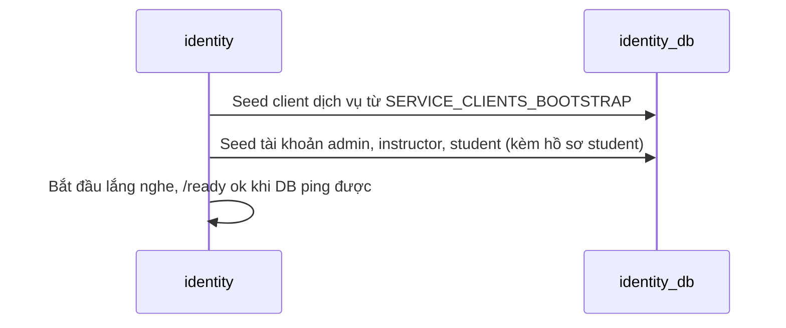

# Khởi động và seed tài khoản v1

> **Trạng thái:** Đề xuất — chờ Đức xác nhận.
>
> **Service sở hữu:** `identity` (`identity_db`). Mục lục domain: [README](README.md). Quy tắc và điểm chưa kiểm chứng: [business-rules-v1](business-rules-v1.md).
>
> **Service tham gia:** `identity`.

## 1. Luồng

Mọi dữ liệu cần seed (client dịch vụ, tài khoản, hồ sơ student của tài khoản student mẫu) nằm trong `identity_db` và `identity` tự verify token bằng khóa cục bộ, nên không còn vòng phụ thuộc với service khác. Trước khi gộp ([ADR-005](../../../adr/adr-005-merge-auth-student-into-identity-v1.md)), `auth` phải đợi `student` (để tạo hồ sơ student mẫu) trong khi `student` cần JWKS của `auth`; vì vậy phải seed sau khi listen và retry tối đa 60 lần. Nay seed chạy **trước khi listen** và không retry.

Tài khoản seed: có `id` cố định, idempotent theo email (đã có thì không ghi đè), bỏ qua nếu cả email lẫn mật khẩu để trống. Tài khoản student mẫu được tạo cùng hồ sơ `ACTIVE` trong một transaction, nếu không đăng nhập bị từ chối ([login-v1](login-v1.md)). Seed lỗi thì service không khởi động thay vì chạy với dữ liệu thiếu.
