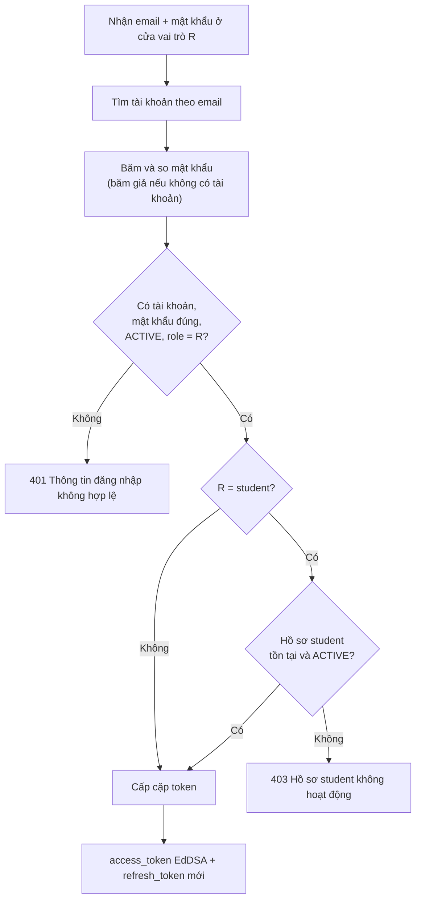
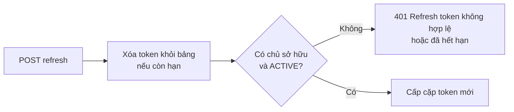

# Đăng nhập và refresh token v1

> **Trạng thái:** Đề xuất — chờ Đức xác nhận.
>
> **Service sở hữu:** `identity` (`identity_db`). Mục lục domain: [README](README.md). Quy tắc và điểm chưa kiểm chứng: [business-rules-v1](business-rules-v1.md).
>
> **Service tham gia:** `gateway`, `identity`. Trace mẫu: luồng `http-login`.

## 1. Đăng nhập ba cửa

Ba cửa đăng nhập cùng một bộ xác thực. Mọi lý do thất bại đều trả **cùng một 401** "Thông tin đăng nhập không hợp lệ", và luôn băm mật khẩu đúng một lần (băm giả khi email không tồn tại), để người ngoài không biết email có tồn tại, bị khóa hay đúng mật khẩu nhưng sai cửa.

Hồ sơ student được đọc cùng truy vấn với tài khoản (cùng `identity_db`), nên đăng nhập student không còn lỗi dependency vì service khác; tài khoản không có hồ sơ hoặc hồ sơ `INACTIVE`/`BLOCKED` nhận 403.

Cặp token:

| Token | Nội dung | TTL mặc định (khoảng cho phép) |
| --- | --- | --- |
| Access token | JWT EdDSA, `typ=user`, `sub`, `role`, `aud=aiops-lms` | 1 giờ (60 giây – 24 giờ), `IDENTITY_JWT_TTL_SECONDS` |
| Refresh token | Chuỗi ngẫu nhiên, chỉ lưu bản băm | 24 giờ (5 phút – 30 ngày), `IDENTITY_REFRESH_TTL_SECONDS` |

## 2. Refresh token

Refresh token **dùng một lần**: câu lệnh xóa và đọc chủ sở hữu là một lệnh SQL, nên hai refresh đồng thời với cùng token chỉ một bên thành công.

Token đã bị xóa thì không dùng lại được, kể cả khi tài khoản `DISABLED` (lần refresh đó vẫn tiêu token).
