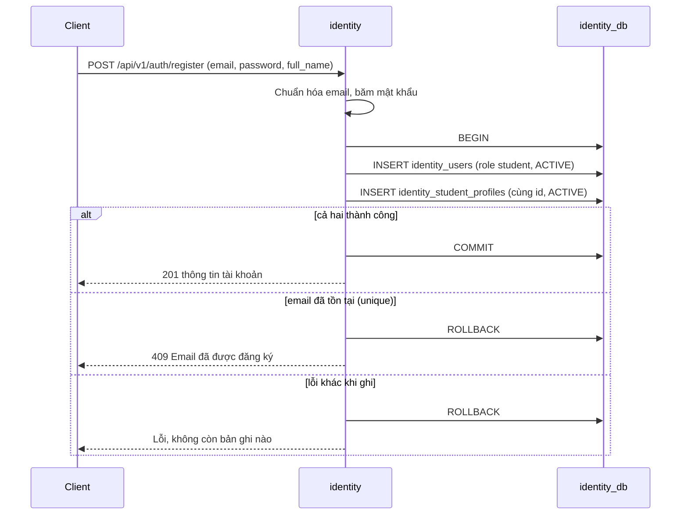
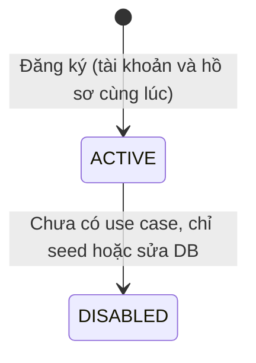

# Đăng ký student v1

> **Trạng thái:** Đề xuất — chờ Đức xác nhận.
>
> **Service sở hữu:** `identity` (`identity_db`). Mục lục domain: [README](README.md). Quy tắc và điểm chưa kiểm chứng: [business-rules-v1](business-rules-v1.md).
>
> **Service tham gia:** `gateway`, `identity`. Trace mẫu: luồng `http-register` ở [catalogue](../../../architecture/complex-case-catalogue-and-rca-result-v0.md).

## 1. Luồng

Tài khoản (`identity_users`) và hồ sơ student (`identity_student_profiles`) cùng nằm trong `identity_db` nên đăng ký là **một transaction PostgreSQL**: hoặc cả hai bản ghi cùng có, hoặc không có bản ghi nào. Không có trạng thái chờ, không có lời gọi sang service khác và không có bước bù trừ. Trước khi gộp ([ADR-005](../../../adr/adr-005-merge-auth-student-into-identity-v1.md)), đăng ký phải tạo dữ liệu ở hai service nên cần trạng thái `PENDING`, bước kích hoạt và cách nhận lại tài khoản bỏ dở; tất cả những phần đó đã bỏ.

## 2. Trạng thái

Tài khoản chỉ có `ACTIVE` hoặc `DISABLED`; hồ sơ student có `ACTIVE`, `INACTIVE` hoặc `BLOCKED`. Đăng ký tạo cả hai ở `ACTIVE`. Chỉ tài khoản `ACTIVE` đăng nhập, refresh và gọi `/me` được; `DISABLED` bị từ chối bằng cùng một 401 như sai mật khẩu nên không lộ tài khoản có tồn tại hay không ([login-v1](login-v1.md)).

Hồ sơ đổi `ACTIVE` ↔ `INACTIVE`/`BLOCKED` cũng chưa có use case: hiện chỉ đổi bằng sửa DB. Hồ sơ không `ACTIVE` làm đăng nhập student trả 403 và loại student khỏi danh sách recipient mà `notification-worker` lấy qua `GET /internal/v1/students`.

## 3. Email trùng

Email được cắt khoảng trắng và đổi chữ thường trước khi lưu. Tính duy nhất do unique index của `identity_users` bảo đảm, không do bước kiểm tra trước: hai đăng ký đồng thời cùng email thì một bên thành công, bên kia nhận 409 và transaction của bên đó được hủy hoàn toàn. Mọi tài khoản đang giữ email (student, instructor, admin, kể cả `DISABLED`) đều cho kết quả 409.

## 4. Lỗi

| Tình huống | Kết quả |
| --- | --- |
| Email đã có tài khoản | 409, không tạo gì |
| Hai đăng ký đồng thời cùng email | Một bên 201, bên kia 409 |
| Chèn hồ sơ lỗi sau khi đã chèn tài khoản | Transaction hủy, không còn tài khoản (đã kiểm bằng unit test với kho giả) |
| DB `identity` lỗi hoặc timeout | Lỗi hạ tầng, không bản ghi nào được commit |
| Dữ liệu đầu vào sai (email, mật khẩu ngắn, tên rỗng) | 400 `VALIDATION_ERROR` với danh sách trường lỗi |

## 5. Còn lại

- Chưa xác thực email nên ai cũng đăng ký được bằng email bất kỳ.
- Chưa có giới hạn tốc độ đăng ký.

Code: [register-student.use-case.ts](../../../../../lms/services/identity/src/application/use-cases/accounts/register-student.use-case.ts), [prisma-account.repository.ts](../../../../../lms/services/identity/src/adapters/persistence/prisma-account.repository.ts) (`createStudent`), test: [identity-use-cases.spec.ts](../../../../../lms/services/identity/test/unit/identity-use-cases.spec.ts), [identity.e2e-spec.ts](../../../../../lms/services/identity/test/e2e/identity.e2e-spec.ts).
