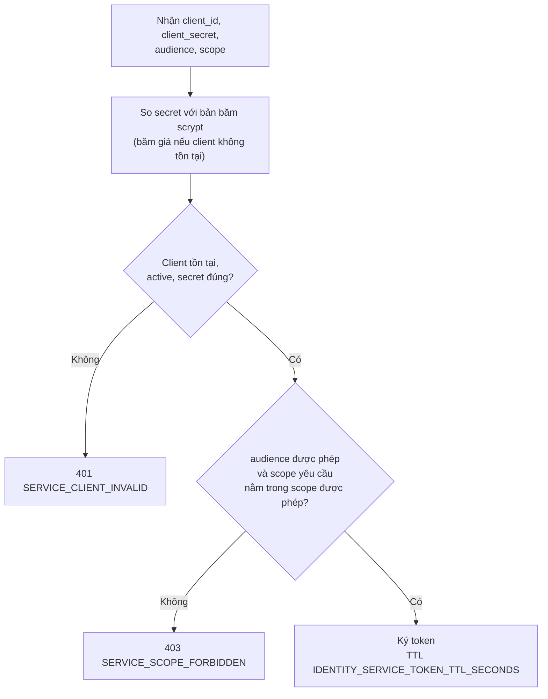
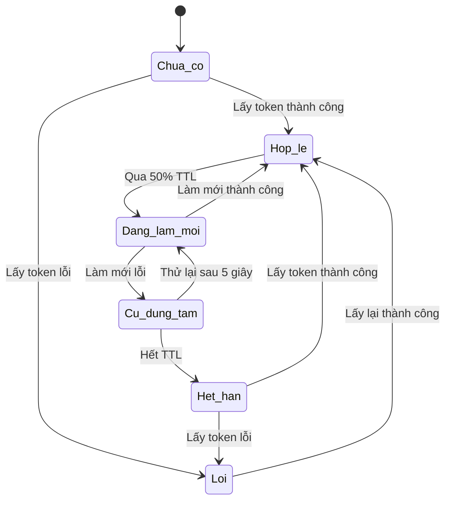
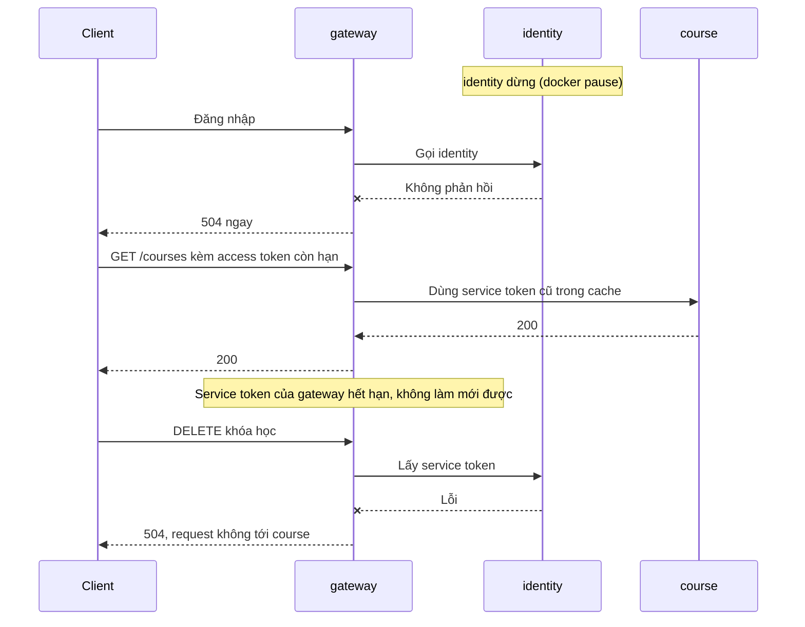
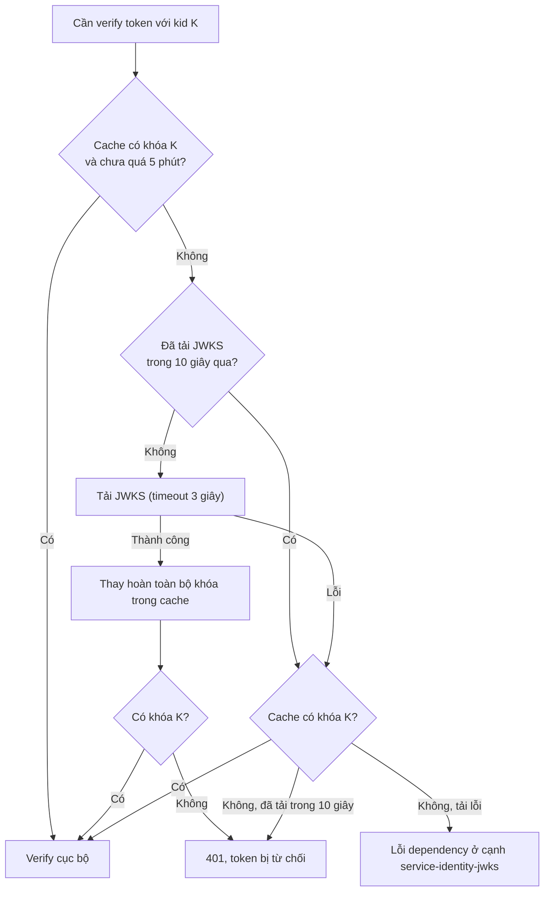

# Service token, JWKS và khoảng yên lặng khi identity lỗi v1

> **Trạng thái:** Đề xuất — chờ Đức xác nhận.
>
> **Service tham gia:** `identity`, `gateway`, mọi service gọi service khác (`course`, `media`, `notification-worker`, `ai-worker`, `scheduler-worker`).
>
> **Phụ thuộc:** [ADR-004](../../adr/adr-004-service-access-token-and-api-surfaces-v1.md), [dependency-resilience-policy-v2](../../architecture/dependency-resilience-policy-v2.md) mục 6, case C6 và C7 ở [catalogue](../../architecture/complex-case-catalogue-and-rca-result-v0.md).

## 1. Mục đích

Mọi request vào service đều cần service token, kể cả route public (chỉ gateway, scope `gateway:proxy`). `identity` vì vậy là điểm lỗi chung, nhưng lỗi không lộ ngay: service cache token và dùng token cũ đến hết hạn. Tài liệu này mô tả vòng đời token, khoảng yên lặng và điều gì xảy ra khi `identity` chết hoặc đổi khóa ký.

## 2. Cấp service token

Service xin token bằng client-credentials: `POST /internal/v1/auth/service-token` với `client_id`, `client_secret`, `audience` (service đích) và `scope` tùy chọn. Token là JWT EdDSA, `typ=service`, `sub` = tên service gọi, `aud` = service đích.

Scope bỏ trống thì cấp toàn bộ scope được phép của client. TTL mặc định 600 giây, cho phép 60–3600 giây; không có refresh token. Client lưu ở `identity_service_clients`, đồng bộ lúc khởi động từ `SERVICE_CLIENTS_BOOTSTRAP`.

## 3. Vòng đời token ở bên gọi

Mỗi cặp (service gọi, audience) giữ một token trong cache.

| Trạng thái | Request đi qua |
| --- | --- |
| `Hop_le`, `Dang_lam_moi`, `Cu_dung_tam` | Dùng token đang có, không chờ `identity` |
| `Chua_co`, `Het_han` | Phải chờ lấy token; lỗi thì request lỗi ngay |

Làm mới nền chạy một lần cho nhiều request đồng thời (single-flight). Lấy token lỗi do timeout, 5xx, mạng hoặc breaker mở thì thành `DEPENDENCY_TIMEOUT`/`DEPENDENCY_UNAVAILABLE` ở cạnh `<service>-identity-token`; `401/403` từ `identity` là cấu hình sai (`SERVICE_CLIENT_INVALID`), không tính là dependency lỗi.

## 4. Khoảng yên lặng khi `identity` dừng (case C6)

Với TTL mặc định 600 giây, lỗi lộ sau tối đa khoảng một TTL, rồi lan ra mọi request qua gateway.

Số đo thật (stack một node, `IDENTITY_SERVICE_TOKEN_TTL_SECONDS=60`, `tracing-smoke`):

| Quan sát | Kết quả |
| --- | --- |
| Đăng nhập khi `identity` dừng | 504 ngay; span lỗi `gateway-identity`, trace không có span của `identity` |
| Request có access token còn hạn trong khoảng yên lặng | 200 |
| Request sau khi service token hết hạn | 504; span lỗi `gateway-identity-token`, trace không có span của `course` |
| Thời điểm quan sát lỗi `gateway-identity-token` | 70–74 giây sau khi dừng (smoke chỉ gửi request sau TTL + 5 giây, nên đây là thời điểm quan sát, không phải thời điểm lỗi bắt đầu) |
| Sau `unpause` | Request trở lại bình thường |

Triệu chứng nằm ở `gateway`; nguyên nhân gốc ở `identity`, nhìn thấy trên cạnh `gateway-identity-token` chứ không ở service đích. Đây là lý do case này khó truy vết thủ công.

## 5. JWKS và xoay khóa (case C7)

Mọi service verify token cục bộ bằng khóa công khai từ `GET /.well-known/jwks.json`.

Xoay khóa đúng cách: đặt khóa mới ở `IDENTITY_SIGNING_KEY_PEM` và phần công khai của khóa cũ ở `IDENTITY_PREVIOUS_PUBLIC_KEY_PEM`; JWKS công bố cả hai trong cửa sổ TTL của token. Đổi khóa mà không giữ khóa cũ thì sau khi cache hết hạn, mọi token ký bằng khóa cũ bị từ chối ở nhiều service cùng lúc, trong khi hạ tầng vẫn khỏe (C7).

## 6. Quy tắc

| Mã | Quy tắc |
| --- | --- |
| BR-TOK-01 | Mọi request vào service cần service token; route public chỉ nhận token `sub=gateway`, scope `gateway:proxy`. Ngoại lệ: `/health`, `/ready`, JWKS. |
| BR-TOK-02 | Token chỉ cấp cho client `active`, đúng secret, audience và scope được phép. |
| BR-TOK-03 | Service token hết hạn sau TTL, không có refresh token; bên gọi làm mới nền ở 50% TTL. |
| BR-TOK-04 | Làm mới lỗi thì dùng token cũ đến hết hạn; chưa có token hoặc đã hết hạn thì request lỗi. |
| BR-TOK-05 | Verify token luôn cục bộ; JWKS tải tối đa một lần mỗi 10 giây, cache 5 phút. |
| BR-TOK-06 | JWKS lỗi mà khóa của `kid` đã có trong cache thì tiếp tục dùng khóa cũ, không có thời hạn. |
| BR-TOK-07 | Gateway không chuyển tiếp `Authorization` của client; nó gắn service token của chính nó. |

## 7. Điểm chưa kiểm chứng

- C7 mới đo tín hiệu (cạnh `*-identity-jwks` có ở các runtime verify token); cơ chế đổi khóa chưa chạy thật.
- Biến thể "identity chậm" (chèn trễ thay vì dừng) và lỗi `identity-postgres` chưa có kịch bản.
- Chưa có giới hạn tốc độ cho `POST /internal/v1/auth/service-token` (chống dò secret).
- Số đo C6 dùng TTL 60 giây để rút ngắn khoảng yên lặng; với TTL 600 giây khoảng yên lặng thực tế chưa đo.

## 8. Đối chiếu code và test

| Quy tắc | Nơi kiểm chứng |
| --- | --- |
| BR-TOK-02, 03 | `lms/services/identity/src/application/use-cases/service-auth/issue-service-token.use-case.ts`, `lms/services/identity/src/domain/service-client.ts` |
| BR-TOK-04, 05, 06 | [dependency-resilience-policy-v2](../../architecture/dependency-resilience-policy-v2.md) mục 6; `lms/packages/common/src/auth/service-token.provider.ts`, `http-jwks-key-provider.ts` |
| BR-TOK-01, 07 | `lms/test/http-surface.test.mjs`, ADR-004 |
| Hành vi khi `identity` dừng | `lms/test/observability/tracing-smoke.mjs` (kịch bản lỗi nhiều bước), chạy bằng `pnpm run test:observability` |
